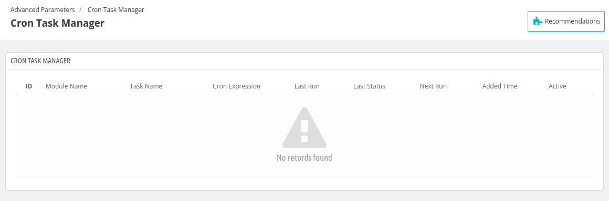
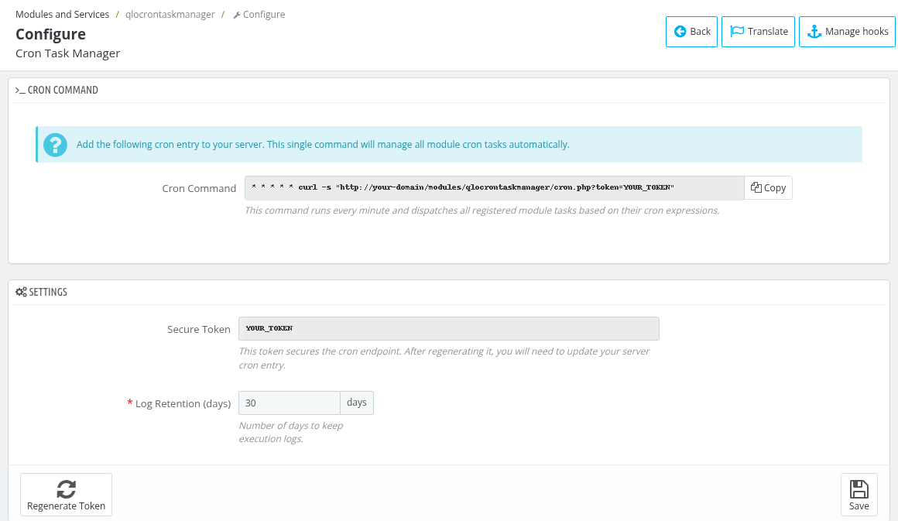

# Cron Task Manager

The Cron Task Manager module (qlocrontaskmanager) is a centralized scheduling system. A single cron entry on your server runs all the scheduled tasks registered by the modules of your QloApps.

You can find it under **Advanced Parameters > Cron Task Manager**.

## Cron Task Manager Configuration

To open the module's settings, go to **Modules and Services**, find **Cron Task Manager** and click **Configure**.

### Cron Command
Add the displayed cron command to your server's crontab. This single command runs every minute and dispatches all registered module tasks based on their cron expressions. Use the **Copy** button to copy the command.

*Note: If the cron command is not found on your server, a "Server cron job not detected" box with a **Configure Cron Job** link is shown on the Dashboard.*

### Settings
- **Secure Token** : This token secures the cron endpoint. After regenerating it, you will need to update your server cron entry.
- **Log Retention (days)** : Number of days to keep execution logs. Enter a whole number between 1 and 365.
- **Regenerate Token** : Click it to generate a new secure token. A confirmation is asked first, and the cron entry on your server must be updated with the new URL.
- **Save** : Click it to save the settings.

## Cron Tasks List

The list shows all the tasks registered by the modules with the following columns:

- **ID** : Unique ID of the cron task.
- **Module Name** : The module that owns the task.
- **Task Name** : The unique name of the task within the module.
- **Cron Expression** : The schedule of the task.
- **Last Run** : Date and time when the task was last executed.
- **Last Status** : Result of the last run (Success, Error or N/A).
- **Next Run** : Date and time of the next scheduled run.
- **Added Time** : Date and time when the task was added.
- **Active** : Shows whether the task is enabled. Click it to enable or disable the task.

To enable or disable many tasks together, select them and use the bulk actions **Enable selected** or **Disable selected**.

## Edit Cron Task

Click **Edit** on a task to open the **Edit Cron Task** form.

- **Module Name** : The module that owns this task.
- **Task Name** : A unique identifier for this task within the module.
- **Description** : A short human-readable description of what this task does.
- **Cron Expression** : The schedule of the task in the format "minute hour day month weekday", for example `0 0 * * *`. A readable explanation of the expression is shown below the field.
- **Active** : Select Enabled or Disabled. Disabled tasks are skipped.

Click **Save** to apply the changes. Use the **Reset Task** action in the list to revert a task to the original values defined by its module.

## Cron Task Logs

Click **View All Logs** on the tasks list to see the execution logs of all the tasks. On the **Edit Cron Task** page, **View Logs** shows the logs of that task only. Use **Back to Tasks** to return.

The logs list has the columns **ID**, **Module**, **Task Name**, **Status**, **Error Message**, **Execution Time** and **Date**.
