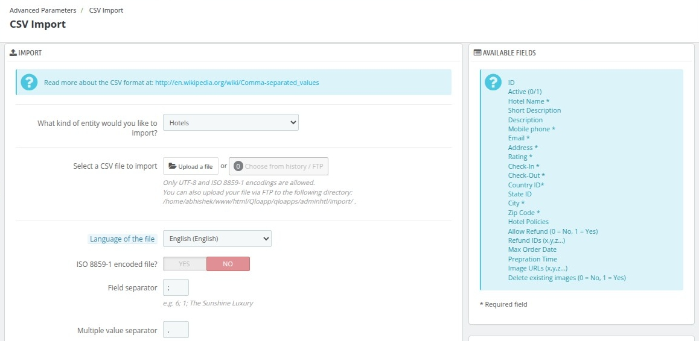
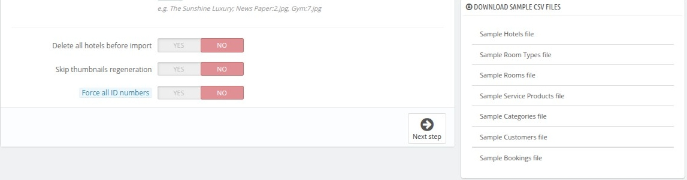

# CSV  import

The CSV Import page allows you to upload data in bulk by importing CSV files. This feature is especially useful for managing large datasets such as hotels, bookings, or customer records. By configuring the import settings, you can ensure smooth and accurate data integration into your QloApps system.

### Import Configuration
- **Entity Selection**:
  - Choose the type of data you want to import (Properties, Room Types, Rooms, Categories, Service Products, Bookings or Customers) from the dropdown menu.

- **File Upload**:
  - **Upload a file**: Click the button to upload a CSV file directly from your computer.
  - **Choose from history/FTP**: Select a file previously uploaded via FTP.

- **Supported File Encodings**:
  - Only UTF-8 and ISO 8859-1 encodings are allowed for CSV files.

- **Language of the File**:
  - Select the language of the data in your file to ensure proper interpretation.

- **ISO 8859-1 Encoded File**:
  - Enable this option if your file uses ISO 8859-1 encoding.

- **Field Separator**:
  - Define the character used to separate fields in the CSV file (e.g., `;`).

- **Multiple Value Separator**:
  - Specify the character used to separate multiple values within a single field (e.g., `,`).

---

### Additional Options
- **Delete all ... before import**:
  - **Yes**: Removes all existing records of the selected entity in the database before importing the new data.
  - **No**: Keeps existing records and adds the imported data.

- **Skip Thumbnails Regeneration**:
  - **Yes**: Speeds up the import process by skipping thumbnail regeneration.
  - **No**: Ensures new thumbnails are created during the import process.

- **Force All ID Numbers**:
  - **Yes**: Forces the import to use the ID numbers specified in the CSV file.
  - **No**: Allows the system to generate unique ID numbers automatically.

---

### Available Fields
On the right-hand side, you will find a list of fields available for import:
- **ID**: Unique identifier (optional).
- **Active (0/1)**: Whether the record is active (0 = No, 1 = Yes).
- **Property Name \***: The name of the property.
- **Short Description**: A brief description of the property.
- **Description**: Detailed information about the property.
- **Mobile phone \***: Contact number for the property.
- **Email \***: Email address associated with the property.
- **Address \***: Physical address of the property.
- **Rating \***: Property's rating.
- **Check-In \***: Check-in time for the property.
- **Check-Out \***: Check-out time for the property.
- **Country ID\***: Identifier for the country.
- **State ID**: Identifier for the state.
- **City \***: City where the property is located.
- **Zip Code \***: Postal code of the property.
- **Fax**: Fax number of the property.
- **Property Policies**: Policies applicable to the property.
- **Allow Refund (0 = No, 1 = Yes)**: Indicates if refunds are allowed.
- **Refund IDs (x,y,z...)**: Specific refund policies.
- **Maximum checkout offset**: The maximum checkout offset of the property.
- **Minimum booking offset**: The minimum booking offset of the property.
- **Image URLs (x,y,z...)**: Links to images of the property.
- **Delete existing images (0 = No, 1 = Yes)**: Specify whether to delete existing images.

*Fields marked with an asterisk (*) are required.*

---

### **Best Practices**
- Ensure your CSV file matches the format specified in the **Available Fields** section to avoid import errors.
- Use the **Delete all ... before import** option with caution to avoid accidental data loss.
- Test with a small dataset before importing a large file to verify the settings.
