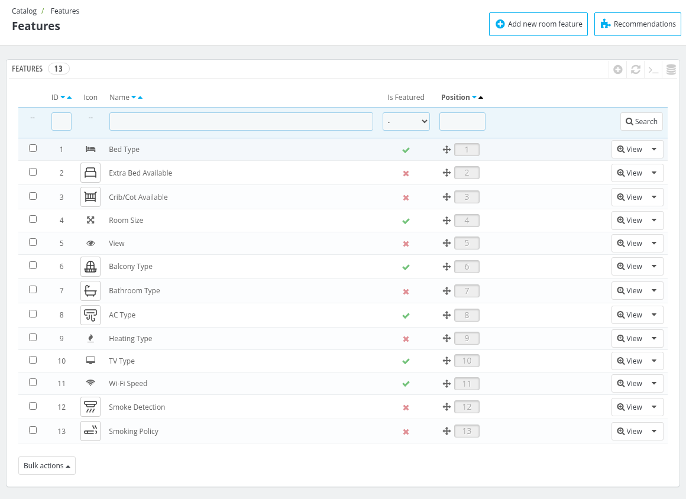
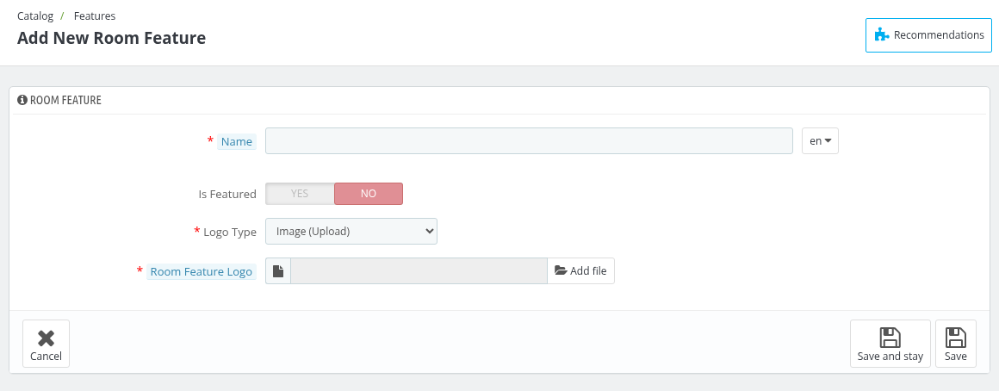
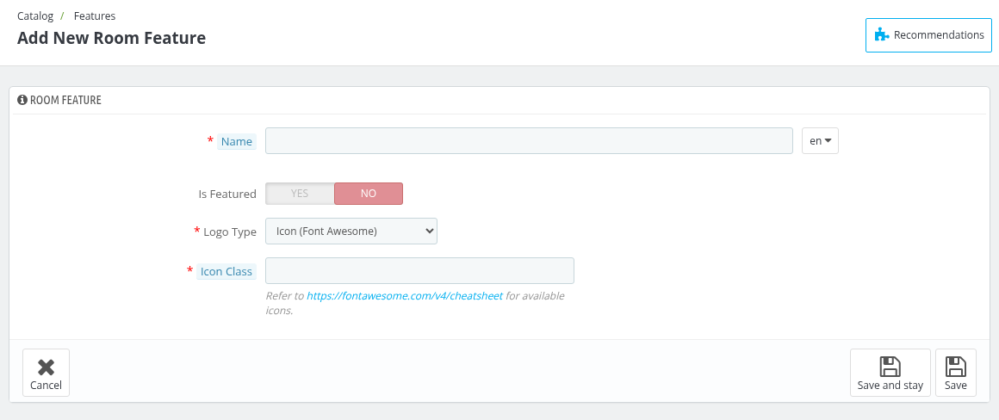

# Features
In features tab we define features of the rooms like wifi, power backup etc. You can change the position of already existing features.

To change the position of features just drag to there desired position.

The list shows the **ID**, **Icon**, **Name**, **Is Featured** and **Position** of each feature. Click on the status icon in the **Is Featured** column to mark a feature as featured or not.

*To add new room feature click on the **Add new room feature** button.*

## Add new room Feature

1. **Name** : In this field you have to enter the name of the feature.
2. **Is Featured** : In this field you can select whether this feature is a featured feature or not.
3. **Logo Type** : In this field you can select the type of the logo, either **Image (Upload)** or **Icon (Font Awesome)**.
4. **Room Feature Logo** : This field is shown when the logo type is **Image (Upload)**. Here you need to select the logo image of the feature.
5. **Icon Class** : This field is shown when the logo type is **Icon (Font Awesome)**. Here you need to enter the Font Awesome icon class by replacing `fa-` with `icon-`, for example `fa-wifi` becomes `icon-wifi`.

To add the values of a feature (for example, the different bed types of a "Bed Type" feature), click on the **View** button of the feature and then click on the **Add new room feature value** button.
