# Manage Room Types

On this page, you can manage room types by editing existing ones or creating new ones.

Before creating a new room type, ensure that a property (hotel) is already set up, as the new room type which will added need to be assigned to a specific property.

*To Add new Hotel* : [Manage Hotel](/1.8.0/hrs/manage_hotel/)

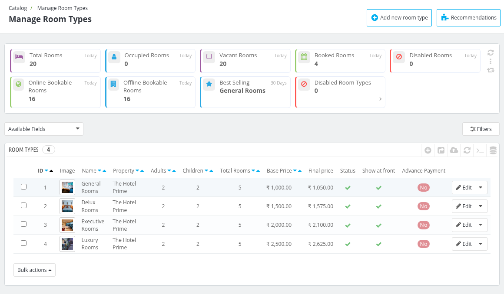

As shown in the image we have some Key performance indicators which tell the insights of a day like:

 

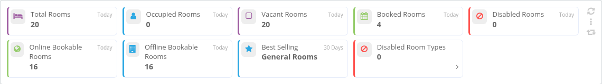

- **Total Rooms** : It tells you about the total number of rooms combing the all room types.

- **Occupied Rooms** : It tells you about the total rooms have occupied on that day.

- **Vacant Rooms** : It tells you the total number of rooms are vacant today.

- **Booked Rooms** : It tells you the total number of rooms are booked today.

- **Disable Rooms** : It tells you the rooms that currently are disabled.

- **Online Bookable Rooms** : It tells you the rooms that are available for online booking.

- **Offline Bookable Rooms** : It tells you the rooms that are available for offline booking.

- **Best Selling Rooms** : It tells you the best selling rooms based on the sales of last 30 days.

- **Disabled Rooms Types** : It tells you the total number of rooms types that are currently disabled.

There are three different buttons on the left:

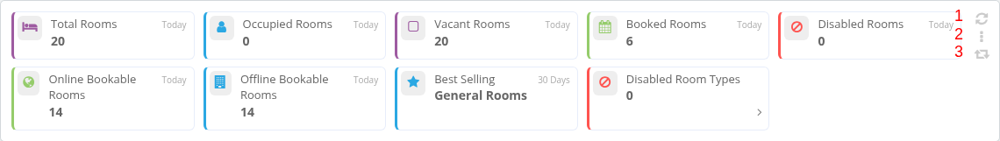
1. It is used to refresh the values of the KPIs.
2. It is used to determine which KPIs should be displayed and which ones should be hidden.
3. It is used to change the view type.

## Filters

 #### Available Fields
You can apply this filter to see different type of available fields as shown below select the fields which you want to
see.
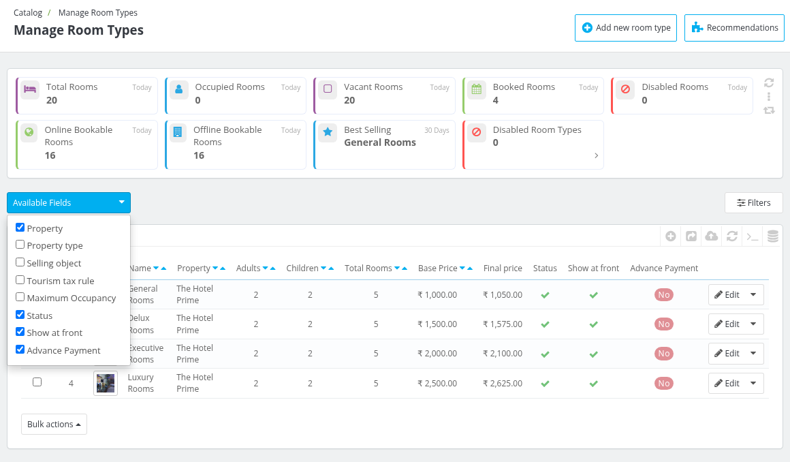
 

#### Filter
There is an another filter button on the right which includes fields like below image:
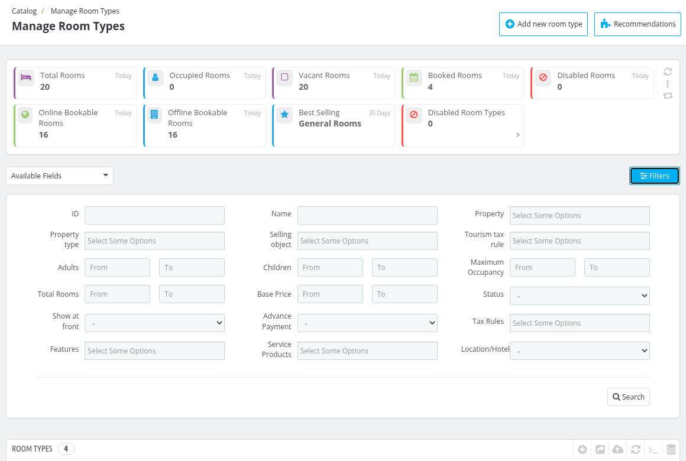

In this filter you can filter list based on:
- **ID** : ID of the room type.
- **Name** : You can filter the list based on the name of the room type.
- **Property** : You can filter based on the property (hotel) the room type belongs to.
- **Property type** : You can filter based on the type of the property.
- **Selling object** : You can filter based on the selling object of the room type (see [Room Selling Objects](/1.8.0/catalog/room_selling_objects/)).
- **Tourism tax rule** : You can filter based on the tourism tax rule applied to the room type.
- **Adults** : You can enter the range of the number of adults allowed for that specific room type.
- **Children** : You can enter the range of the number of children allowed.
- **Maximum Occupancy** : You can enter the range of the maximum occupancy of the room type.
- **Total Rooms** : You can enter the range of the total number of rooms of the room type.
- **Base Price** : You can enter the range of the base price for the rooms.
- **Status** : You can filter list based on the status of the room type.
- **Show at front** : You can select Yes/NO if the room type you want to filter is allowed on the front office or not.
- **Advance Payment** : You can filter results based on whether advance payment is allowed.
- **Tax Rules** : You can filter based on the tax rules applied on the room types.
- **Features** : You can filter based on the features of the room types.
- **Service Products** : You can filter based on the Service Products.
- **Location/Hotel** : You can filter based on the location of the hotel.

*To create a new room category click on **Add new Room types** button*

## Add new Room type :

In the Add new room type page you have to enter some details in each section which are as follows :

### Information
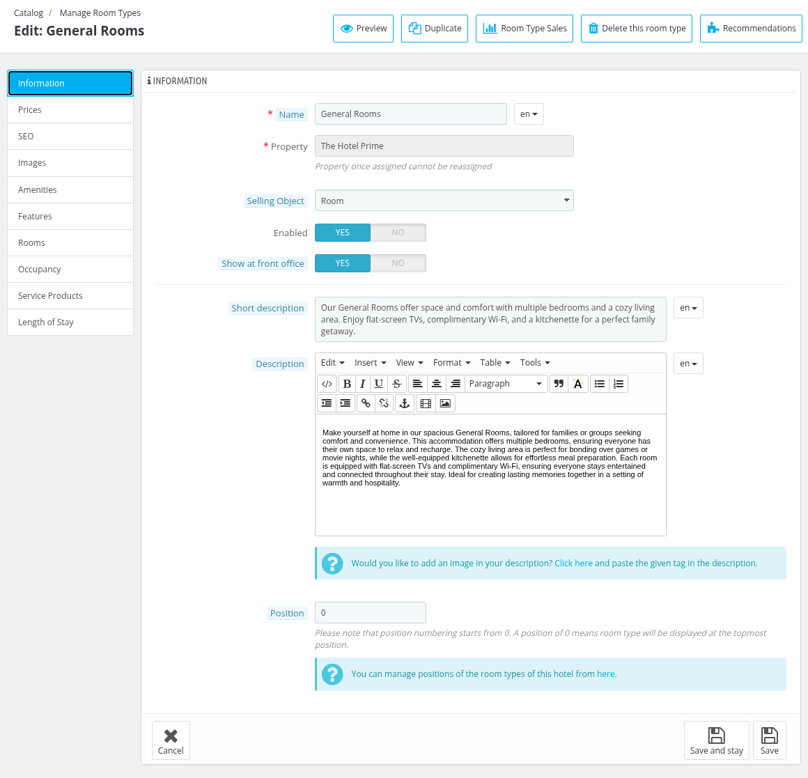

1. **Name** : In this field you will write the name of the room type.
2. **Property** : In this field you will select the property (hotel) in which you want to assign this room type to. Please be noted that once the property is assigned it can not be changed after saving the details.
3. **Selling Object** : In this field you will select the selling object of the room type, for example **Room**. The selected name is used for the labels on the room type page (for example, in the **Rooms** tab). You can manage the selling objects from [Room Selling Objects](/1.8.0/catalog/room_selling_objects/).
4. **Enabled** : In this field you have to select if you want to Enable this room type or not.
5. **Show at front office** : In this field you have to select if you want to show it at the front office or not.
6. **Short description** : In this field you have to enter a short description for the room type.
7. **Description** : In this field you can enter a description for you room type.
8. **Position** : In this field you can enter the position of the room type. A position of 0 means the room type is displayed at the topmost position.

### Price
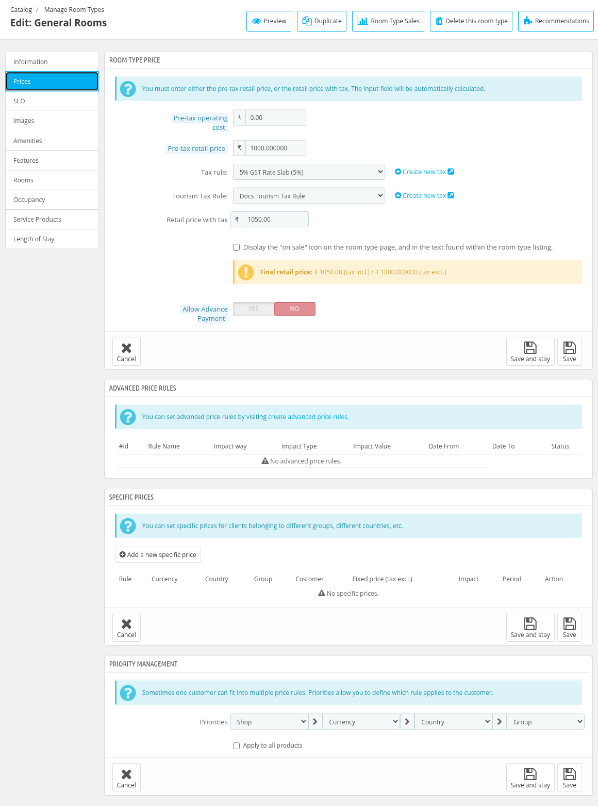

#### Room Type price section

**In this section you can enter or edit details related to pricing of
the room type.**

1. In **Pre-tax operating cost** you have to enter your operating cost of the room type.
2. In **Pre-tax retail price** you have to enter the price in which you want to sell the room exclusive of tax.
3. In **Tax-rule** you have to select the tax rule you want to apply in the room type.
4. If tourism tax is enabled in the tax settings, you will also see the **Tourism Tax Rule:** field. Here you can select the tourism tax rule you want to apply on the room type.
5. The system will automatically fill the value of **Retail price with tax** based on the Pre-tax retail price and Tax rule which you have entered.
6. In **Allow Advance Payment** field you can select weather you want to allow customers to pay in advance or not.
7. In **Apply Room Type Advance Payment Setting.** field you can choose weather you want to use global advance payment or you want to make a specific rule for this type of room type.
If you select Yes means you want to make a new Advance payment rule for this type of room and if you select No in this field means you want to choose global advance rule.
   1. If you select Yes in the above field you will see some more fields.
   2. In **Payment type** field you can select which payment method you will allow the customer to pay in you can choose between percentage (percentage of room price) and amount.
   3. In the **Value** field you have to enter the amount of percentage or amount depends on what you have selected in the above field.
   4. In **Include tax** field you have to select if you want to include tax in the advance payment or not.

*Note: If the payment type is percentage, the value can not be more than 100.*

#### Advance Price rule section
In this section you will see all advance price rule you have set for this room type.
To make new advance price rule you can refer to this document: [Advanced Price Rule](/1.8.0/hrs/general_settings/#advanced-price-rule).

#### Specific Price Rule section
In this section you can Add new specific price rule or can edit already existing specific price rule.

**Specific Price Rule** : These rules are the special discounts which you can apply for specific people based on their
country, Group or currency they are making payment in.
To add new specific price rule click on add new specific price rule button.
When you click on to add new specific price rule you will see below interface:

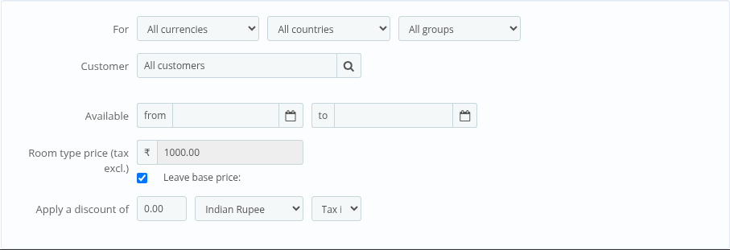
1. In for field you can select for which this rule will be applicable to
   1. First you can select the currency type for which this rule will be applicable to.
   2. Second you can select for which country this rule will be applicable to.
   3. Third you can select for which group this rule will be applicable to.

2. In **Customer** field you can select any customer for which this rule is specific to.
3. In **Available** field you can select the date range in which this rule is applicable to.
4. In **Room type price** field you have to enter the base price on which you will apply discount.
5. In **Apply a Discount** of field you have to enter discount value which you want to apply.
6. Last step is to save the changes you have applied.

#### Priority Management Section
In this section you will set the Priority for the specific price rule.
Let's consider you have made multiple Specific Price Rules and a customer is eligible for more than one rule to set
which rule will be applied you have to set the Priority of the rules.

Select the field to apply priority, with higher priority assigned to the fields on the left and decreasing as you move to the right.

Select **Apply to all products** to apply this rule to every room type.

**Note:** The more specific a rule is, the higher priority it will hold. For example : Group is more specific than the country.

### SEO Section
In this section you enter details which is important for the SEO, so that customer can search room type without searching the name of the website.
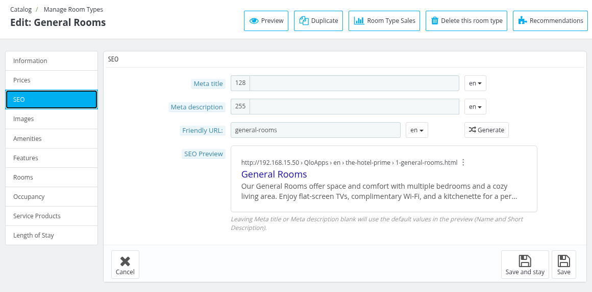

1. In **Meta title** field you have to enter the Meta title for this room type page. If you leave it blank, the room type name is used.
2. In **Meta description** field you have to enter a meta description for your room type. If you leave it blank, the room type short description is used.
3. In **Friendly URL** section you have to enter a Friendly URL or you can go with the automatic selected. You can click on the **Generate** button to generate it from the room type name.
4. **SEO Preview** : This block shows how the room type will appear in the search engine results, using the title and description entered above.

### Images Section
In this section you have to upload some images for this room type. 

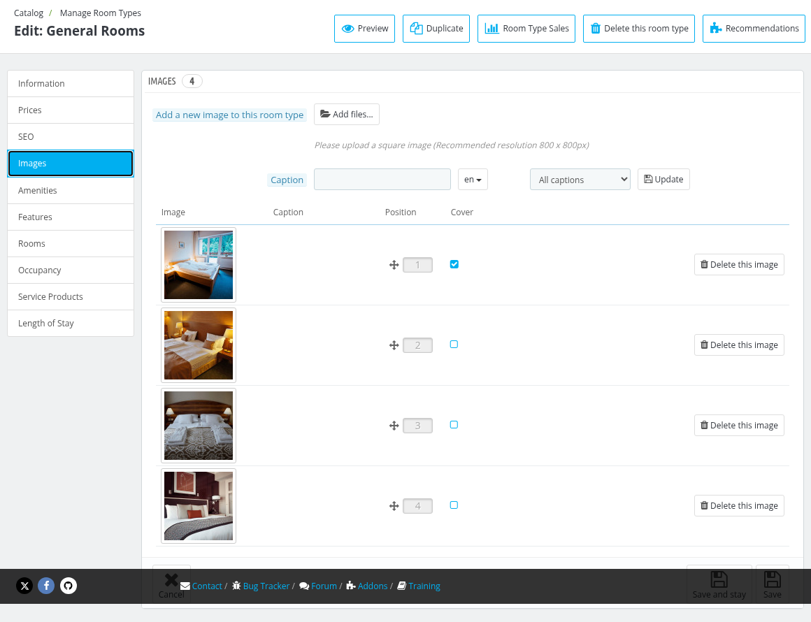
1.  In **Add a new image to this room type** field you can upload your desired image.
2.  In **Caption** field you can write the caption for the image.
3.  You can also drag the already existing image to change their orders.

### Amenities Section
In this section you can select the amenities which are available for this room type.
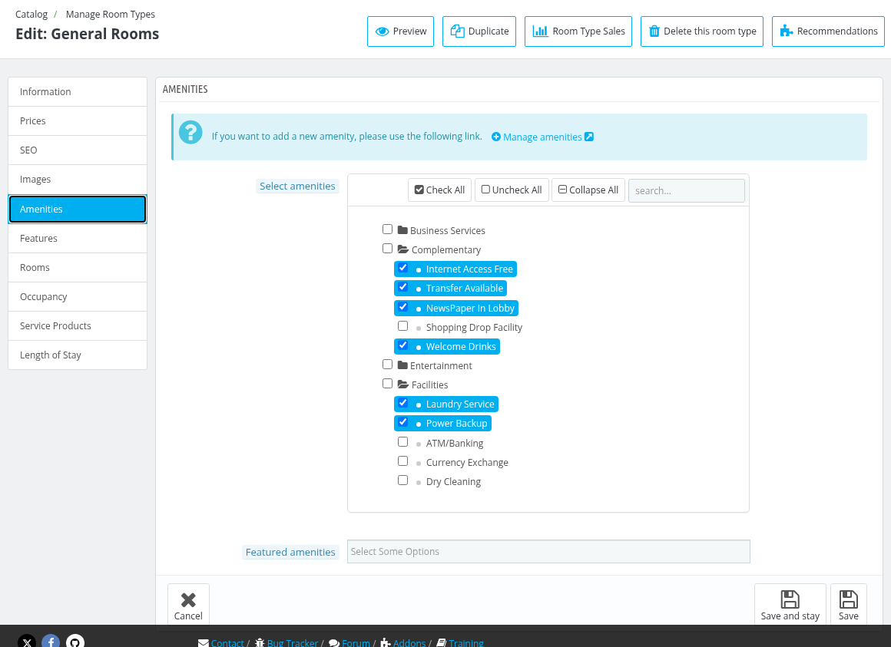
1. **Select amenities** : In this field you can select the amenities available for this room type by clicking on the checkboxes. You can also add new amenities by clicking on the **Manage amenities** link (see [Manage Amenities](/1.8.0/hrs/manage_amenities/)).
2. **Featured amenities** : In this field you can select which of the chosen amenities should be featured for this room type.

### Features Section
In this section you can select and un select feature values for the room types by clicking on the checkbox button
and you can also add make new features by clicking on the **Add a new feature** link.
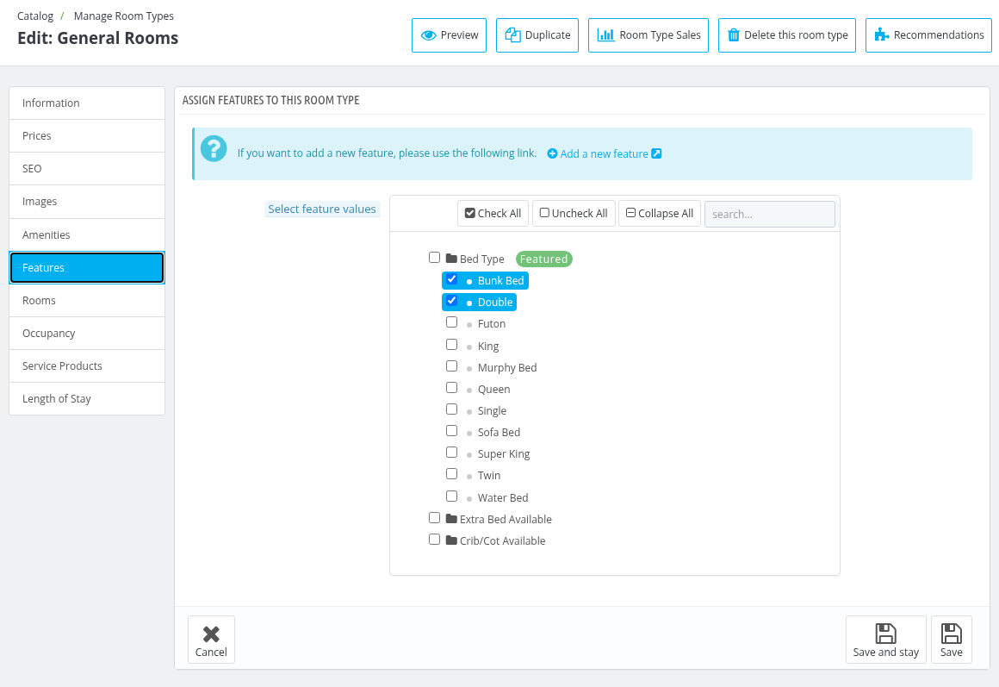
**To add new features you can visit this page** : [Features](/1.8.0/catalog/features/)

### Rooms Section
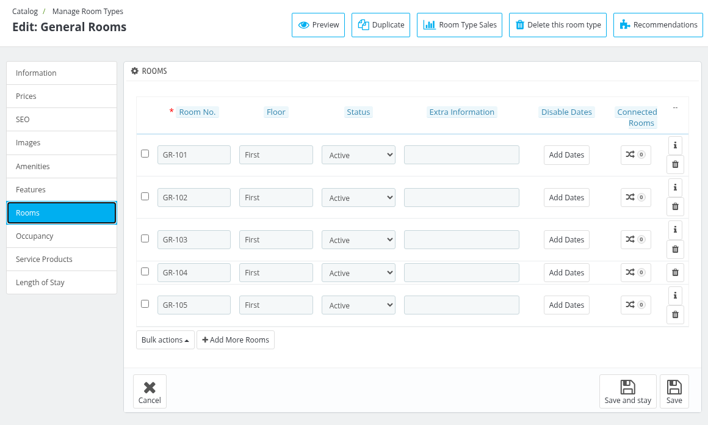
Add individual rooms to your room type to manage your property's inventory. For each room number you create, you'll need to specify the following parameters:
1. **Room No.** : In this field you can enter the room numbers which represent each room.
2. **Floor** : In this field you can enter floor of that room number you are mentioning.
3. **Status** : In this field you can select the status of room, either Active or Inactive.  
Active: When the room is in active state and available for booking.
  Inactive: When a room is permanently unavailable for booking, often due to being repurposed for other uses.
4. **Extra Information** : In this field you can enter extra comments about the room. Leave it empty if not required.
5. **Disable Dates** : If you want to temporarily make a room unavailable for booking, for example due to maintenance, click on the **Add Dates** button of that room. If dates are already set for the room, the button is shown as **View Dates**. A calendar opens as shown below, where you can click on the **Add Dates** button to select the date range, enter the **Reason** and click on **Submit**. You can also remove already selected dates with the **Remove Dates** button.

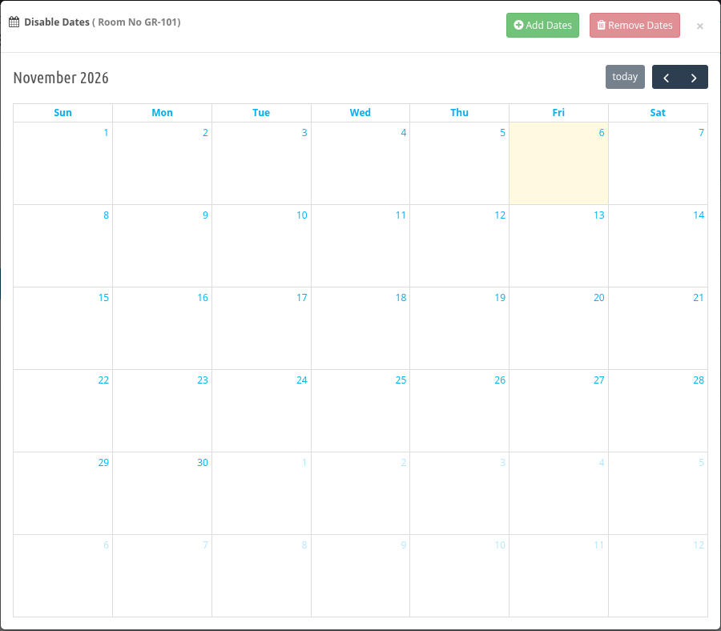

*Note: The room needs to be saved first before you can add the disable dates for it.*

6. **Connected Rooms** : This column shows a button with the number of rooms connected to that room. Click on it to open the **Connected Room** window, which lists the connected rooms with their room type. Click on the **Add Connected Room** button to select a room type and a room and click on **Add** to connect it. You can disconnect a connected room with the remove (trash) button.

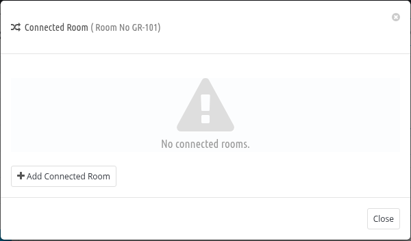

7. The trash button at the end of each row removes that room.

Click on the **Add More Rooms** button to add a new row for another room. You can also use the **Bulk actions** button below the list, which has the following options:
- **Select all** / **Unselect all** : It selects or unselects all the rooms of the list.
- **Update selection** : It opens the **Bulk Update Rooms** window, where you can change the **Floor**, **Status**, **Extra Information** and **Disable Dates** (**Date From**, **Date To** and **Reason**) of all the selected rooms at once.
- **Delete selection** : It deletes the selected rooms.
- **Create Rooms** : It opens the **Bulk Create Rooms** window, where you can create many rooms at once by entering the **Room prefix**, **Starting Room No.**, **Number of Rooms** (required), **Floor**, **Status**, **Extra Information** and **Disable Dates**. If both the Room prefix and Starting Room No. fields are left blank, the room name is generated using the acronym of the room type name.

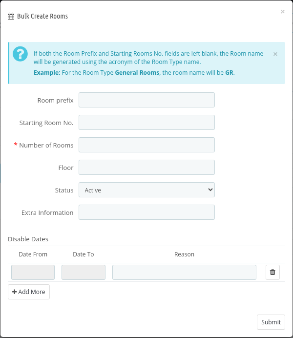

After entering all rooms click on save and stay to save the Information.

### Occupancy Section
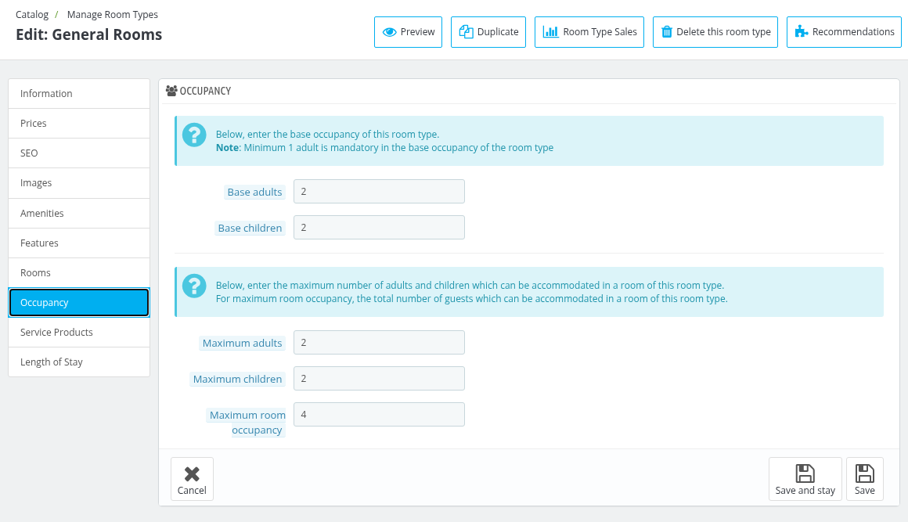
1. **Base Adults** : In this field you need to enter the minimum number of adults allowed in the room.
2. **Base children** : In this field you need to enter the minimum number of children allowed in the room.
3. **Maximum adults** : In this field you need to enter the maximum number of the adults allowed in the room.
4. **Maximum Children** : In this field you need to enter the maximum number of the children allowed in the room.
5. **Maximum room Occupancy** : In this field you need to enter the maximum number of the person allowed in the room.

### Service Products Section
In this you can edit already defined Service products for example change the position, Price and tax rule. The list shows the **ID**, **Name**, **Auto Add to Cart**, **Position**, **Price** and **Tax rule** of each service product.
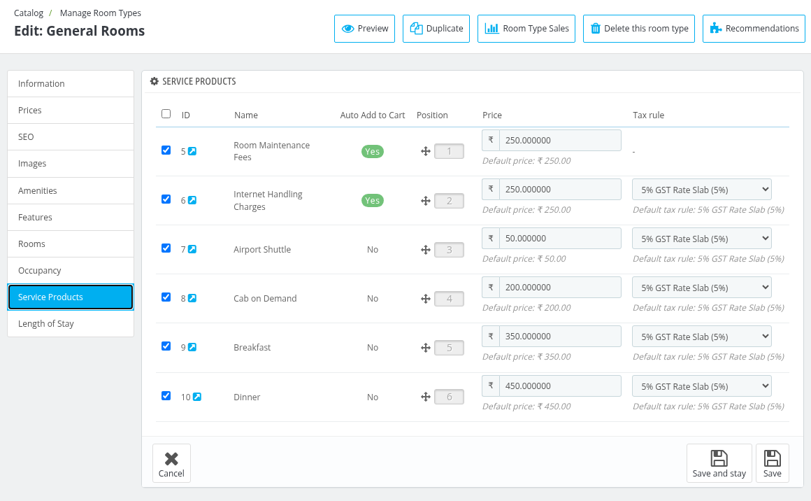

### Length of Stay section
Length of stay is defined as the duration of the stay in the number of days for the room type.
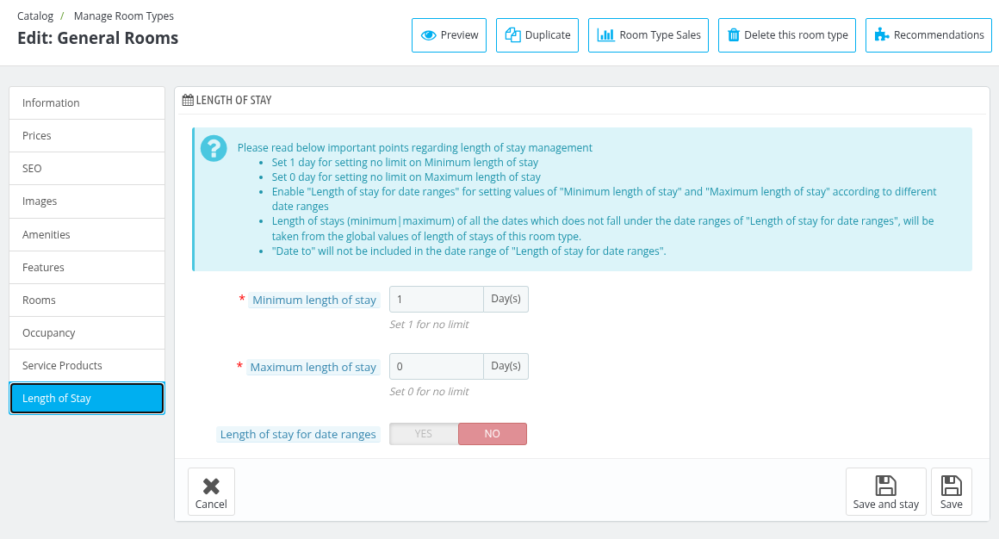
1. **Minimum length of stay** : In this field you can set value for which minimum number of days for which the customer can book the room.
2. **Maximum length of stay** : In this field you can set value for which maximum number of days for which the customer can book the room.
3. **Length of stay for date ranges** : In this field you can select if you want to apply the date range.
4. If you have selected yes in the Length of stay for the date ranges you need to fill following
fields:
 
 

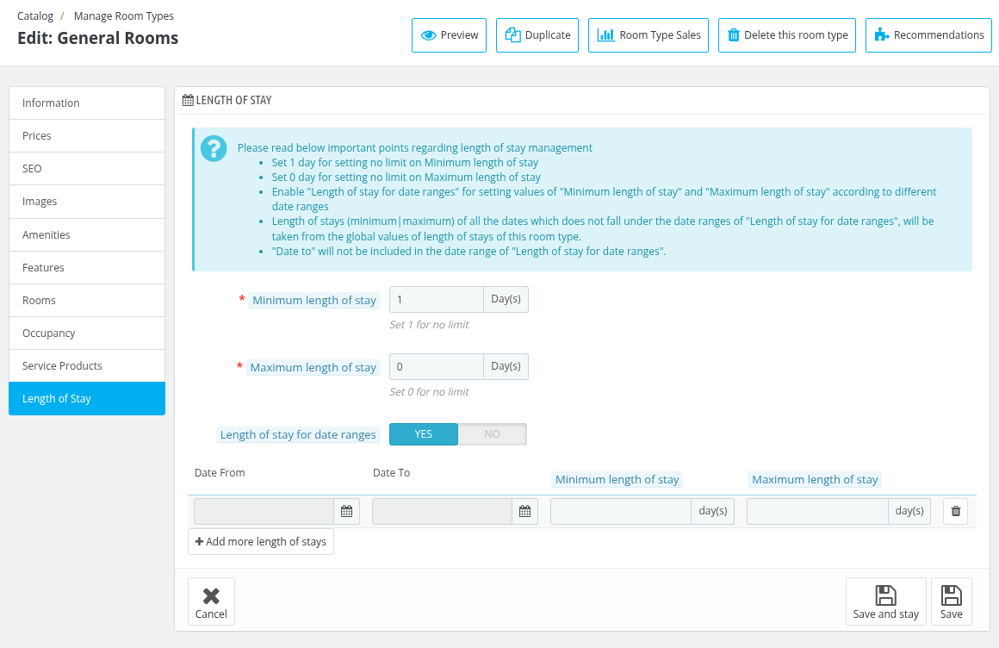

   1. **Date From** : In this field you need to enter the starting date of the date range.
   2. **Date To** : In this field you need to enter the ending date of the date range.
   3. **Minimum Length of Stay** : In this field you need to enter minimum number of the length stay.
   4. **Maximum Length of Stay** : In this field you need to enter maximum number of the length stay.

*Note: Set 1 day for no limit on the minimum length of stay and 0 day for no limit on the maximum length of stay. If a maximum length of stay is set, it must be greater than the minimum length of stay.*

**After filling all the above details your room type will be created.**
