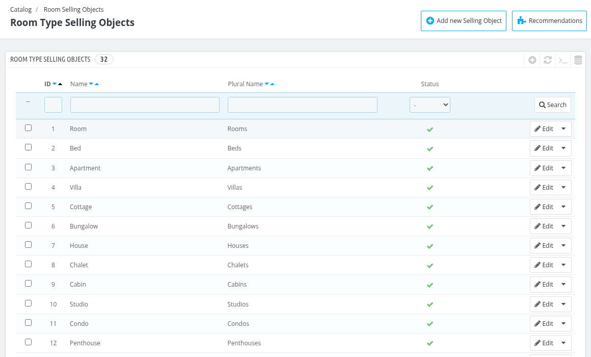
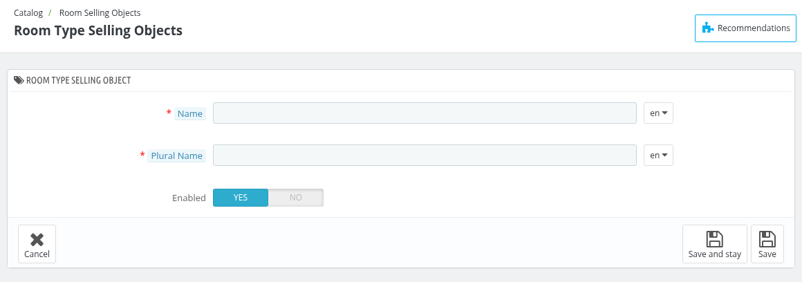

# Room Selling Objects
On this page, you can manage the selling objects of your room types. A selling object is the name used for what you sell in a room type, for example **Room**. This name is used in the labels of the room type page, for example in the **Rooms** tab.

The list shows the **ID**, **Name**, **Plural Name** and **Status** of each selling object. The **Name** is used when one is booked and the **Plural Name** is used when more than one is booked.

*To add a new selling object click on the **Add new Selling Object** button.*

## Add new Selling Object

1. **Name** : In this field you need to enter the name of the selling object. It is displayed for this room type selling object.
2. **Plural Name** : In this field you need to enter the plural name of the selling object. It is displayed when more than one is booked.
3. **Enabled** : In this field you can select whether you want to enable this selling object or not.

Click on **Save** to save the details.

The selling object of a room type is selected in the **Selling Object** field of the **Information** tab of the room type (see [Manage Room Types](/1.8.0/catalog/manage_room_types/)).

*Note: A selling object which is assigned to one or more room types can not be deleted.*
