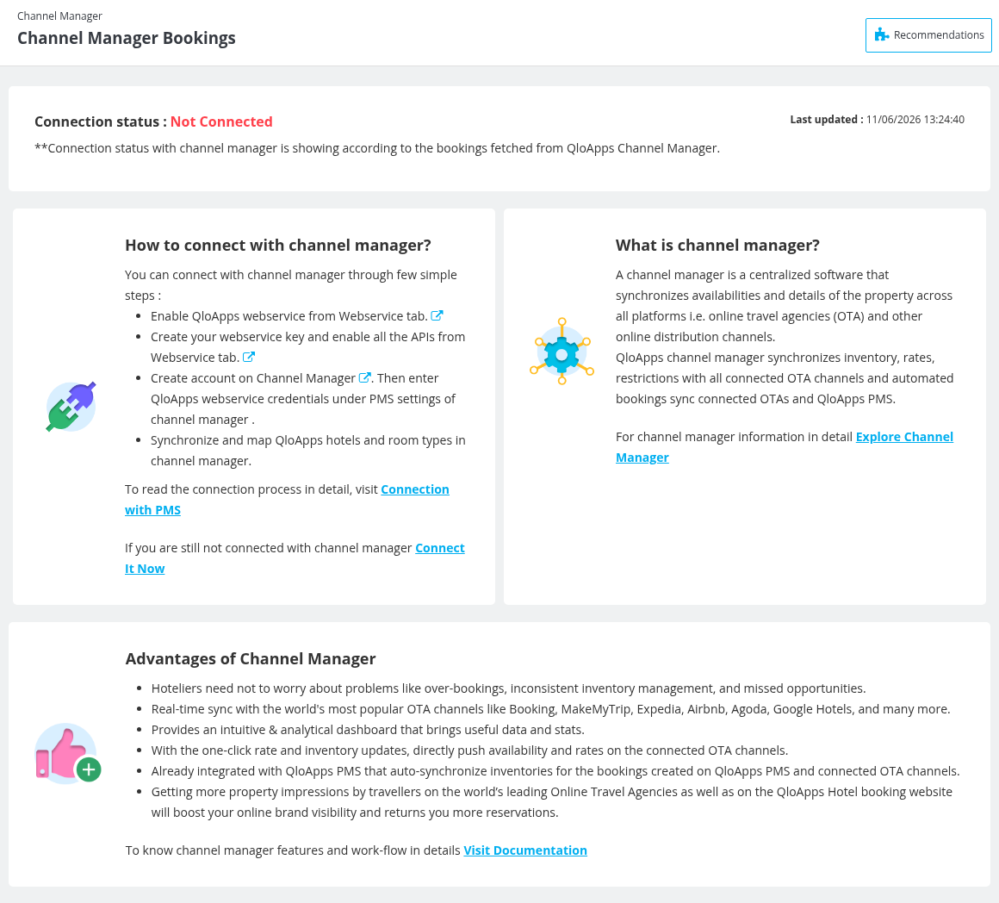
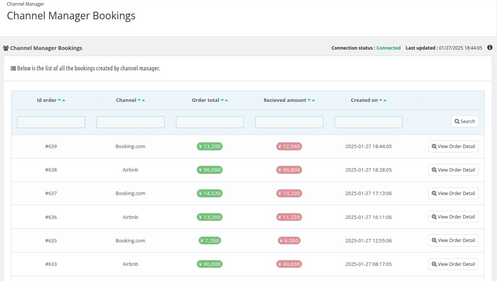
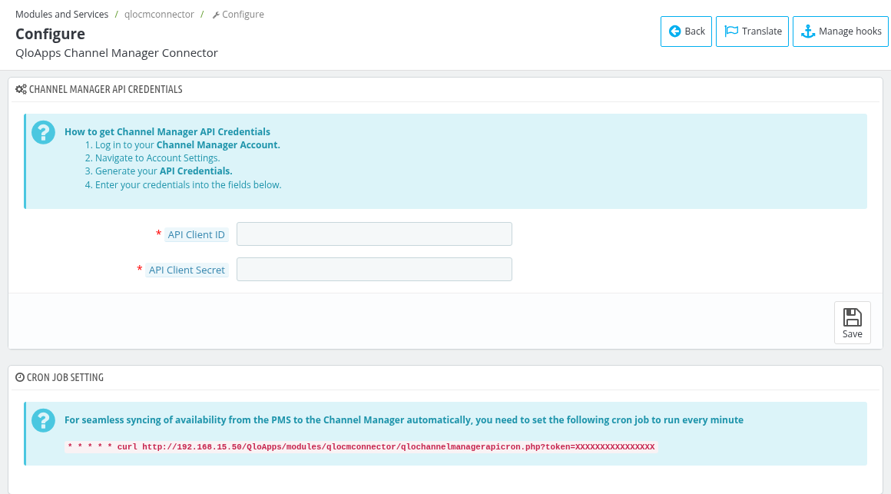

# Channel Manager

The **Channel Manager** menu is added by the **QloApps Channel Manager Connector** module, which is installed by default. It connects QloApps with the QloApps Channel Manager and helps hoteliers to manage the property details and bookings across multiple Online Travel Agencies (OTAs) and online distribution channels.

It ensures real-time synchronization, eliminating manual effort and reducing errors.

## **Connection status**
Until the property is connected, the **Channel Manager** page displays the current connection status with the channel manager.
  - **Connection status:** Indicates whether the property is **Connected** or **Not Connected**.
  - **Last updated:** Shows the last synchronization timestamp.
  Example: *"Connection status : Not Connected"*

- The connection status reflects whether bookings are successfully fetched from the **QloApps Channel Manager**.

   

## **What is channel manager?**
A **channel manager** is a centralized software that synchronizes availabilities and details of the property across all platforms i.e. online travel agencies (OTA) and other online distribution channels.

QloApps channel manager synchronizes inventory, rates, restrictions with all connected OTA channels and automated bookings sync connected OTAs and QloApps PMS.

## **Advantages of Channel Manager**
- Hoteliers need not to worry about problems like over-bookings, inconsistent inventory management, and missed opportunities.
- Real-time sync with the world's most popular OTA channels like Booking, MakeMyTrip, Expedia, Airbnb, Agoda, Google Hotels, and many more.
- Provides an intuitive & analytical dashboard that brings useful data and stats.
- With the one-click rate and inventory updates, directly push availability and rates on the connected OTA channels.
- Already integrated with QloApps PMS that auto-synchronize inventories for the bookings created on QloApps PMS and connected OTA channels.
- Getting more property impressions by travellers on the world's leading Online Travel Agencies as well as on the QloApps Hotel booking website will boost your online brand visibility and returns you more reservations.

## **How to connect with channel manager?**
Follow these simple steps to establish a connection:

1. **Enable QloApps Webservice:**
   - Navigate to the **Webservice** page (**Advanced Parameters > Webservice**) and enable the QloApps webservice.
   - Create a webservice key and enable all the required APIs.

2. **Create an Account on the Channel Manager:**
   - Create an account on the channel manager using the **Connect It Now** link.

3. **Enter Webservice Credentials in Channel Manager:**
   - Enter the QloApps webservice credentials under the **PMS settings** of the channel manager.

4. **Synchronize and Map Data:**
   - Synchronize and map the QloApps hotels and room types in the channel manager to ensure accurate data exchange.

For a detailed guide, visit the **[Connection with PMS](https://qloapps.com/qloapps-channel-manager/#section-24)** documentation.

**Once you are connected with QloApps Channel Manager then you can easily manage your properties connected with OTA's like Booking.com, Expedia, Airbnb, Agoda, Google Hotels, and more.**

After the connection, the **Channel Manager** page shows the list of **Channel Manager Bookings**, i.e. all the bookings created by the QloApps Channel Manager, with the **Id order**, **Channel**, **Order total**, **Received amount** and **Created on** of each booking. Click **View Order Detail** to open the order.

## **Module configuration**

To open the settings, go to **Modules and Services > Manage Modules**, find **QloApps Channel Manager Connector** and click **Configure**.

### Channel Manager API Credentials
Log in to your channel manager account, go to the account settings, generate your API credentials and enter them here.

- **API Client ID** : Enter the client ID from your channel manager account API credentials.
- **API Client Secret** : Enter the client secret from your channel manager account API credentials.
- **Save** : Click it to save the credentials. If the credentials are wrong, the message "Wrong credentials used." is shown.

### Cron job setting
For seamless syncing of availability from the PMS to the channel manager automatically, set the cron job shown in this section to run every minute on your server.

*Note: The cron jobs of other modules, like the Sitemap Generator and Google Hotel Connector, are managed with the [Cron Task Manager](/1.8.0/advance_parameter/cron_task_manager/).*

## **Resources**
- **Connection Process:** For detailed steps, visit the [Connection with PMS](https://qloapps.com/qloapps-channel-manager/#section-24) guide.
- **Channel Manager Features:** Explore detailed documentation on how the channel manager works and its full capabilities.
