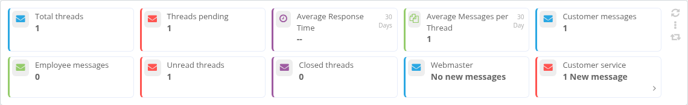
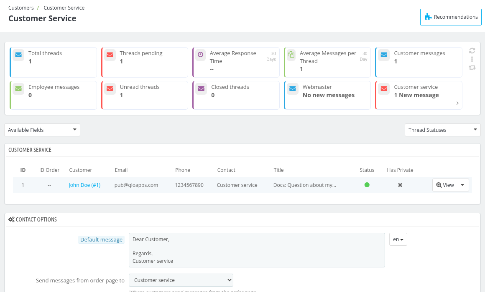
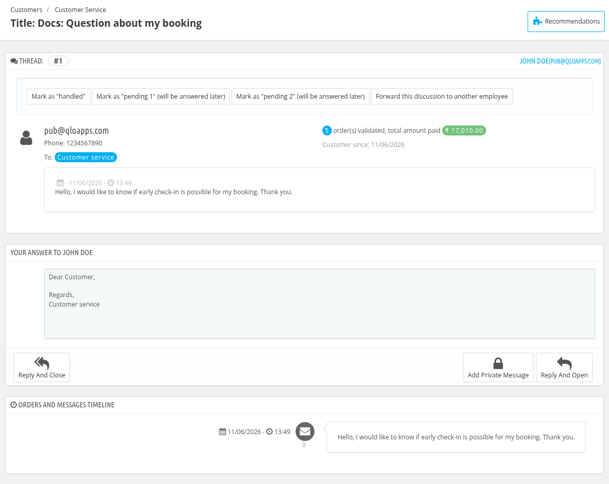
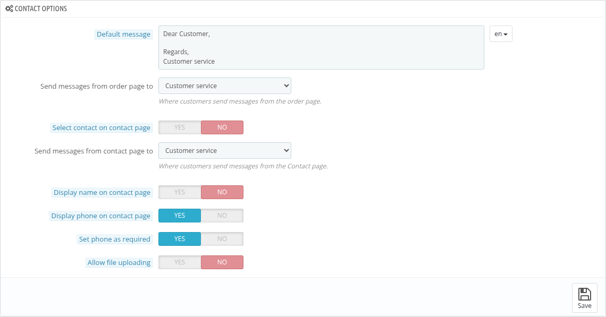
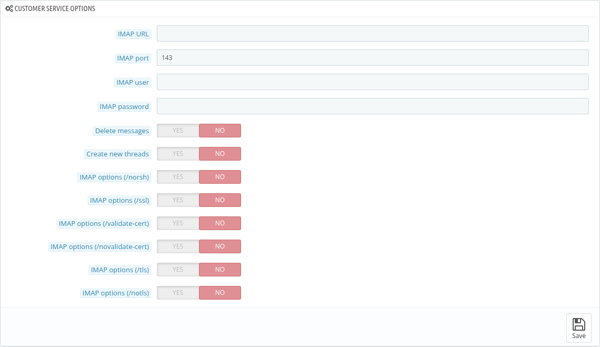

# Customer Service

The customer service page centralizes all customer requests in one place.

It displays all queries raised by customers, whether they are related to bookings or any technical issues.
 This helps you track which discussion threads need a response, eliminating the need to check email recipients to see if someone has already replied.

## KPI Metrics

Here, you will find different KPI blocks such as:

- **Total threads:** It will display the total number of threads.
- **Threads pending:** It will display the no of unanswered thread.
- **Average Response Time:** Average time of answering the response.
- **Average Messages per Thread:** It is the ratio of total messages with the number of threads.
- **Customer messages:** It will display the total number of customer messages.
- **Employee messages:** It will display the total number of employee messages.
- **Unread threads:** It will display the number of unread threads.
- **Closed threads:** It will display the number of closed threads.

- **Webmaster:** This section shows the no. complaint raised that are related to any technicality issue.

- **Customer Service:** This section shows the no. of queries raised regarding the hotel or a booking.

The **Thread Statuses** dropdown above the list shows the meaning of the status:
    - Open: When the thread needs to be answered
    - Closed: When the thread's status is resolved.
    - Pending 1: When the thread's status is changed to pending 1
    - Pending 2: When the thread's status is changed to pending 2

 ## View Customer Service

Here, you can view all customer queries along with the following details: **ID**, **ID Order**, **Customer**, **Email**, **Phone**, **Contact**, **Title**, **Language**, **Status**, **Employee**, **Last Reply by**, **Messages**, **Has Private** and **Last message**. Use the **Available Fields** dropdown to choose which of these columns are shown. The first employee to reply to a thread becomes responsible for it, and can forward it to another employee if needed.

Additionally, you can filter by Language, Status,and Employee, and view the Messages, including Private notes and the Last Message.

By clicking on the "View" option at the end of a customer's query, the admin can:

- View the number of threads
- Forward the discussion to another employee
- Change the status of the query,
- Write a reply to the customer using the **Reply And Close** or **Reply And Open** button, or add a note that is not sent to the customer using the **Add Private Message** button, and
- View the timeline for the order and messages.

## Contact options

In this block, the admin can set the following options:

- **Default message:** The message that appears by default when you answer a thread.
- **Send messages from order page to:** Select the contact to whom the messages sent by customers from the order page go.
- **Select contact on contact page:** Enable it to let customers select the contact on the contact page.
- **Send messages from contact page to:** Select the contact to whom the messages sent from the contact page go.
- **Display name on contact page:** Enable it to display the name field on the contact page.
- **Display phone on contact page:** Enable it to display the phone field on the contact page.
- **Set phone as required:** Enable it to make the phone field required.
- **Allow file uploading:** Enable/disable the option to allow customers to upload an attachment.

## Customer Service Options

In this block, the admin can enter the following details:

- **IMAP URL:** URL for your IMAP server (i.e. mail.server.com)
- **IMAP Port:** Port to use to connect to your IMAP server.
- **IMAP user:** User to use to connect to your IMAP server.
- **IMAP password:** Password to use to connect your IMAP server.

Admin can also enable/disable the following options:

- **Delete messages:** If enabled, you can delete messages after synchronization. If this option is disabled then the synchronization will take more time.
- **Create new threads:** If enabled, you can create a thread for unrecognized emails.
- **IMAP options (/norsh:)** Do not use RSH or SSH to establish a pre-authenticated IMAP sessions.
- **IMAP options (/ssl):** Enable this option to use the Secure Socket Layer (TLS/SSL) to encrypt the session.
- **IMAP options (/validate-cert:)** Enable this option to validate certificates from TLS/SSL server
- **IMAP options (/novalidate-cert:)** Enable this option to not validate certificates from TLS/SSL server. This is only needed if a server uses self-signed certificates.
- **IMAP options (/tls:)** enable to force use start-TLS to encrypt the session, even with servers that support it.
- **IMAP options (/notls:)** Do not use start-TLS to encrypt the session, even with servers that support it.

