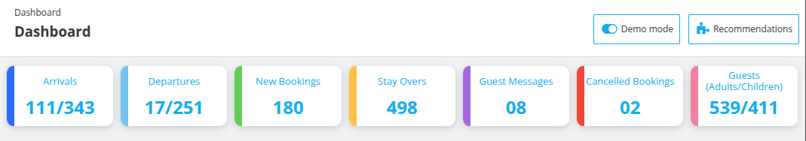

# Guest Insights

- The first section of the dashboard gives a glimpse of the statistics of various data of the hotel.

- In this, the user can get an idea about the current day arrivals, departures, and much more about the guests. It will help him to efficiently manage his hotel operations.

Let's discuss what metric is highlighted by each parameter in detail:

### The various parameters of the current day displayed in the row include:

1. **Arrivals**: Arrival refers to the number of guests who are arriving in your hotel on the current day (today). It also displays how many guests have arrived out of the total scheduled arrivals.

2. **Departure**: Departure refers to the number of guests who are leaving your hotel on the current day (today). It also displays how many guests have departed out of the total scheduled departures.

3. **New Bookings**: It displays the number of new bookings received by your hotel today.

4. **No-show Bookings**: The number of bookings marked as No-show today so far.

5. **Occupied Rooms**: The count of rooms currently occupied by guests.

6. **Guest Messages**: Number of new messages you received from your guest on the current day.

7. **Cancelled Bookings**: Number of cancelled bookings of your hotel for today.

8. **Guests**: Number of total guests(adults / children) which are scheduled to stay at your hotel today.

