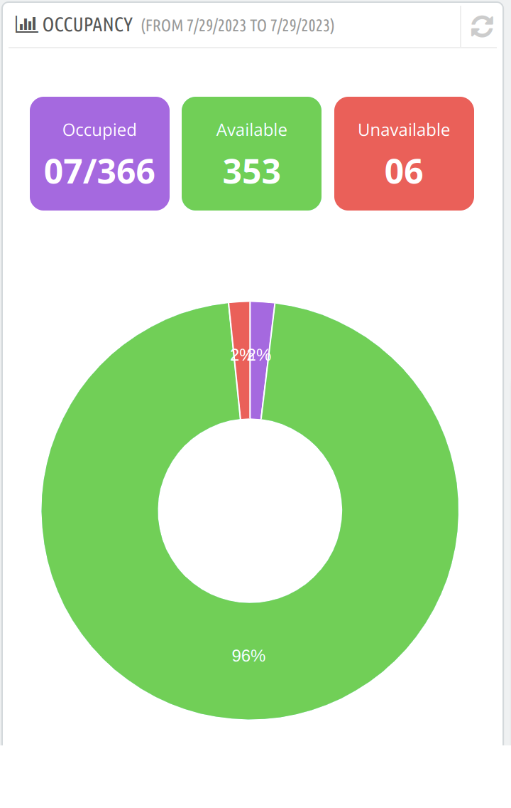

# Occupancy

It displays data on the occupancy of the hotel rooms under 3 categories:

- **Occupied**: The total number of booked room nights in the selected date range out of total available room nights.
- **Available**: The total number of available room nights in the selected date range.
- **Unavailable**: The total number of unavailable room nights in the selected date range out of total available room nights.

The pie chart demonstrates the percentage of occupied, available and unavailable room nights.

