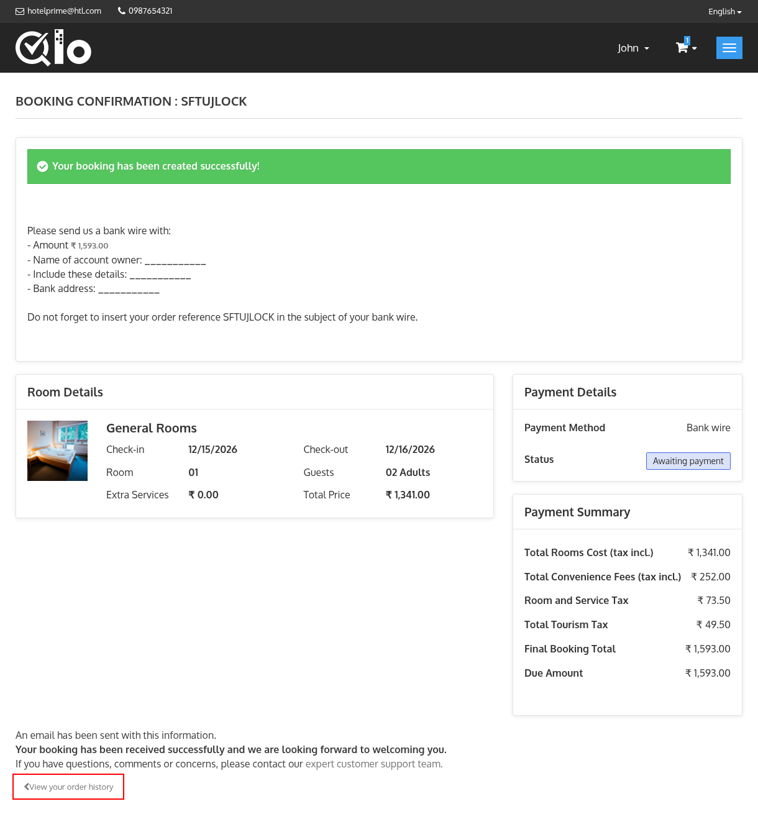

# Booking Confirmation

The Booking Confirmation page is displayed after the booking has been successfully placed. It provides a summary of the reservation and payment details.

- **Room Details**: Displays the check-in and check-out dates, the number of rooms, the guests, the extra services and the total price of each booked room. Click the amount shown in **Extra Services** to view the list of extra services added to the room.

- **Product Details**: If the booking includes service products, this section displays them along with their quantity, unit price and total price.

- **Payment Details**: Displays the **Payment Method** and the current booking **Status**.

- **Payment Summary**: Provides a breakdown of the booking charges, including:
    - **Total Rooms Cost**: The cost of the rooms and their extra services.
    - **Total products cost**: The cost of the service products, if any are booked.
    - **Total Convenience Fees**: Displayed only when convenience fees apply.
    - **Taxes**: Displayed as **Total Taxes**. If the hotel has tourism tax enabled and chooses to show it separately, the taxes are displayed as **Room and Service Tax** and **Total Tourism Tax**.
    - **Total Vouchers**: Displayed only when a discount has been applied.
    - **Final Booking Total**: The total amount of the booking.
    - **Due Amount**: Displayed only when the booking is not fully paid.

> **Note for Administrators:** The tourism tax can be displayed separately from **Localization → Taxes → Show tourism tax separately in price summary**. For more information, refer to the QloApps documentation: [Taxes](/1.8.0/localization/taxes/)

Click **View your order history** to view your reservation details and booking status.
