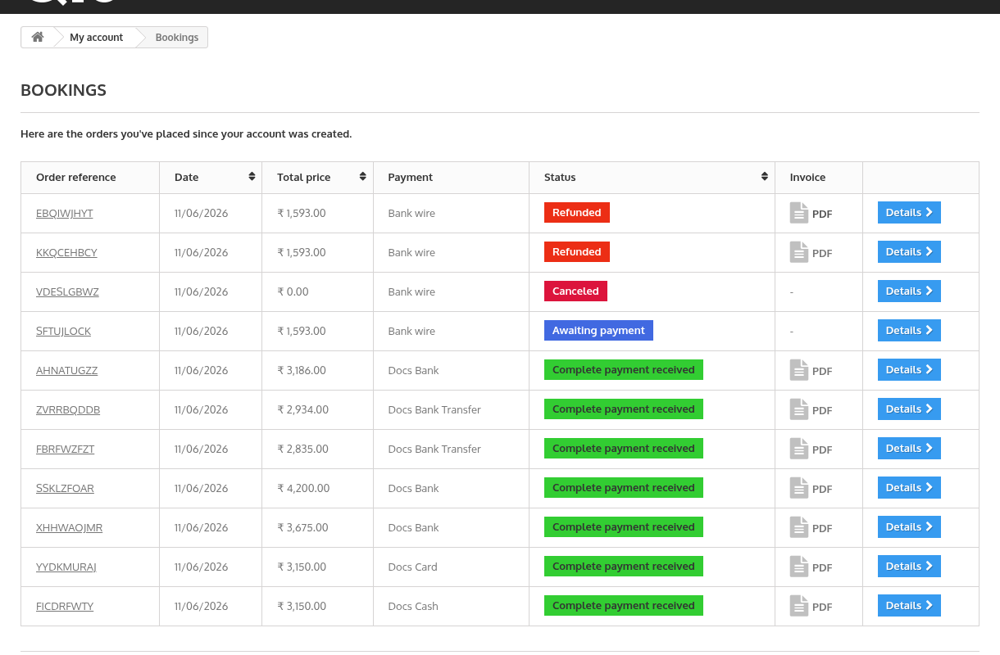
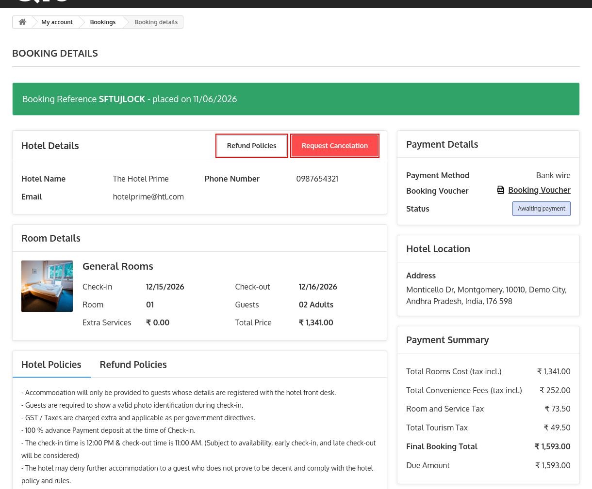
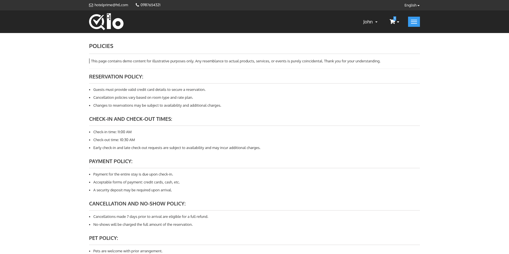
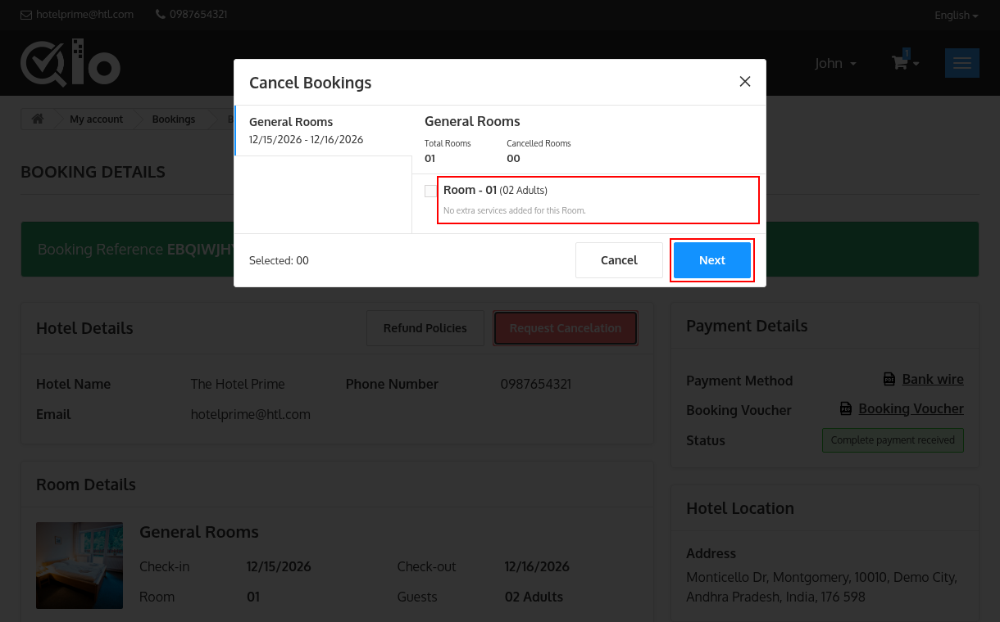
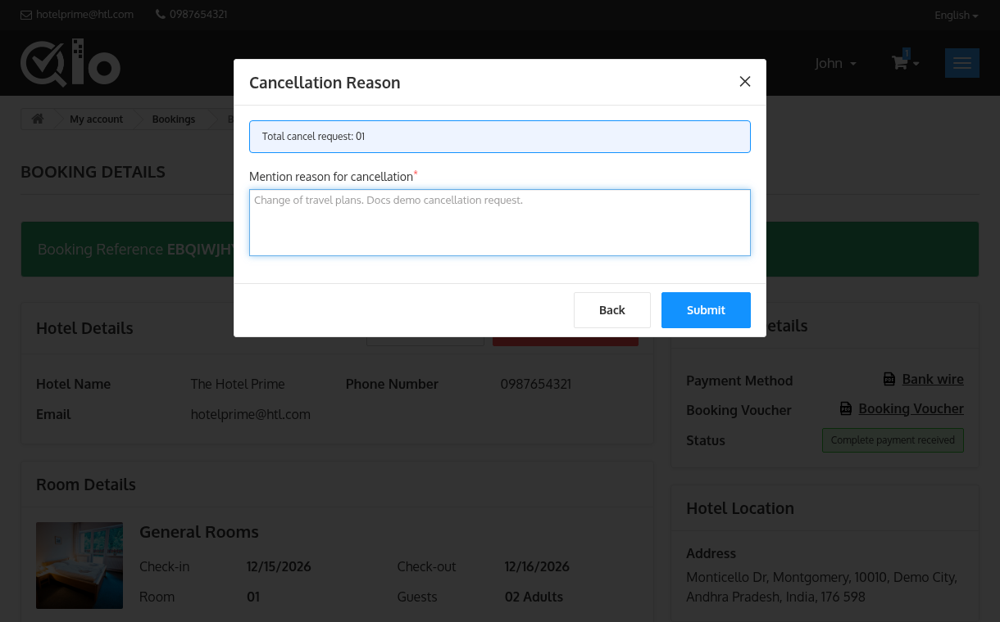
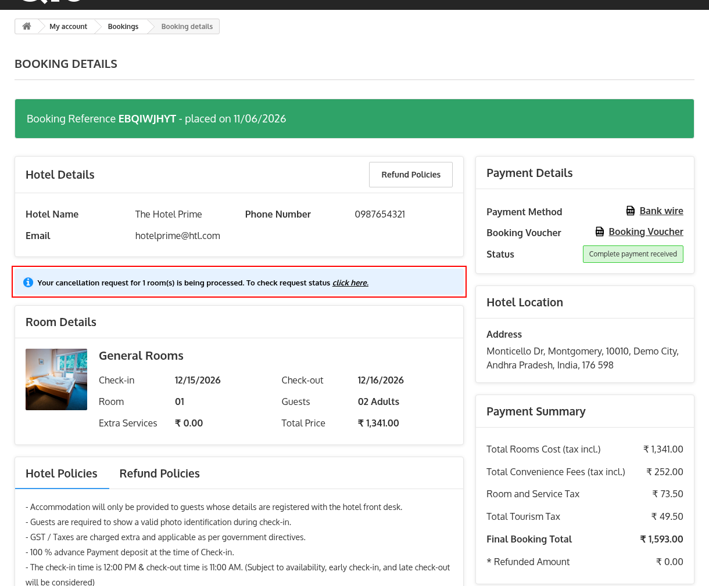
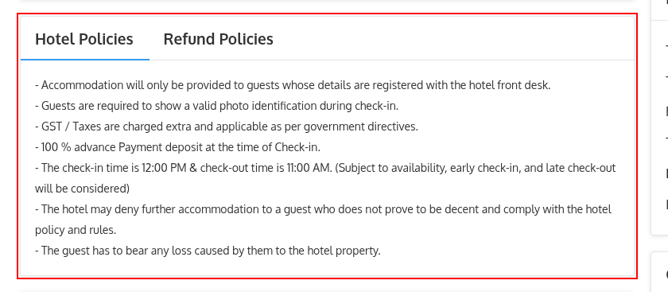
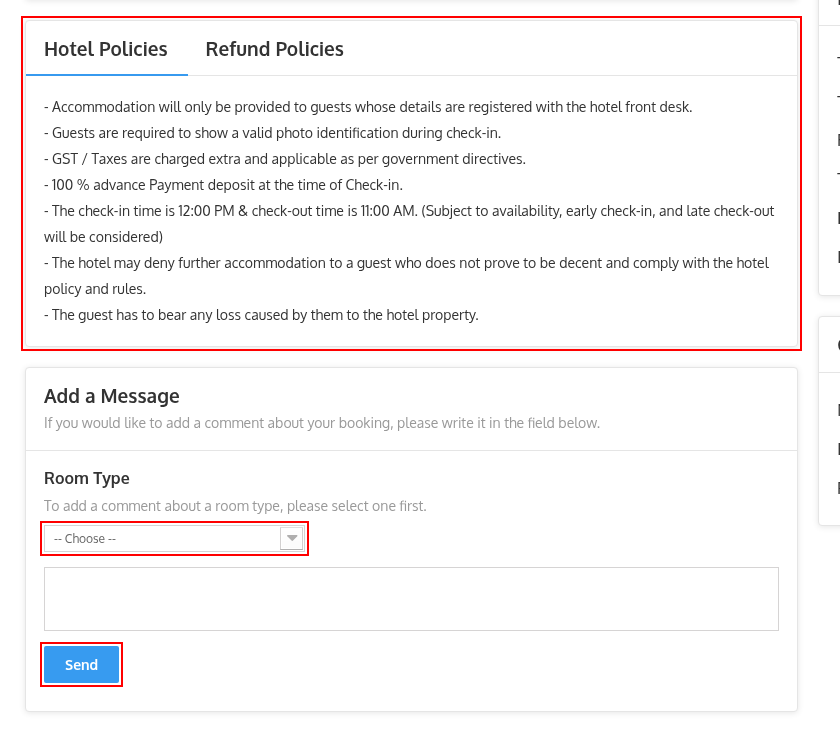

# Booking History

The **Booking History** page displays all bookings made using your account. From this page, you can review your booking details, payment method, booking status, and access individual reservation information.

Guests can access this page in either of the following ways:

- Click **View your order history** on the **Booking Confirmation** page.
- Navigate to **My Account → Bookings** after signing in to your account. The page is displayed with the heading **Bookings**.

The page displays the following information for each booking:

- **Order Reference:** Unique booking reference number.
- **Date:** Booking creation date.
- **Total Price:** Total booking amount.
- **Due Price:** Remaining amount to be paid. This column is displayed only when the advance payment feature is active.
- **Payment:** Selected payment method.
- **Status:** Current status of the booking, such as Awaiting payment, Complete payment received, Canceled, Refunded or No-show.
- **Invoice:** Displays the invoice if available.
- **Details:** Click **Details** to view the complete booking information.

## Booking Details

The **Booking Details** page allows guests to review their reservation and manage booking-related actions.

The page includes the following sections:

- **Hotel Details:** Displays the name, phone number and email address of the hotel, along with the **Refund Policies** and **Request Cancelation** buttons.
- **Payment Details:** Displays the payment method, the **Booking Voucher** PDF and the current status of the booking.
- **Hotel Location:** Displays the address of the hotel.
- **Room Details:** Displays the booked rooms along with their stay dates, occupancy and prices.
- **Product Details:** Displays the service products included in the booking, if any.
- **Payment Summary:** Displays the breakdown of the booking charges, including the refunded amount and the due amount, if applicable.
- **Guest Details:** Displays the name, email address and phone number of the guest.
- **Hotel Policies and Refund Policies:** Displays the policies applicable to the reservation.
- **Messages and Add a Message:** Displays the messages sent for the booking and allows you to send a new one.

## Refund Policies

The **Refund Policies** page displays the refund policy of the hotel applicable to the reservation.

Guests can access this page by clicking **Refund Policies** from the **Booking Details** page. The page opens in a new tab. This button is displayed only if order refunds are enabled and a refund policy page has been selected by the administrator.

The page displays the refund policy content configured by the administrator.

Guests are advised to review these policies before requesting a cancellation.

> **Note for Administrators:** To enable Order Refunds, navigate to Hotel Reservation System → Manage Order Refund Rules → Order Refund Setting and enable the **Enable Order Refund** option. Refunds must also be enabled for the specific hotel from **Hotel Reservation System → Manage Hotel** by editing the hotel. For more information, refer to the QloApps documentation: [Manage Order Refund Rules](/1.8.0/hrs/manage_refund_rules/)

> **Note for Administrators:** The refund policy page is selected from **Hotel Reservation System → Manage Order Refund Rules → Order Refund Setting → Detailed refund policy**. The content of that page can be updated from **Preferences → CMS** in the Back Office.

## Request Cancellation

If you wish to cancel your booking and request a refund, open the **Booking Details** page and click **Request Cancelation**.

The **Cancel Bookings** window displays the rooms included in the reservation.

To continue:

1. Select the room(s) you want to cancel.
2. Review the booking details, including the room type, stay dates, and number of cancelled rooms.
3. Click **Next** to proceed with the cancellation request.

*Note: Rooms that are already cancelled, refunded, checked-in, checked-out or marked as no-show cannot be selected for cancellation. Guests who booked using the guest checkout option cannot request a cancellation.*

The window displays the total number of cancellation requests selected.

Enter the reason for cancellation in the **Mention reason for cancellation** field. This field is mandatory.

Click **Submit** to send the cancellation request to the hotel.

After the request is submitted, a confirmation message **Request submitted successfully** is displayed, and the request is sent to the hotel for review. The hotel administrator can approve or reject the request according to the configured cancellation policy.

If no payment has been made for the booking, the rooms are cancelled immediately and the message **Booking cancelled successfully** is displayed instead.

> **Note for Administrators**: Cancellation and refund requests submitted by guests can be viewed and managed from Hotel Reservation System → Manage Order Refund Requests in the Back Office. For more information, refer to the QloApps documentation: [Manage Order Refund Requests](/1.8.0/hrs/manage_refund_request/).

## Cancellation Request Status

After submitting the cancellation request, close the confirmation message and the **Booking Details** page is reloaded.

A notification is displayed confirming that the cancellation request is currently being processed by the hotel.

To check the status of the refund click on **click here**.

The booking details are also updated to reflect the cancellation request, including:

- The number of cancelled rooms.
- The refunded amount in the **Payment Summary**, once the refund is processed.

## Hotel Policies

The **Hotel Policies** section displays the policies applicable to your reservation, as entered by the hotel administrator. It contains two tabs, **Hotel Policies** and **Refund Policies**. The **Refund Policies** tab lists the refund rules of the hotel and is displayed only if refunds are enabled for the hotel and rules are available.

Guests are advised to review these policies before their stay.

> **Note for Administrators:** Hotel policies can be managed from Hotel Reservation System → Manage Hotels by editing the desired hotel. For more information, refer to the QloApps documentation: [Add a New Hotel](/1.8.0/hrs/manage_hotel/#add-a-new-hotel).

## Add a Message

The **Add a Message** section allows guests to send additional instructions or requests related to their booking.

Previous messages sent for the booking, if any, are displayed in the **Messages** section above the form.

To send a message:

1. Select the **Room Type** from the dropdown list. If the booking includes service products, the field is named **Room Type/Product**.
2. Enter your message in the text box.
3. Click **Send** to submit your message.

The message will be associated with the selected room type and shared with the hotel.

> **Note for Administrators**: Guest messages are available in the Back Office under Customers → Customer Service. For more information, refer to the QloApps documentation: [Customer Service](/1.8.0/customers/customer_service/customer_service.html).
