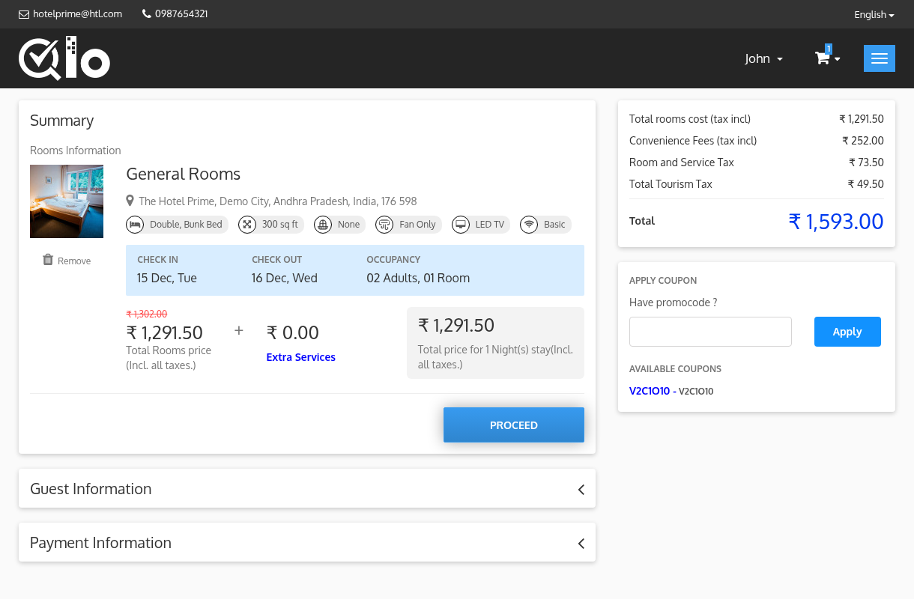
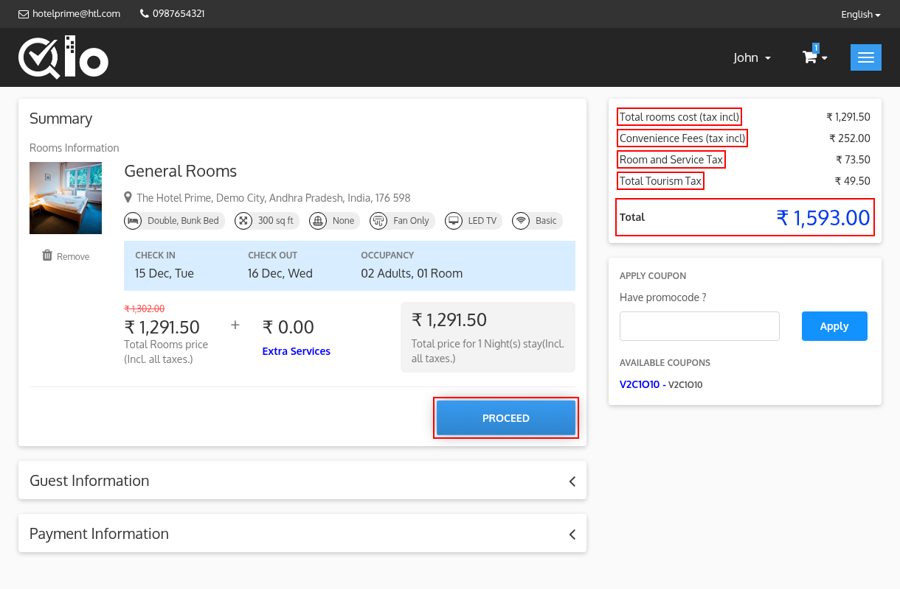

# Checkout Page

The Checkout Page allows guests to review their booking details, apply coupon codes, enter guest information, select a payment method, and complete the reservation.

The **Summary** section displays the details of the selected rooms under **rooms information**, including:

* Room name and image
* Hotel location
* Featured room features
* **CHECK IN** and **CHECK OUT** dates
* **OCCUPANCY** details (or **QUANTITY** if the rooms quantity booking method is used)
* Total room price
* Extra services price. Click **Extra Services** to add or edit the services of the room.
* Total price for the stay

Guests can click **Remove** to remove the room from the booking.

If service products are added to the booking, they are displayed under **Product information** with their unit price, quantity and total price.

## Booking Total

The Booking Total section, displayed on the right side of the page, provides a detailed breakdown of the reservation cost.

### Total rooms cost (tax excl)

Displays the total cost of all selected rooms, including their extra services, without tax. Depending on the tax display settings, the label may be displayed as **(tax incl)**.

### Total products

Displays the total cost of the service products, if any are added to the booking.

### Taxes

Displays the total tax amount calculated based on the room charges and the tax rules configured by the hotel. It is displayed as **Total Taxes**. If the tourism tax is enabled and set to be displayed separately, it is displayed as two lines: **Room and Service Tax** and **Total Tourism Tax**.

> **Note for Administrators:** The tourism tax can be displayed separately from **Localization → Taxes → Show tourism tax separately in price summary**. For more information, refer to the QloApps documentation: [Taxes](/1.8.0/localization/taxes/)

### Total Discount

Displayed only when a coupon or discount has been applied.

### Total

Displays the final amount payable by the guest, including room charges and applicable taxes. If advance payment is active, **Due Amount** and **Partially Payable Total** are also displayed.

## Apply Coupon

If a promotional code is available, enter it in the **Apply Coupon** field and click **Apply** to receive the applicable discount. An applied coupon is displayed as **Applied** and can be removed using the delete icon.

> **Note for Administrators:** Coupons can be created and managed from **Manage Discounts → Cart Rules** in the Back Office. For more information, refer to the QloApps documentation: [Cart Rules](/1.8.0/discounts/cart_rule/).

## Proceed

After reviewing the booking details, click **Proceed** to continue to the Guest Information section.
