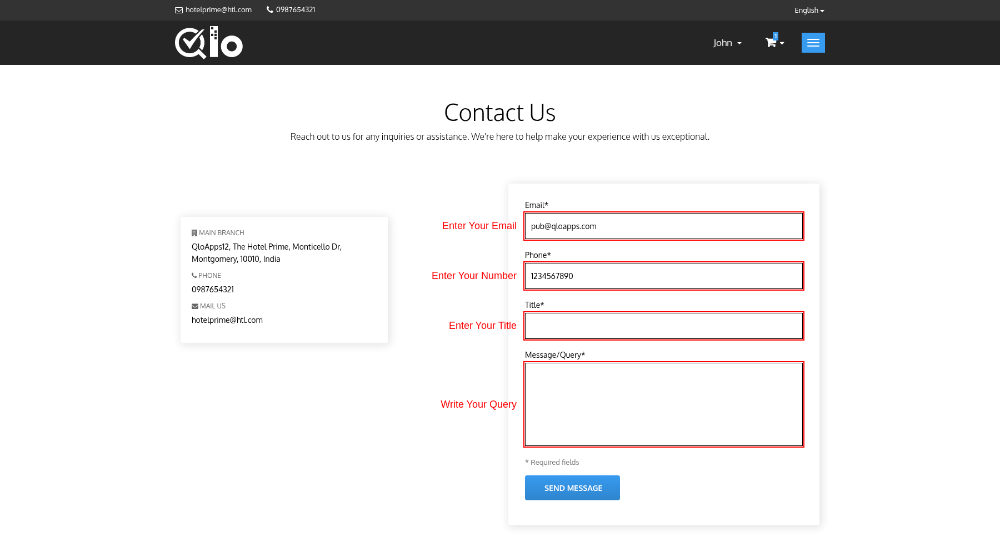

# Contact Us

The **Contact Us** page allows users to send inquiries, support requests, or feedback directly to the hotel.

## Send a Message

To submit an inquiry, provide the following information:

- **Name:** Displayed only if enabled by the administrator.
- **Email:** Email address of the sender.
- **Phone:** Displayed only if enabled by the administrator.
- **Title:** Subject of the message.
- **Send To:** Select the recipient of the message. Displayed only if enabled by the administrator.
- **Message/Query:** Your message.
- **Attach File:** Optionally attach a file. Displayed only if enabled by the administrator.

Fields marked with an asterisk (*) are mandatory.

After entering the required details, click **Send Message** to submit your request.

> **Note for Administrators:** Messages submitted through the **Contact Us** page can be viewed and managed from the Back Office by navigating to **Customers → Customer Service**. For more information, refer to the QloApps documentation: [Customer Service](/1.8.0/customers/customer_service/customer_service.html)

> **Note for Administrators**: To display the list of hotels on the Contact Us page, navigate to **Hotel Reservation System → General Settings → Website Configuration** and enable **Display Contact Page Hotel List**. The hotels are then displayed under **Our Hotels** along with their address, phone number and email address.
