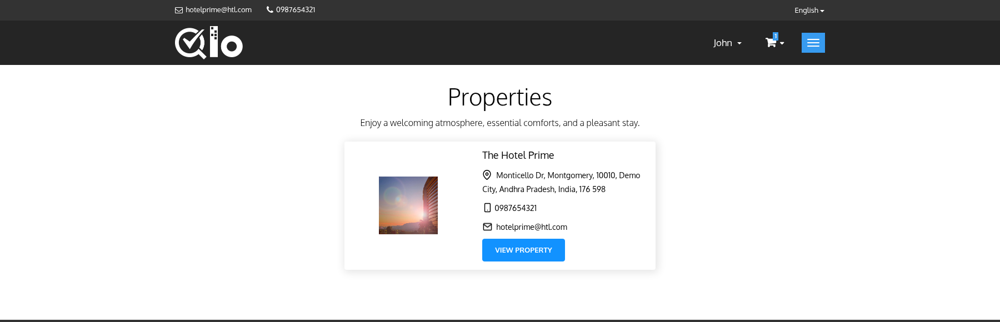

# Our Properties

The **Our Properties** page displays all hotels managed through the QloApps installation. It allows guests to browse available properties and view their basic details before proceeding to book a room.

The page includes the following information for each property:

* **Hotel Image:** Displays the featured image of the hotel.
* **Hotel Name:** Name of the property.
* **Hotel Address:** Shows the complete address of the hotel.
* **Phone Number:** Contact number for the property.
* **Email Address:** Hotel email address.
* **View Property:** Redirects guests to the selected hotel's room listing page, where they can browse available room types and continue with the booking process.
* **View on map:** Opens the hotel location on the map. This button is displayed only if the location of the hotel is available.

> **Note for Administrators:** To display a link to the **Properties** page in the website header, navigate to **Hotel Reservation System → General Settings → Website Configuration** and enable **Display Properties link in Header**. For more information, refer to the QloApps documentation: [General Settings](/1.8.0/hrs/general_settings/#general-settings-2)
