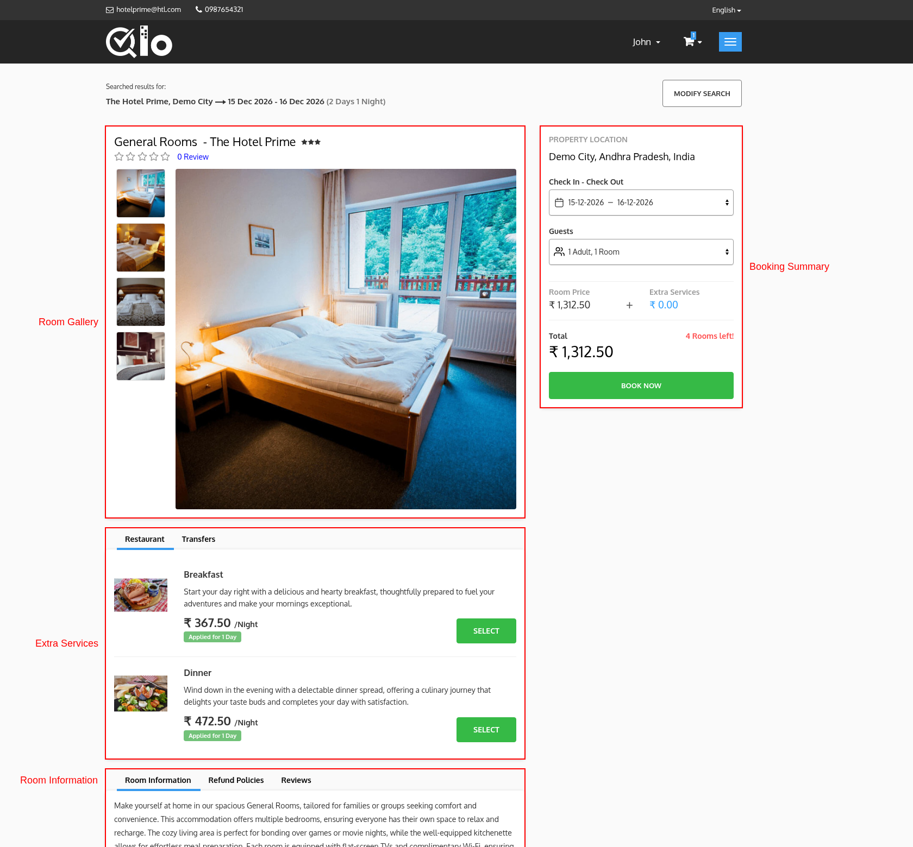
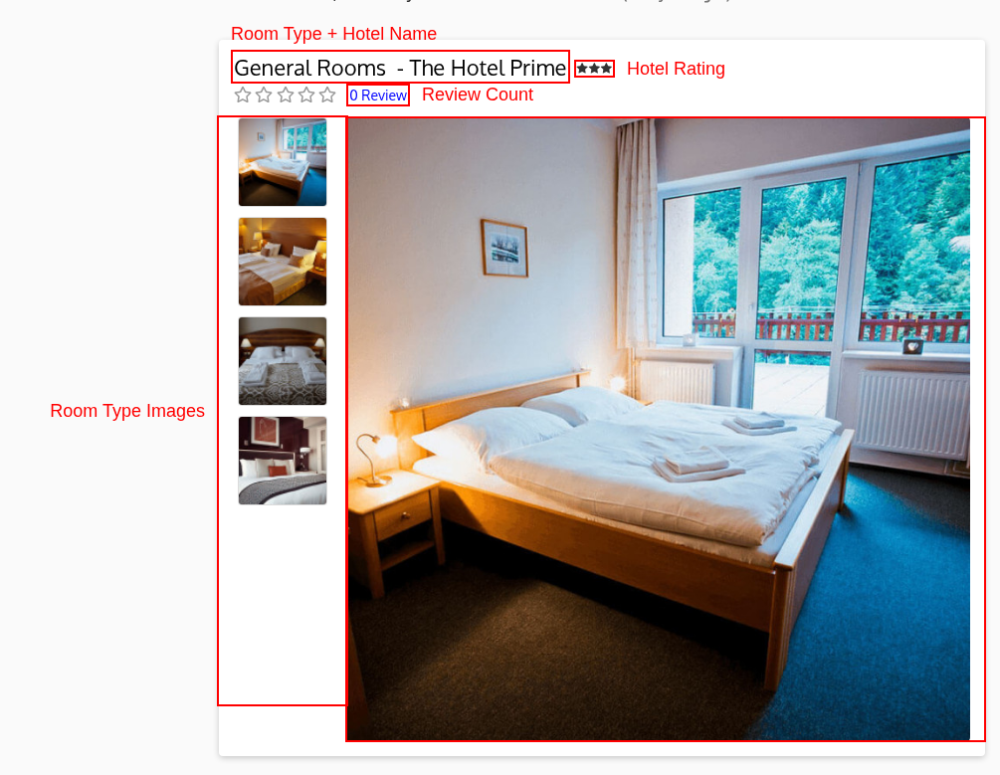
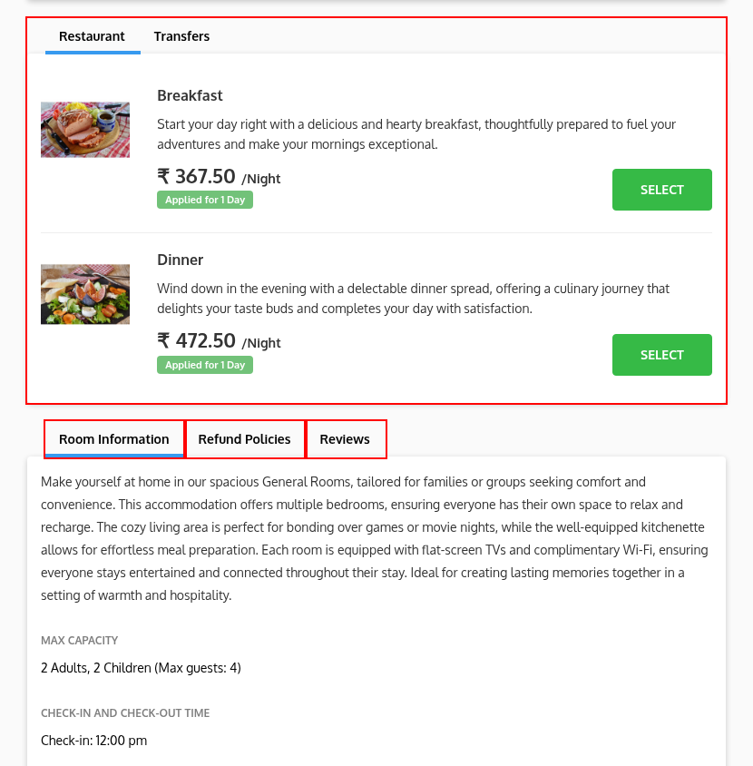
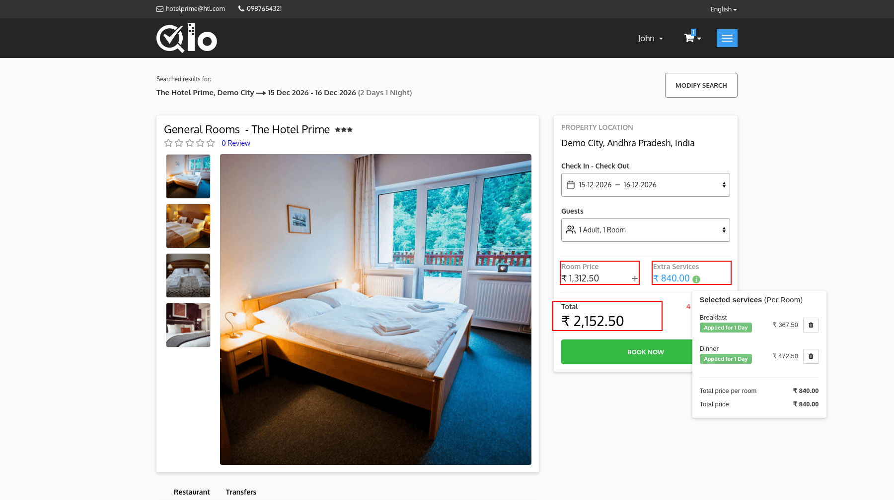

# Room Detail Page

The Room Detail Page provides detailed information about the selected room. Guests can view room images, pricing, amenities, occupancy details, hotel policies, and proceed with booking.

## Room Gallery

The Room Gallery displays images and basic information about the selected room.

It includes:

* **Room Type:** Displays the name of the selected room.
* **Hotel Name:** Displays the hotel offering the selected room.
* **Guest Rating:** Displays the room's rating based on guest reviews.
* **Review Count:** Displays the total number of guest reviews.
* **Main Room Image:** Displays a large preview image of the room.
* **Room Image Thumbnails:** Displays additional room images. Guests can click a thumbnail to view it in the main image area.

> **Note for Administrators:** Room images can be managed from the Back Office by navigating to **Catalog → Manage Room Types**, selecting the desired room type and opening the **Images** section. For more information, refer to the QloApps documentation: [Images](/1.8.0/catalog/manage_room_types/#images-section)

## Extra Services

If the hotel offers additional services, they are displayed in this section under different categories such as **Restaurant** and **Transfers**. Guests can browse the available services, review their descriptions and pricing, and click **Select** to add them to their booking.

For services that allow multiple quantities, use the **+** and **-** buttons to choose the quantity before clicking **Select**. After a service is selected, the button changes to **Remove**. For services priced per day, an **Applied for N Days** badge is displayed. Hover over it to see the exact dates on which the price applies.

> **Note for Administrators:** Extra services can be managed from **Catalog → Manage Service Products** in the Back Office. While creating a service product, you can associate it with one or more hotels and specific room types, allowing you to control which services are available for each room. For more information, refer to the QloApps documentation: [Manage Service Products](/1.8.0/catalog/manage_service_products/)

## Room Information

The **Room Information** tab displays a detailed description of the room along with important information such as:

* **Max Capacity:** The maximum number of adults and children allowed in the room.
* **Check-in and check-out time:** The check-in and check-out time of the hotel.
* **Featured Amenities:** The featured amenities of the room.
* **Room features:** The features of the room, grouped by category.
* **Room Amenities and Property Amenities:** The amenities available in the room and in the hotel.
* **Property Description and Property Images:** The description and images of the hotel.
* **Property Policies:** The policies of the hotel.

## Refund Policies

The **Refund Policies** tab displays the cancellation and refund terms applicable to the selected room. Guests can review these policies before completing their reservation.

## View on Map

The **View on Map** tab displays the location of the hotel on a map. Click **View on Map** to open the location in Google Maps. This tab is displayed only if the map is enabled and the location of the hotel is available.

## Reviews

The **Reviews** tab displays ratings and feedback shared by previous guests, helping future guests make informed booking decisions.

> **Note for Administrators:** Guest reviews are submitted by customers after their stay and are displayed automatically on the **Reviews** tab once approved.

## Booking Summary

The **Booking Summary** panel displays a real-time overview of the selected room and booking details.

It includes:

* **Property Location:** Displays the selected hotel's location.
* **Check In - Check Out:** Displays the selected stay dates.
* **Guests:** Displays the selected occupancy. If the rooms quantity booking method is used, **No. of Rooms** is displayed instead.
* **Room Price:** Displays the price of the selected room. This is displayed only when extra services are selected.
* **Extra Services:** Displays the total cost of the selected extra services. Click the **information (i)** icon to view the selected services along with their individual prices.
* **Total:** Displays the combined cost of the room and selected extra services.
* **Book Now:** Adds the selected room and extra services to the cart and proceeds with the booking process.

### Length of Stay Restriction

If the selected stay does not meet the minimum or maximum length of stay of the room type, the panel displays the message **Minimum stay allowed is N nights.** or **Maximum stay allowed is N nights.**, and the **Book Now** button is not displayed. Select different stay dates to continue.

If no room is available for the selected dates, the message **All Rooms sold out!** is displayed.
