# General Settings

The Hotel General Settings section in QloApps is designed to provide hoteliers with centralized control over fundamental configurations for their property.

Here, the admin can access and manage the following settings:

- General Settings
- Advanced Price Rules
- Hotel Interior Block
- Hotel Amenities Block
- Landing Page Header Media

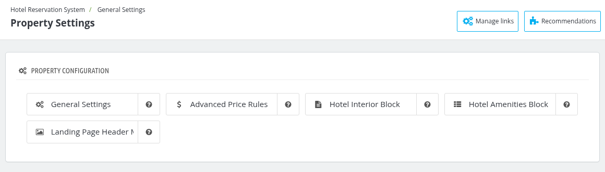

## General Settings

The General Settings section allows administrators to configure the search panel, website details, contact information, Advance Payment Global Settings, occupancy preferences, and Google Maps settings.

### Search Panel Settings

In the **Search Panel Setting** block the admin can enable/disable the following settings:

- **Enable Hotel Location:** Enable it to display the hotel location search field shown on the front page.
- **Display Hotel Name:** The name of the hotel can be enabled or disabled for display when managing a single property. However, if multiple hotels are being managed, the hotel name will automatically appear in the search panel.
- **Focus next field automatically:** Enable it if you want the next booking search field to be focused automatically after setting value for a field.
- **Property name search threshold:** Enter the number of properties after which user can search property by name. Set to 0 to always show the search box.

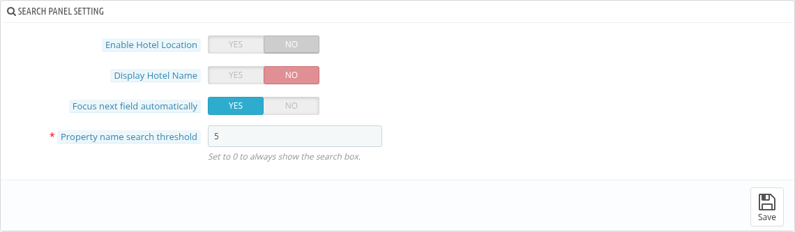

### Website Configuration

In the **Website Configuration** panel, the admin can set the following details:

- **Primary property:** This is used to display the primary address for your hotel. The property address will be considered as your registered business address.
- **Display Properties link in Header:** Enable it to display the Properties link in the header in the front office.
- **Display Contact Page Hotel List:** Enable it to display the hotels list on the contact us page.
- **Max featured amenities in room search:** Enter the maximum number of featured amenities to display for each room type on the front office room search page. Set to 0 to display all featured amenities.
- **Max Featured room type features on room search page:** Enter the maximum number of featured features to display for each room type on the front office room search page. Set to 0 to display all featured features.
- **Max Featured room type features on Checkout page:** Enter the maximum number of featured features to display for each room type on the front office checkout page. Set to 0 to display all featured features.
- **Max display values for room type Featured features:** Enter the maximum number of room type feature values to display for each featured feature in room search results and orders. For example, if the featured feature Bed Type has the values Single, Double, and Queen, and this setting is set to 2, only Single, Double will be displayed. Set to 0 to display all values of each featured feature.

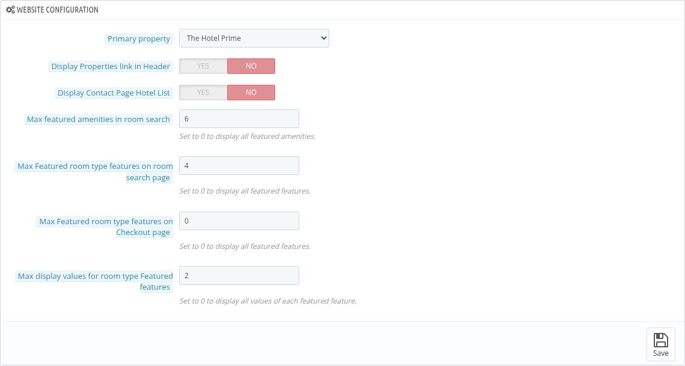

### Support Contact Details

In the **Support Contact Details** panel, the admin can set the contact details of customer service, which are shown on the navigation bar.

- **Support Phone Number:** The phone number used for customer service.
- **Support Email:** The email used for customer service.

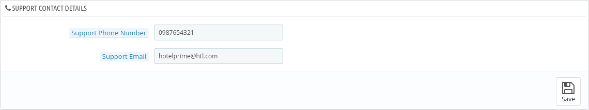

### Website contact details

This section allows the admin to manage default address for his hotel.

- **Website name:** The name of the website, displayed in emails and page titles.
- **Website email:** The email displayed in emails sent to customers and on the Contact Us page.
- **Website Launch Year:** The year when the website of the hotel became live.
- **Phone:** The phone number of the main branch.
- **Address line 1:** The address of the main branch.
- **Address line 2, Zip/postal code, City, Country and State:** The remaining address details of the main branch.
- **Registration number:** Website registration information (e.g. SIRET or RCS).
- **Fax:** The fax number of the main branch.

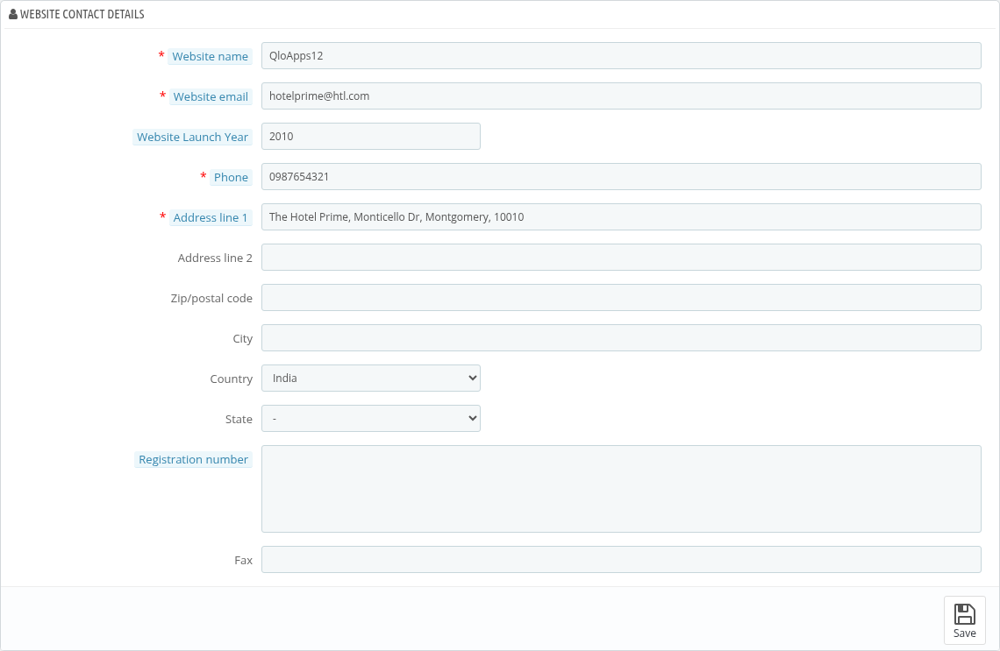

### Advance Payment Global Setting
In the advance payment global setting, the admin can make changes to the following.

- **Allow Advance Payment:** If No, then the advance payment option will be disabled.
- **Global Minimum Booking Amount:** Enter the minimum amount to pay in percentage for booking a room.
- **Global Booking Amount Include Tax:** Enable if you want to take tax with Advance Payment.

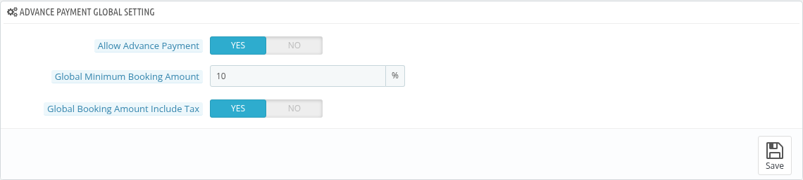

### Occupancy Settings

In the **occupancy setting** block, the admin can make changes to the following:

- **Consider guest as child below age:** Enter the age of the guest below which that guest will be considered as a child.
- **Consider guest as Infant below age:** Enter the maximum age (in years) below which a guest is considered an infant. The infant age must be at least 1 and less than the child max age.

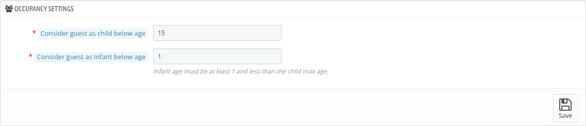

### Google Maps Settings
In the **google maps settings**, the admin can make changes to the following:

- **Google Maps API Key:** Admin can enter the unique API key for Google Maps. It is required to display Google Maps.
- **Google Map ID:** Enter the Map ID for Google Maps. This field is optional.
- **Display Google Maps For Hotel Location:** If disabled then Google Maps won't be displayed for the hotel location.

When **Display Google Maps For Hotel Location** is enabled, the following options are shown:

- **Display Active Hotels Only:** If Yes, only active hotels will be displayed on the map.
- **Display Properties page Google map:** Enable to display a map with the hotels locations on the properties page.
- **Display Contact Us page Google map:** Enable to display a map with the hotels locations on the contact us page.

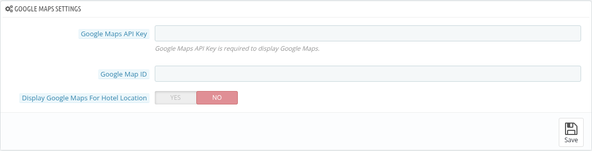

## Advanced Price Rule

The **Advanced price rule** section allows you to define specific rules for room rates based on various conditions, such as booking dates and days of the week for specific room types, and for different user groups.

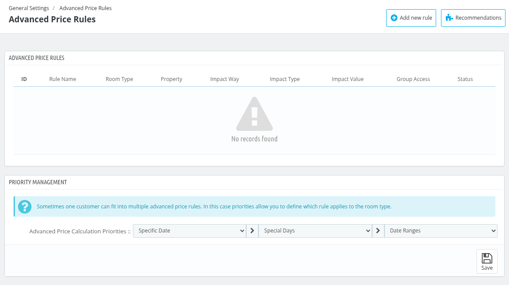

The list shows the **ID**, **Rule Name**, **Room Type**, **Property**, **Impact Way**, **Impact Type**, **Impact Value**, **Group Access** and **Status** of every rule.

### Add a new rule

To add a new rule, click on **Add new rule** and enter the following details:

- **Advanced Price Rule Name:** Enter a name for the advanced price rule. You can use {room_type_name} to generate dynamic price rule names.
- **Create for multiple room types:** Enable this option to create advanced price rules for multiple room types. When it is enabled, the **Room Types** field is shown, where you can select the room types for which you are going to create the rule.
- **Room Type:** Enter the room type name and select the room type for which you want to create this advanced price rule.
- **Restrictions:** Add the date restrictions of the rule. At least one restriction is required. Click on **Add More Restrictions** to add more.
    - **Date Selection type:** From the dropdown, select whether you want to create the restriction for a **Date Range** or a **Specific Date**.
    - **Date From** and **Date To:** Enter the starting date and the end date of the date range.
    - **Specific Date:** Select the date, when the **Specific Date** is selected as Date Selection type.
    - **Restrict to Week Days:** Choose whether to apply the rule to specific days of the week of the selected date range by selecting Yes or No. If enabled, select the week days (Mon to Sun).
- **Impact Way:** Select how the advanced price rule will impact the pricing: **Decrease Price**, **Increase Price** or **Fixed Price**.
- **Impact Type:** Define whether the impact is calculated as a **Percentage** or an **Amount**.
- **Impact Value(tax excl.):** Enter the value of the impact, excluding taxes.
- **Enable Advanced Price Rule:** Choose Yes to activate the rule or No to deactivate it.
- **Group access:** Specify which user groups (e.g., Visitor, Guest, Customer) can benefit from this advanced price rule.

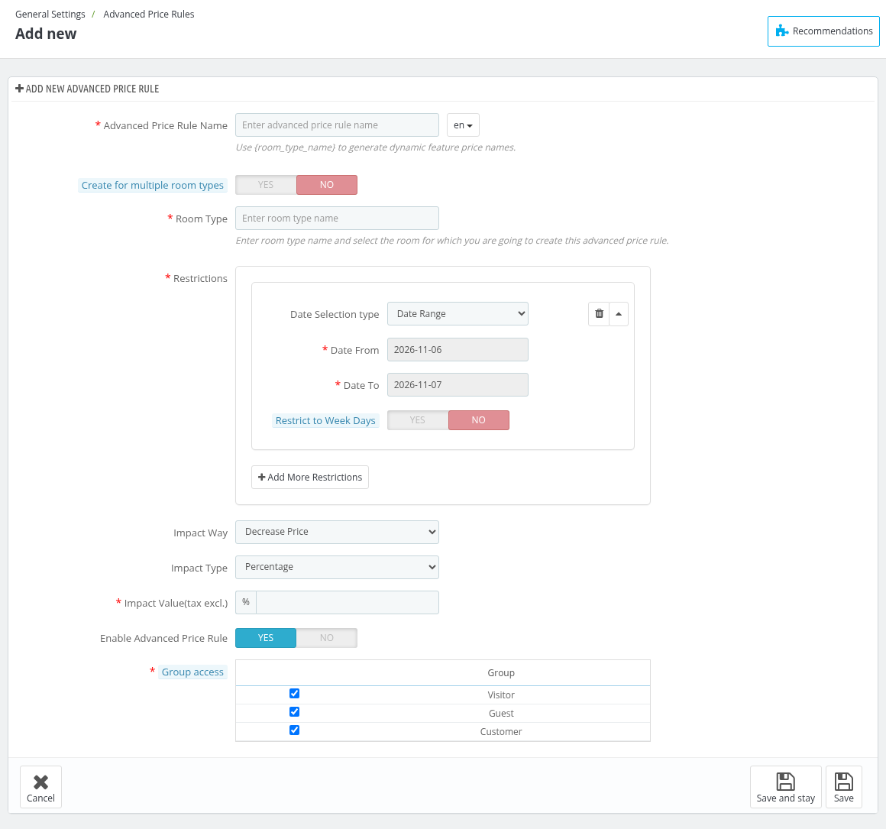

*Note: Two active rules of the same room type cannot have overlapping conditions. If such a rule already exists, the message "An advanced price rule already exists with overlapping conditions. Please update the existing rule to activate this one." is shown while activating a rule.*

### Priority Management
Priority management of price defines which rule applies to the customer first. You can set the priority among Specific dates, special days and date ranges.

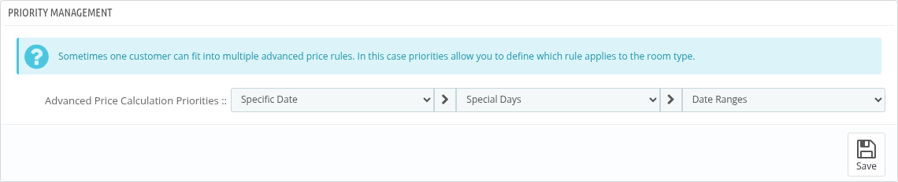

## Hotel Interior Block

The admin can display hotel interior images using this block, which will be showcased on the homepage. This feature allows the hotel to visually highlight its interior design and key spaces.

### Hotel Interior Description

- **Interior Block Title:** Enter a title for the interior block.
- **Interior Block Description:** Provide a brief description that details the design, ambiance, and special features of the hotel's interior.
- **Navigation Type:** Select the navigation of the interior images slider: **Dots**, **Arrows** or **Arrows and dots**.
- **Auto slide:** Enable it to slide the interior images automatically.
- **Slide Interval:** Enter the milliseconds between slides. The minimum is 500, for example 5000 = 5 s.

*Note: Keep interior images in a multiple of 3 for the best view.*

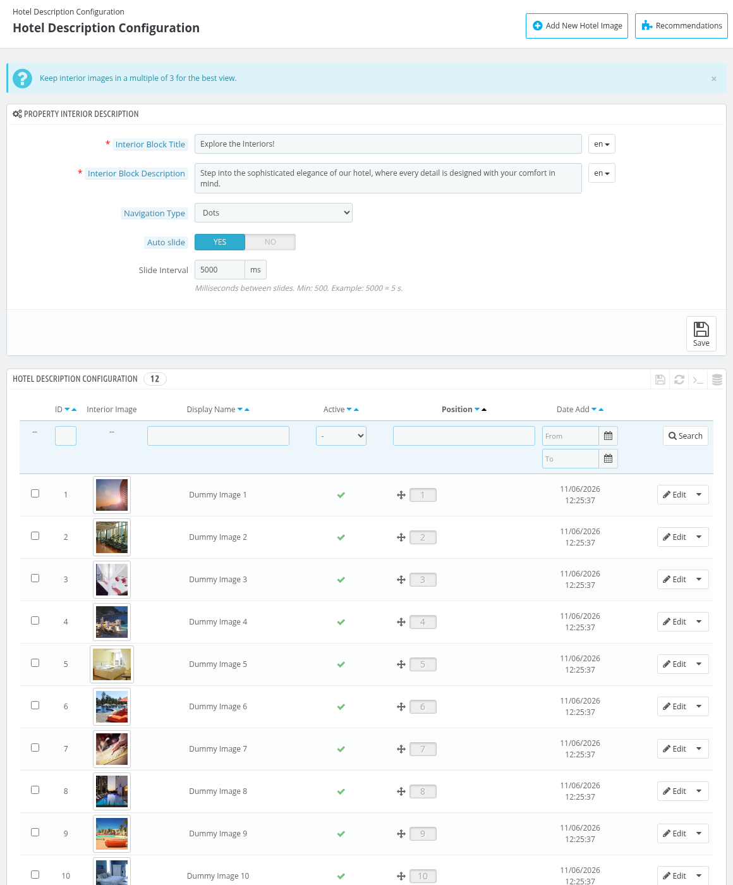

### Add a new Hotel image

To add an interior image click on **Add New Hotel Image** and fill the following fields:

- **Image Display name:** Specify a name for the image that will be displayed in the interior block.
- **Property Interior Image:** Upload an image showcasing the hotel's interior. The recommended resolution is 720 x 360 pixels.
- **Active:** Choose Yes to make the image visible on the homepage, or No to keep it inactive.

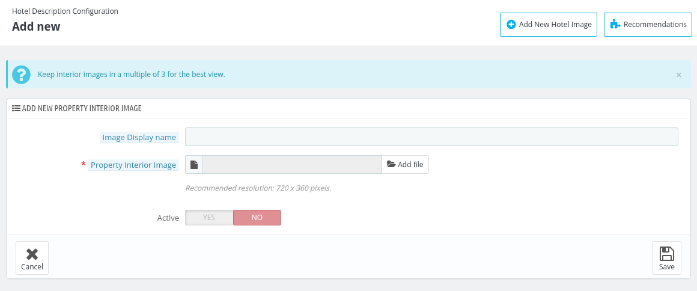

### Hotel Description Configuration

Below the settings, the admin can view the list of all images added for the interior block. The admin has the flexibility to change the positions of the images to control their display order. Additionally, the admin can edit these images, including updating or replacing them, ensuring that the content is always up to date.

#### Edit Hotel Image

To edit a hotel image, click on edit and follow the same steps as Discussed while adding New Image section.

## Hotel Amenities Block

The admin can manage the display of the amenities block on the landing page. From the backend, the admin can add as many images as desired, each accompanied by a description.

*Note: This block only shows images and descriptions on the landing page. To create the amenities that are assigned to the hotels, see [Manage Amenities](../manage_amenities/).*

### Property Amenity Setting

- **Amenity Block Title:** Enter a title for the amenity block.
- **Amenity Block Description:** Enter a description for the amenity block.

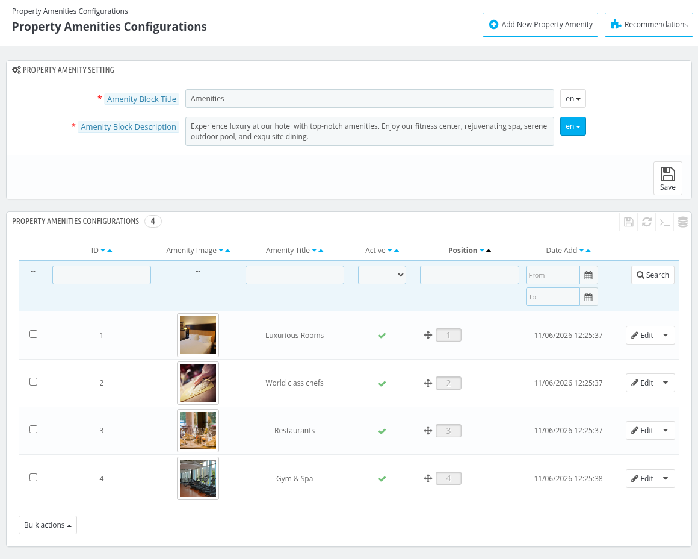

### Add a new property amenity

To add a new amenity, click on **Add New Property Amenity** and provide the following details:
- **Amenity Title:** This will be displayed as an amenity heading.
- **Amenity Description:** This will be displayed as an amenity description.
- **Amenity Image:** Upload the image of your amenity. The recommended resolution is 720 x 540 pixels.
- **Active:** To enable or disable the amenity in the block.

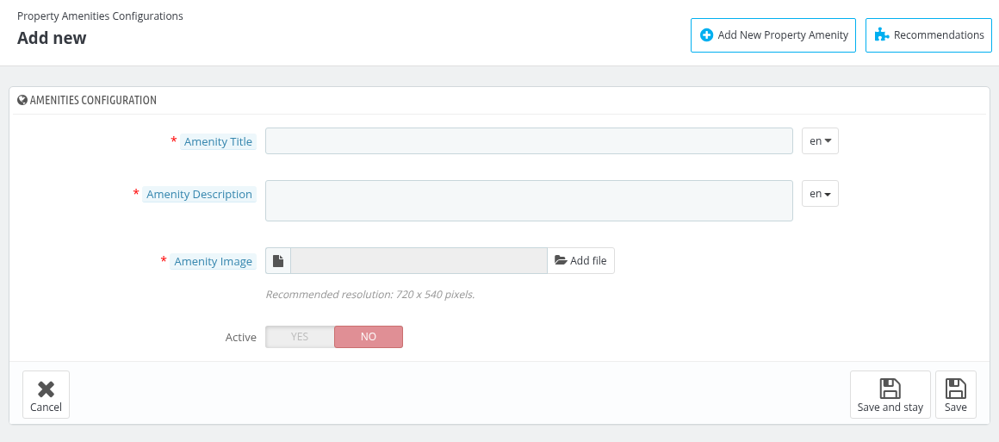

### Property Amenities Configurations

Below the settings, the admin can see the list of already added amenities with their image, title, status and position. Admin can edit any of the amenities by clicking on **Edit**, following the same steps as discussed in the add amenity section.

## Landing Page Header Media

On the **Landing Page Header Media** page (Header Image Configuration), the admin can set whether the header of the home page shows a slideshow of images or a background video.

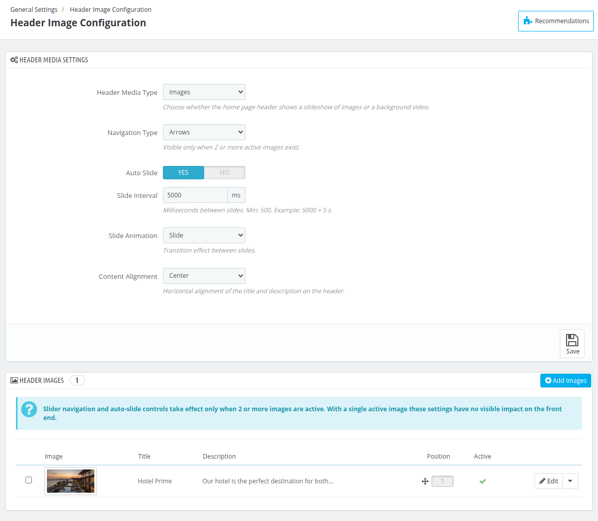

### Header Media Settings

- **Header Media Type:** Choose whether the home page header shows a slideshow of **Images** or a background **Video**.
- **Navigation Type:** Select **Arrows**, **Dots** or **Both (Dots + Arrows)**. It is visible only when 2 or more active images exist.
- **Auto Slide:** Enable it to slide the images automatically.
- **Slide Interval:** Enter the milliseconds between slides. The minimum is 500, for example 5000 = 5 s.
- **Slide Animation:** Select the transition effect between slides: **Slide**, **Fade**, **Zoom** or **Blur**.
- **Content Alignment:** Select the horizontal alignment of the title and description on the header: **Center**, **Left** or **Right**.

Click on **Save** to save the settings.

### Header Images

In the **Header Images** panel, the admin can see the list of the header images with their title, description, position and status. Click on **Add Images** to upload new images.

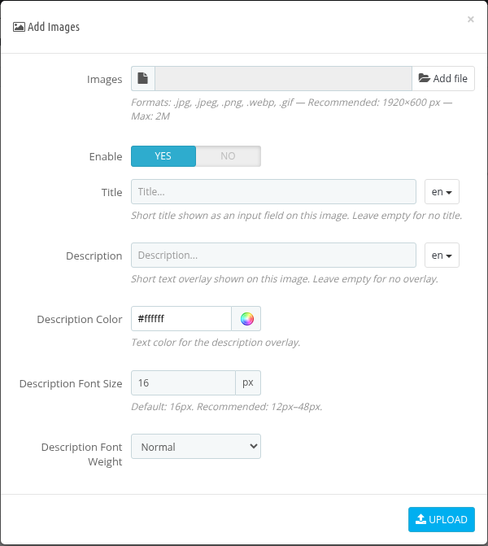

- **Images:** Upload the images. The allowed formats are .jpg, .jpeg, .png, .webp and .gif. The recommended size is 1920×600 px.
- **Enable:** Choose Yes to make the image active.
- **Title:** Enter a short title for the image. Leave it empty for no title.
- **Description:** Enter a short text overlay for the image. Leave it empty for no overlay.
- **Description Color:** Select the text color of the description overlay.
- **Description Font Size:** Enter the font size of the description in px. The default is 16px and the recommended is 12px to 48px.
- **Description Font Weight:** Select **Normal** or **Bold**.

To change an image, click on **Edit** to open the **Edit Image** window, which has the same fields and also allows you to update the image.

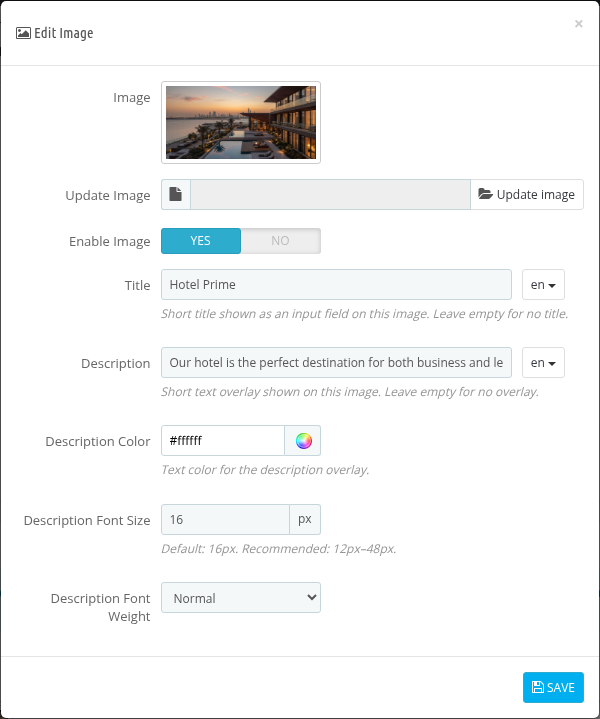

*Note: At least one active image is required. The slider navigation and auto-slide settings take effect only when 2 or more images are active.*

### Video

If **Video** is selected as the **Header Media Type**, the following fields are shown:

- **Video Source:** Select **Upload video file** or **External video URL**.
- **Video File:** Choose the video file to upload. The allowed formats are .mp4, .webm and .ogg.
- **External Video URL:** Enter a direct URL to an MP4, WebM or OGG video file (server-hosted only). Streaming links (e.g., YouTube, Vimeo) are not supported.

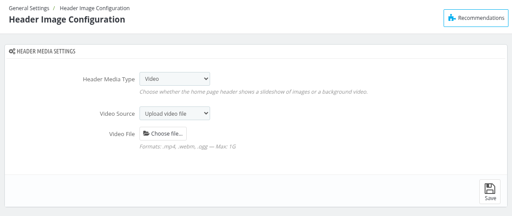

*Note: Switching to Video deletes all images except the one in the first position, so a confirmation is asked before it.*
