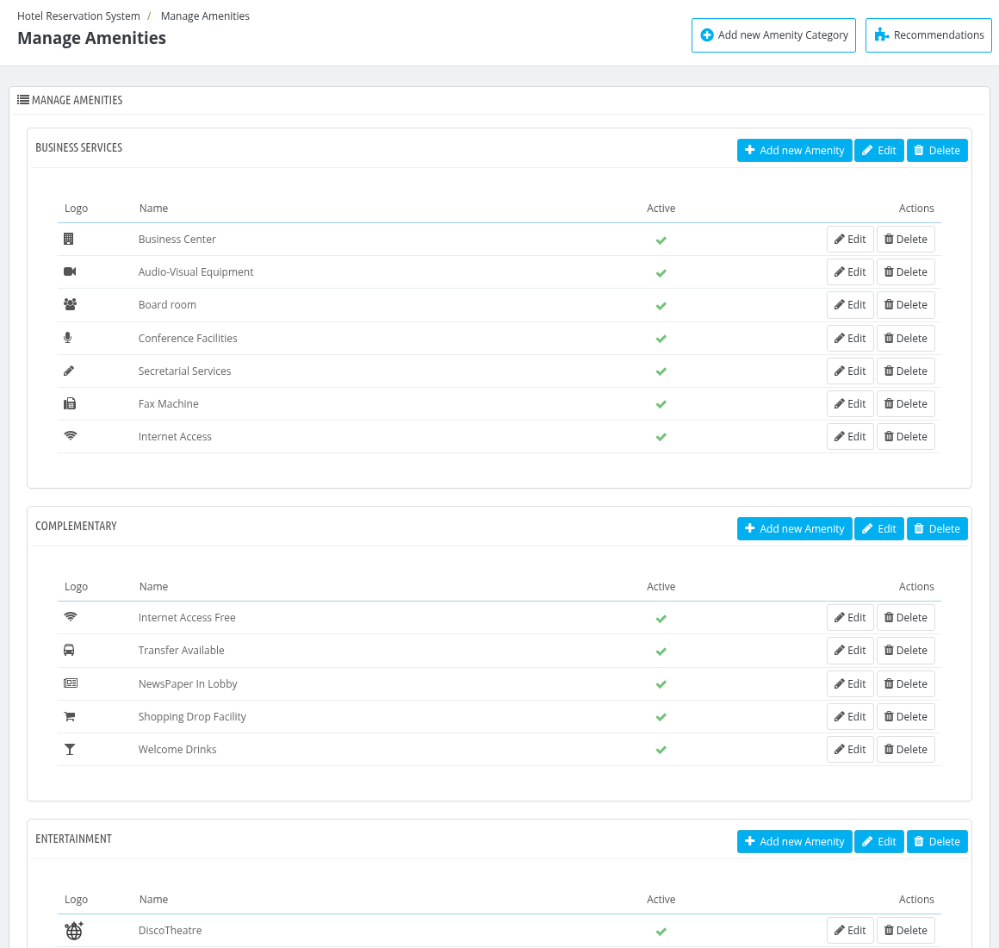
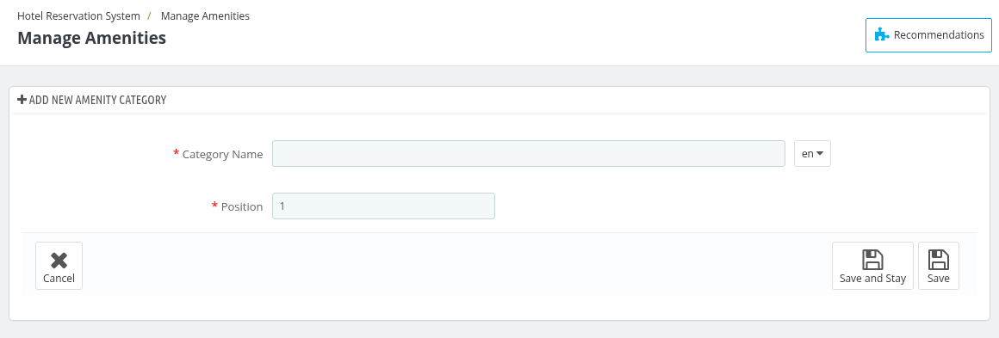
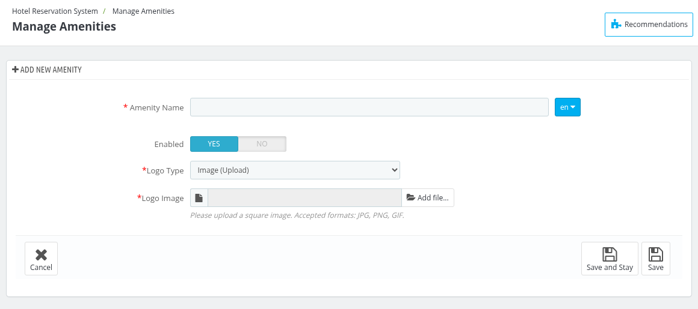
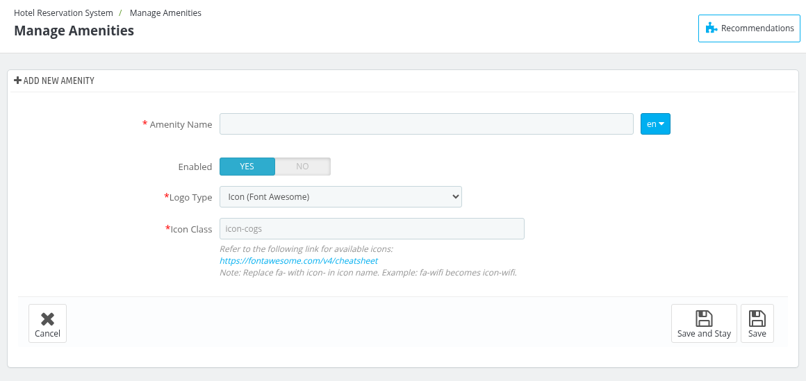

# Manage Amenities

Under the Manage Amenities tab, the admin can create amenity categories (for example "Business Services" or "Complementary") and add the amenities that belong to each category. These amenities can then be assigned to the hotels in the Amenities tab of [Manage Hotel](../manage_hotel/#amenities).

Every category is shown in its own block with the list of its amenities. The table shows the **Logo**, **Name** and **Active** status of each amenity, with the **Edit** and **Delete** buttons for it under **Actions**.

## Add a new Amenity Category

To add a new category, click on the **"Add new Amenity Category"** button at the top right of the page.

- **Category Name:** Enter the name of the category. It is required at least in the default language.
- **Position:** Define the display order of the category.

Click on **Save** to save the category.

## Add a new Amenity

To add an amenity to a category, click on the **"Add new Amenity"** button of that category block.

- **Amenity Name:** Enter the name of the amenity. It is required at least in the default language.
- **Enabled:** Enable or disable the amenity.
- **Logo Type:** Choose how the logo of the amenity is set. The available options are **Image (Upload)** and **Icon (Font Awesome)**.
- **Logo Image:** Shown when the logo type is **Image (Upload)**. Click on **Add file...** and upload a square image. The accepted formats are JPG, PNG and GIF.

If you choose **Icon (Font Awesome)** as the logo type, the **Icon Class** field is shown instead of the logo image.

- **Icon Class:** Enter the icon class, which must start with "icon-" (for example, icon-wifi). The available icons can be found on the Font Awesome cheatsheet linked on the page. Replace "fa-" with "icon-" in the icon name, for example fa-wifi becomes icon-wifi.

Click on **Save** to save the amenity.

## Edit or delete an Amenity or a Category

- Click on the **Edit** button of a category block to change its name and position, or on the **Edit** button of an amenity to change its details.
- Click on the **Delete** button of a category or an amenity to delete it. A confirmation message is shown before the deletion.
- Click on the status icon in the **Active** column to enable or disable an amenity.
