# Manage Hotel

The Manage Hotel Tab in QloApps helps you easily manage your hotel.

From Adding new hotels to managing Refund Policies, this tab ensures seamless control over your property.
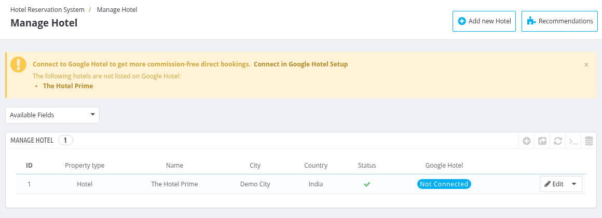

The list shows the **ID**, **Property type**, **Name**, **City**, **State**, **Country** and **Status** of every hotel, along with the **Google Hotel** status when the Google Hotel Connector module is installed.

## Add a new Hotel

To add a new hotel you need to click on **"Add new Hotel"** button.

After clicking "Add a New Hotel," the admin will see the following fields.

- Information
- Seo
- Images
- Restrictions
- Refund Policies
- Amenities
- Tourism Tax (shown only when tourism tax is enabled)
- Google Hotel (shown when the Google Hotel Connector module is installed)

Let’s go through them one by one.

### Information

In the Information panel, the admin provides the basic details of the hotel, such as its name, address, contact information, and description. These details are essential for identifying and showcasing the hotel to potential guests.

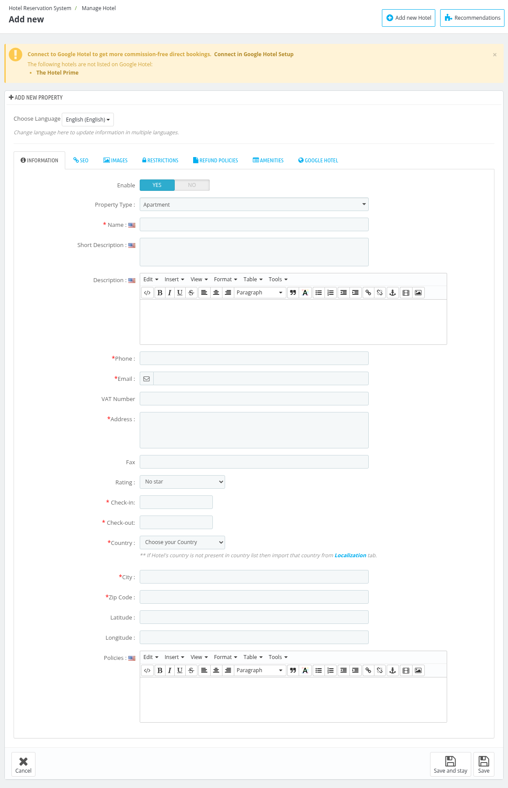

- **Enable:** To enable/disable the hotel
- **Property Type:** Select the type of your property (for example Hotel, Guest House or Resort) from the drop-down menu. These types are managed in the [Manage Property Types](../manage_property_types/) section.
- **Name:** Enter the name of the hotel.
- **Short Description:** Give a Short description of the hotel.
- **Description:** Give a detailed description of the hotel.
- **Phone:** Contact number of the hotel.
- **Email:** Enter the official Email-ID of the hotel.All booking information and related details will be sent to this email.
- **VAT Number:** Enter the VAT number of the hotel, if it has one. It is shown on the invoice when it is available in the hotel address.
- **Fax:** Enter the fax number of the hotel.
- **Address:** Enter the Address of the hotel.
- **Rating:** Select the star rating of your hotel from the drop-down menu. This field is optional, select **No star** if a rating does not apply to your hotel.
- **Check-in:** Set the check-in time in hours and minutes.
- **Check-out:** Set the check-out time in hours and minutes.
- **Country:** Choose your country from the drop-down menu.

    ***Note:** If your country is not available in the drop-down menu, then you need to import that country from the Localization(insert link) tab.*

- **City:** Enter your city name.
- **State:** Choose your state from the drop-down menu. You need to first choose the country before selecting the state.
- **Zip Code:** Enter the zip code of the hotel.
- **Latitude** and **Longitude:** Enter the coordinates of the hotel location.
- **Policies:** Provide the key policies of your hotel, such as pet policies, cancellation rules, or any other important guidelines that guests need to know

Click on **save** to save the information

### SEO
Under SEO section, Fill in the details as explained below:

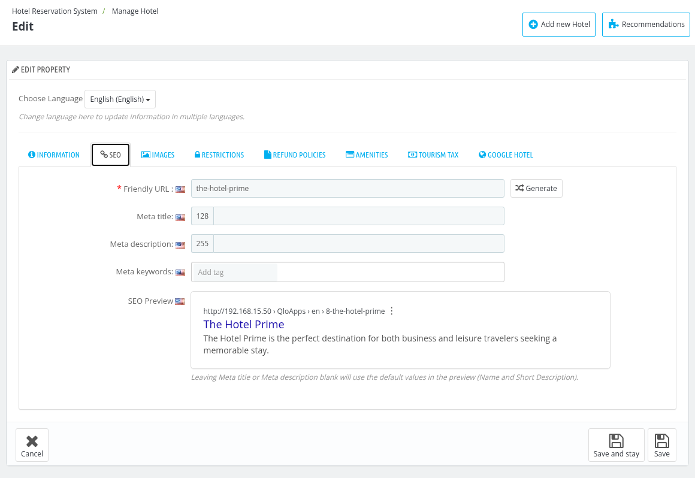

- **Friendly URL:** Click the "Generate" button to create a human-readable URL based on the hotel name. You can edit it manually if needed.
- **Meta title:** Add a meta title for the hotel which will serve as the title of the public page.
- **Meta description:** Provide a brief description of the hotel to appear in search engine results.
- **Meta keywords:** Add relevant tags or keywords related to your hotel to improve search engine visibility.
- **SEO Preview:** Shows a preview of how the page may appear in search results.

*Note: Leaving Meta title or Meta description blank will use the default values in the preview (Name and Short Description).*

### Images

In the **Images panel**, upload images of the hotel to showcase its features. You can select one image as the cover image, and the others will be arranged in the order you upload them.

*Note: The Images, Restrictions, Refund Policies and Amenities tabs can be used after the hotel information is saved.*

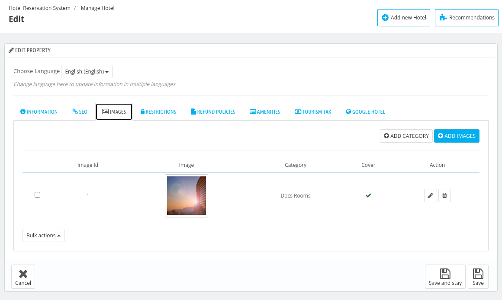

The images are listed with the **Image Id**, **Image**, **Category**, **Cover** and **Action** columns.

- Click on **ADD CATEGORY** to create a category (for example "Lobby" or "Rooms") for the hotel images. You will be redirected to the Hotel Image Category page, where the categories are listed with their **ID**, **Name** and **Created On**, and a category only needs a **Name**.

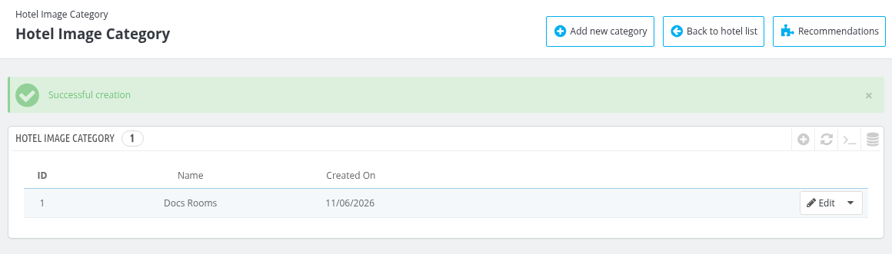

- Click on **ADD IMAGES** to upload images. Select the images (the allowed formats are .gif, .jpg, .jpeg and .png), optionally choose a **Category** (if no category is selected, the image will be uncategorized) and click on **Upload**.

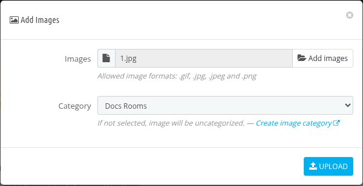

- Use the **Edit** button of an image to change its category or to make it the cover image, and the **Delete** button to delete it.
- Use **Bulk actions** to select all images, update the category of the selected images or delete the selected images.

### Restrictions

In the Restrictions panel, you can set the maximum date in advance for booking a room and define the minimum booking offset, which specifies the earliest time a booking can be made before the check-in date

- **Use Global Maximum checkout offset:** If set to **No**, you can specify your own **Maximum checkout offset**, that is, how many days from today the checkout is allowed for this hotel.
- **Use Global minimum booking offset:** If set to **No**, you can specify your own **Minimum booking offset**, that is, the number of days after which a booking can be made from current time. Set it to 0 to disable this feature.

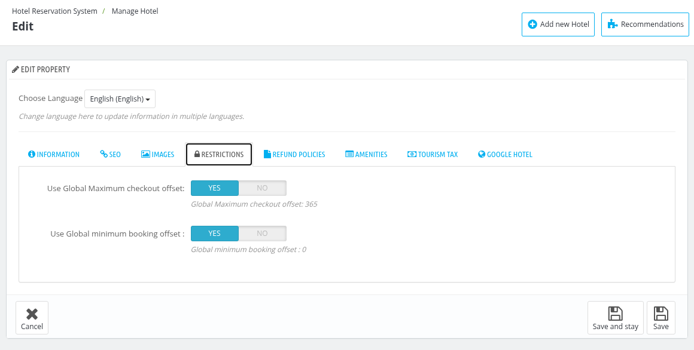

To set the global values, go to **Preferences > Orders**

- **Maximum checkout offset:** Set how many days from today the checkout is allowed.

- **Minimum booking offset:** Enter the minimum number of days before the check-in date that a guest must book a room.

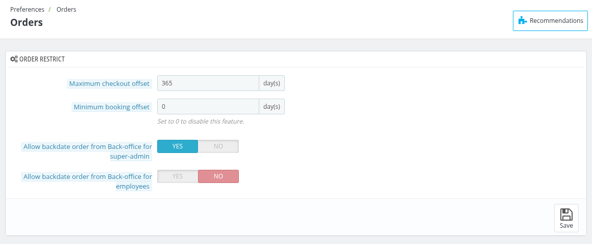

### Refund Policies

To enable refunds, select "Yes" for **Enable refund** and choose the refund rule you wish to apply for this hotel from the options below.

*Note: To enable hotel-wise refunds, order refunds must first be activated in [Manage Order Refund Rules](../manage_refund_rules/).*

These rules can be created in the [Manage Order Refund Rules](../manage_refund_rules/) section.

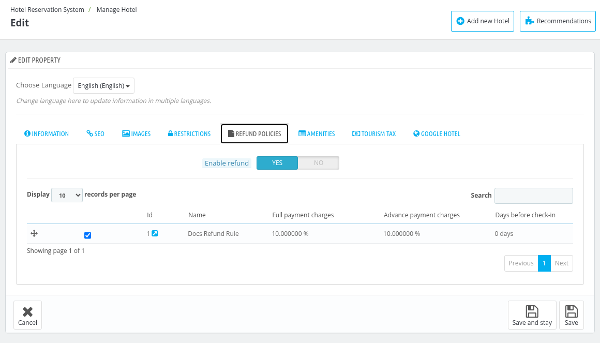

### Amenities

Under the Amenities tab, the admin assigns all the relevant amenities that the hotel offers.

These amenities can be created in the [Manage Amenities](../manage_amenities/) section, which can also be opened with the **Manage amenities** link given on this tab.

- **Select amenities:** Select the amenities of the hotel from the categories shown in the tree. You can use the **Check All**, **Uncheck All** and **Collapse All** buttons, or search for an amenity.
- **Featured amenities:** Select which of the chosen amenities should be featured for this hotel.

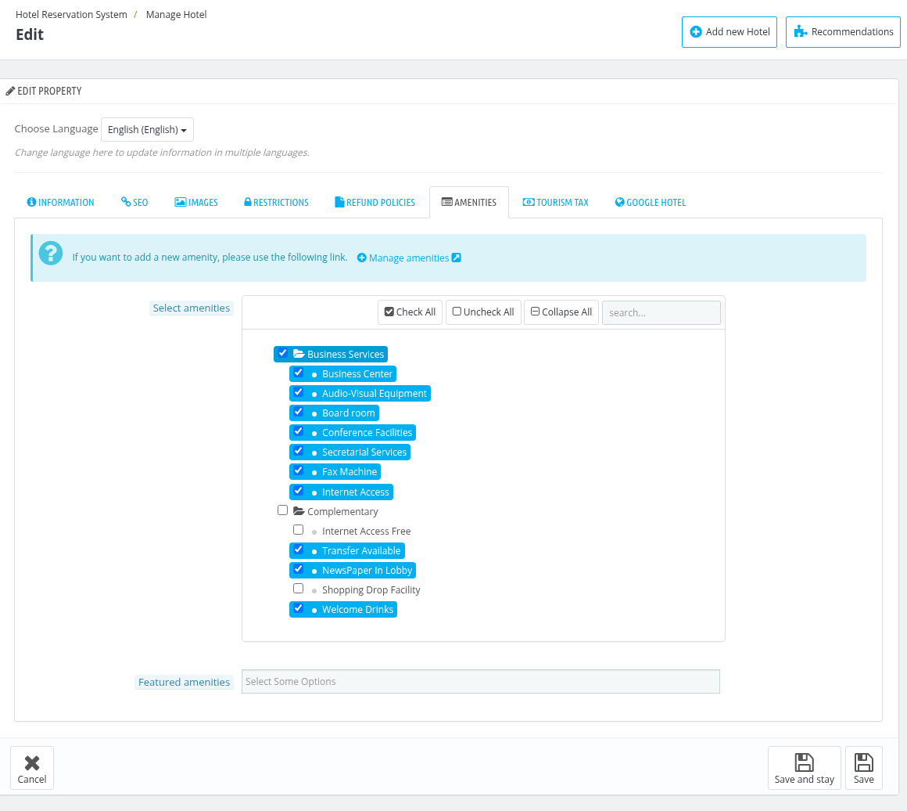

### Tourism Tax

The **Tourism Tax** tab is shown only when tourism tax is enabled.

- **Collection Type:** Select when the tourism tax is collected from the guest, **At time of booking** or **At time of arrival**.

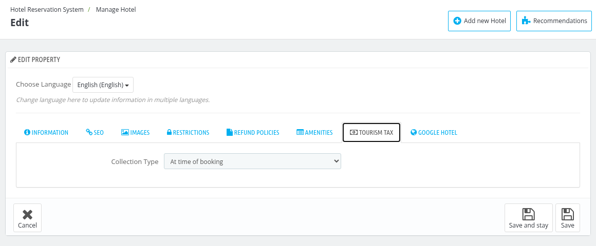

### Google Hotel

The **Google Hotel** tab is added by the Google Hotel Connector module. It shows the **Google Status** of the hotel and the **Enable on Google Hotel** option, and when it is enabled you can select the room types of the hotel. If the webservice key is not set yet, the tab asks you to configure the Google Hotel Connector first.

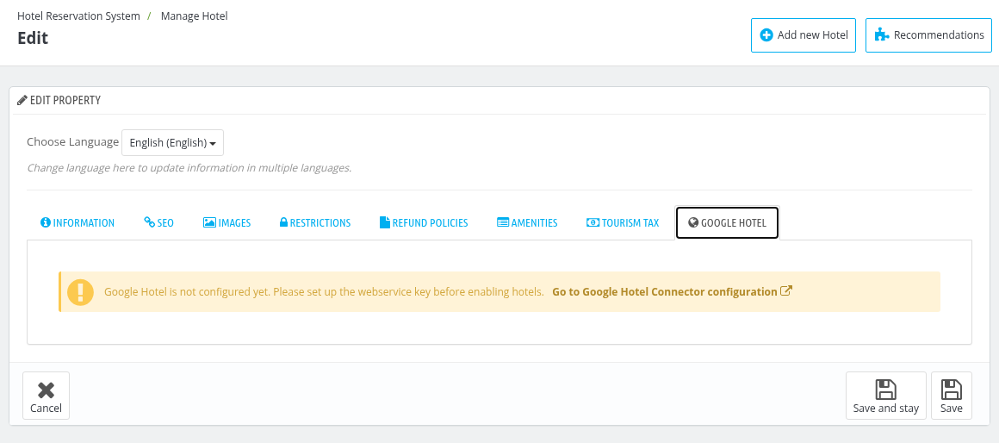

### Edit Hotel

You can edit the hotel by tapping on the edit hotel button.

Here you have to follow the steps discussed above in the [Add Hotel](#add-a-new-hotel)   section to edit the hotel.

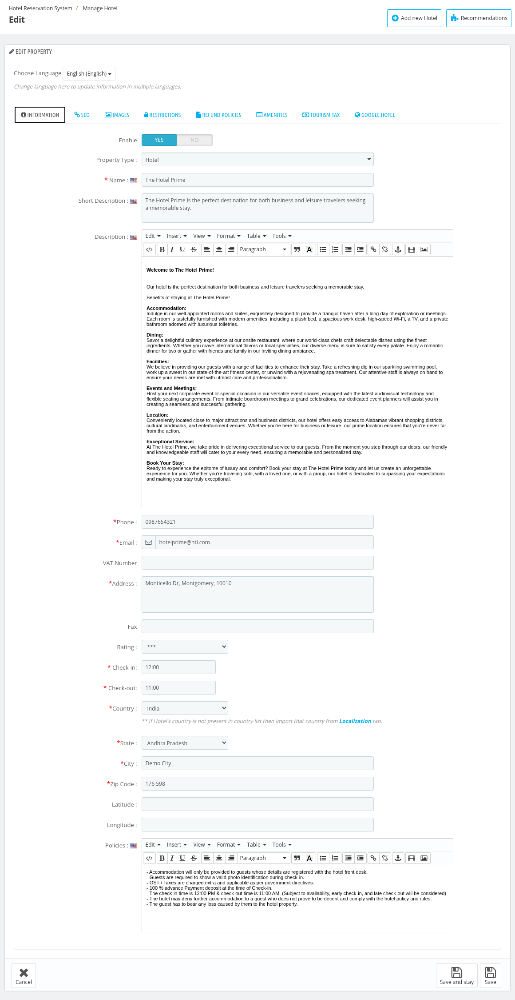

### Front end view

On the front end, this is how all these sections appear on the room type page.

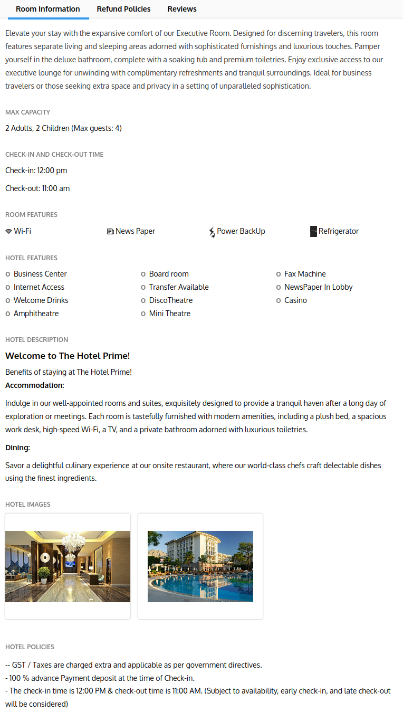

