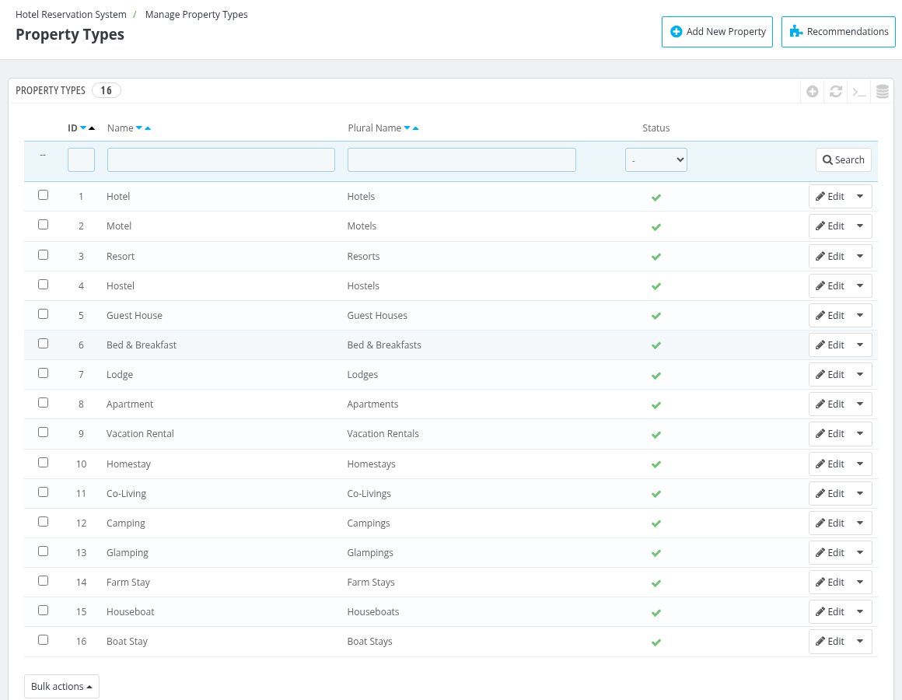
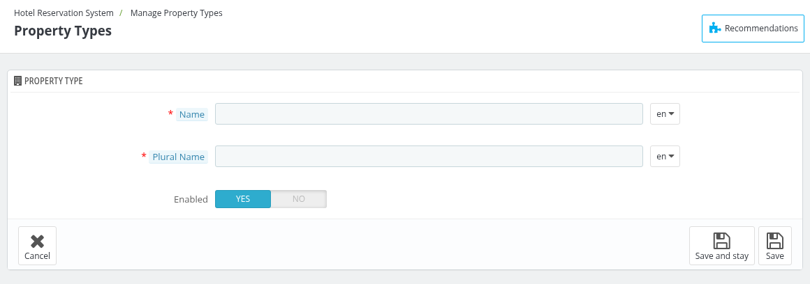

# Manage Property Types

Under the Manage Property Types tab, the admin can see the types of properties (Hotel, Motel, Resort, Hostel and so on) that can be selected while adding a property, and can create new types or edit the existing ones.

The list shows the **ID**, **Name**, **Plural Name** and **Status** of every property type. You can filter the list, edit or delete a property type with the buttons at the end of each row, and use **Bulk actions** to enable, disable or delete the selected property types.

## Add a new Property Type

To add a new property type, click on the **"Add New Property"** button at the top right of the page.

- **Name:** Enter the name of the property type, for example "Hotel". This is the displayed name for this property type.
- **Plural Name:** Enter the name used when more than one property of this type is referred to, for example "Hotels".
- **Enabled:** Enable or disable the property type.

Click on **Save** to save the property type.

*Note: The name and the plural name are required at least in the default language of your website.*

## Edit or delete a Property Type

Click on the **Edit** button of a property type to change its details, or use the drop-down next to it to delete it.

*Note: A property type that is assigned to one or more properties cannot be disabled or deleted.*

The enabled property types are available in the **Property Type** field of the Information tab when you [add or edit a hotel](../manage_hotel/).
