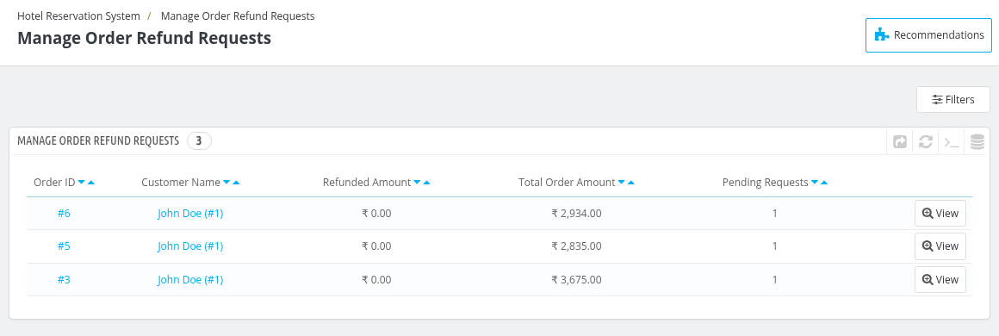
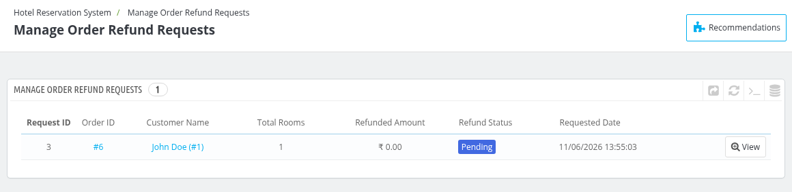
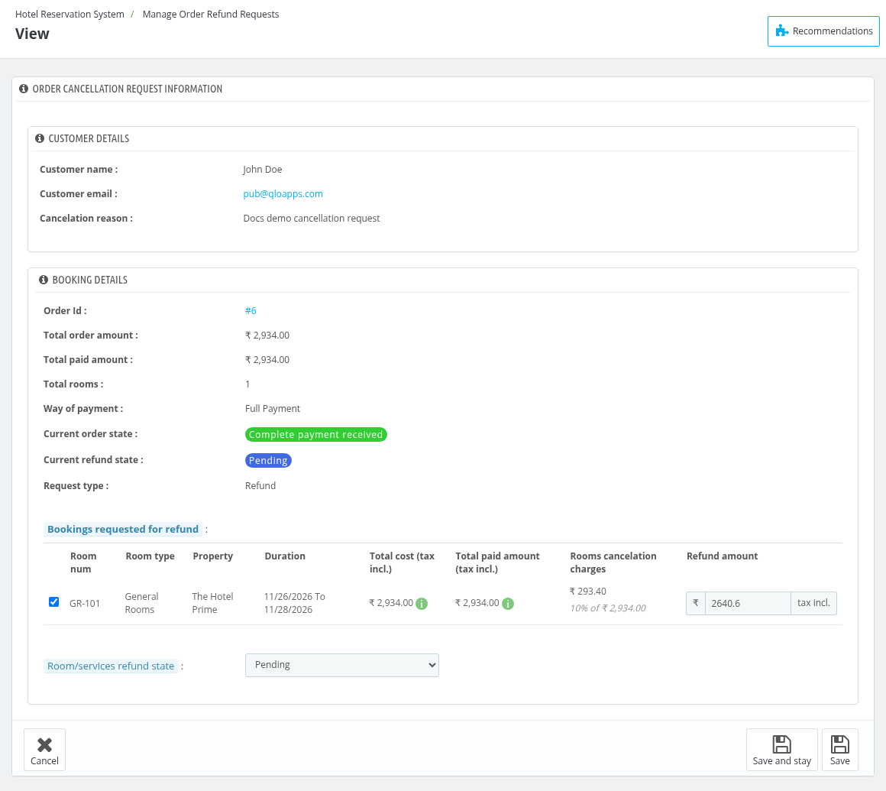
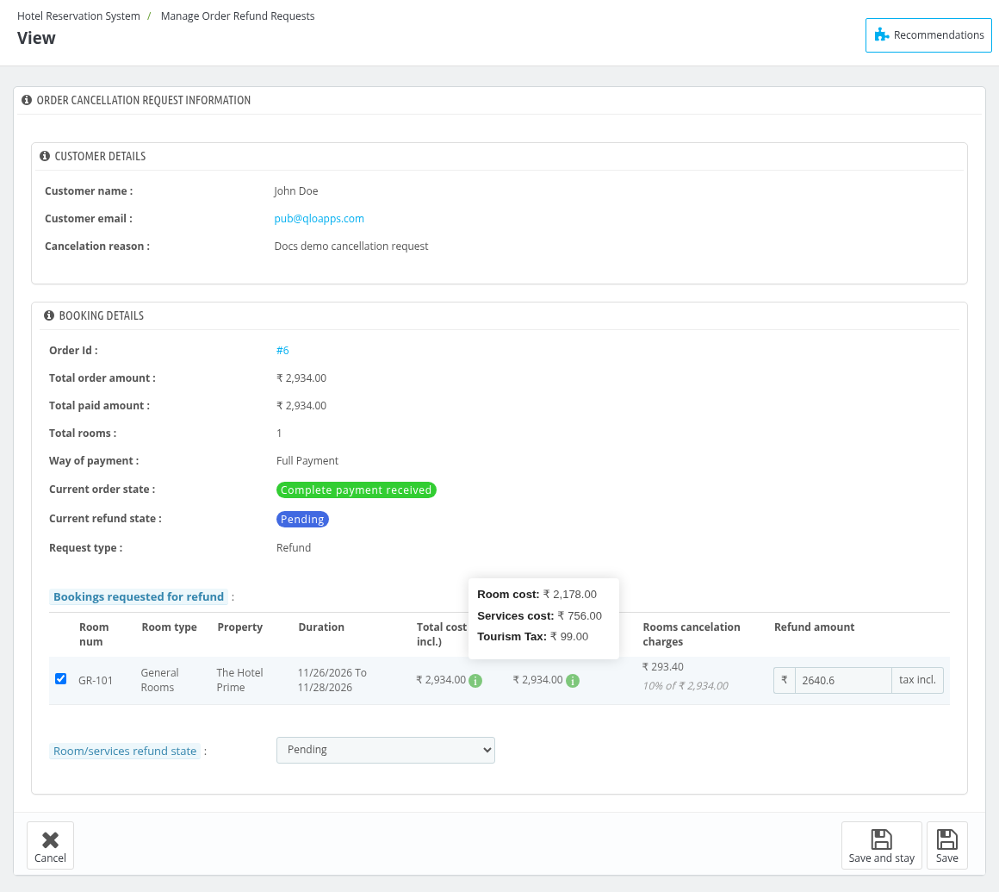
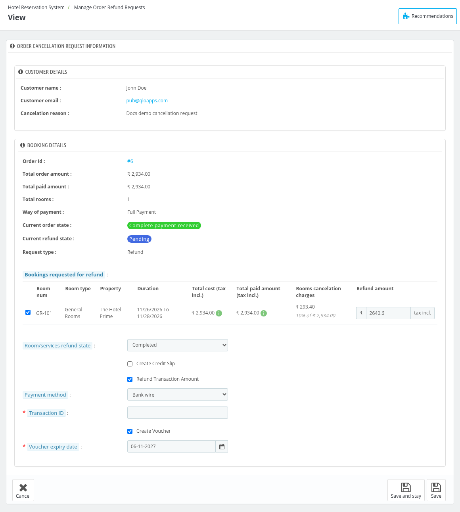

# Manage Order Refund request

 The Manage Order Refund Requests section allows the admin to review and process refund requests made by customers. Here, the admin can view the details of each refund request, including the order information, refund amount, and reason for the request.

The admin can either complete or deny the refund based on the hotel's policies and the conditions set in the refund rules.

The list shows one row for every order that has refund requests, with the **Order ID**, **Customer Name**, **Refunded Amount**, **Total Order Amount** and the number of **Pending Requests**.

## Initiate a refund

To complete or deny a refund request, navigate to the Manage Order Refund Request section. Click on View for the order whose request you want to process.

You will see the list of the requests of that order with the **Request ID**, **Order ID**, **Customer Name**, **Total Rooms**, **Refunded Amount**, **Refund Status** and **Requested Date**. Click on View for the specific refund request you want to process.

After clicking on View, you will be redirected to a page displaying the following details:

### Customer details

- **Customer name:**
- **Customer email:**
- **Cancelation reason:**

### Booking Details

- **Order Id:**
- **Total order amount:**
- **Total paid amount:**
- **Total rooms:**
- **Way of payment:**
- **Current order state:**
- **Current refund state:**
- **Request type:** Shows whether the request is a **Cancellation**, a **No-show** or a **Refund** request.

Below it, the admin will see the booking details for which the refund request has been received, with the **Room num**, **Room type**, **Property**, **Duration**, **Total cost (tax incl.)**, **Total paid amount (tax incl.)**, **Rooms cancelation charges** and the **Refund amount**. The refund amount can be changed by the admin. Hover on the info icon next to the total cost and the total paid amount to see the room cost, the services cost and the **Tourism Tax**, when tourism tax is applied.

The admin can update the **Room/services refund state** to Denied or Completed. On selecting Completed, the following options are shown:

- **Create Credit Slip:** Select it to generate a credit slip for the refund.
- **Refund Transaction Amount:** Select it to record the refund transaction. Then select the **Payment method** (or enter the **Payment mode name** if Others is selected) and enter the **Transaction ID** through which the amount has been refunded to the customer.
- **Create Voucher:** Select it to give the refunded amount to the customer as a voucher. Select the **Voucher expiry date** until which the voucher can be used.

This ensures the refund is handled efficiently and recorded successfully.

