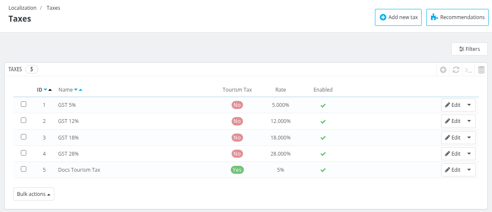
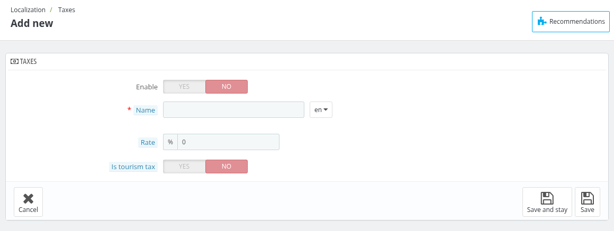
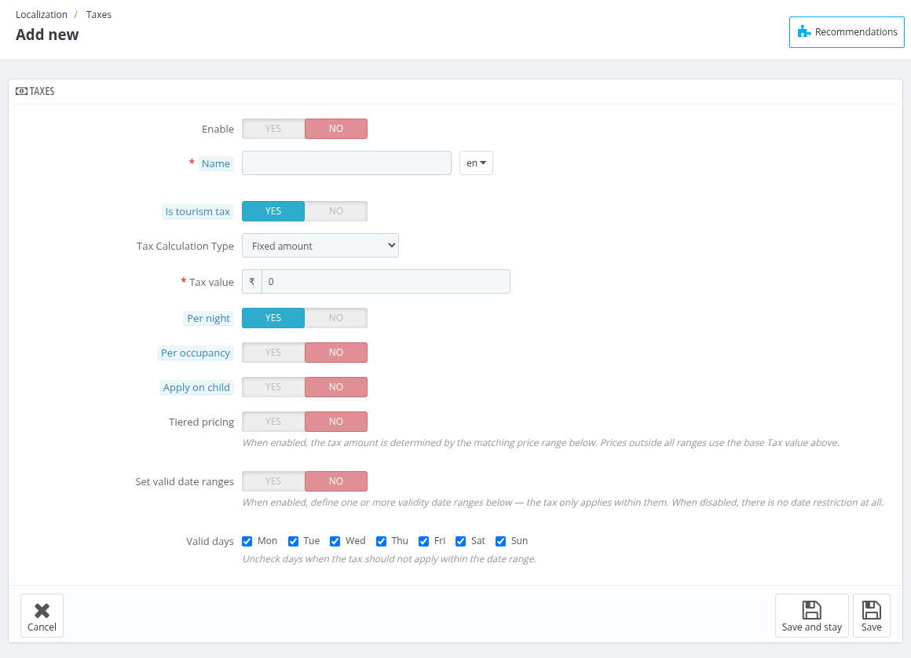
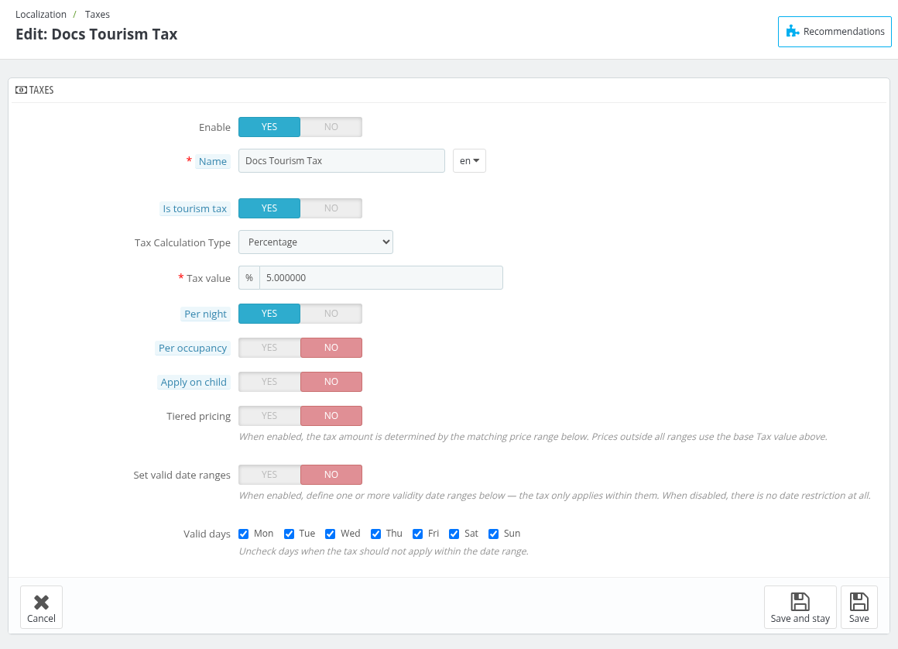
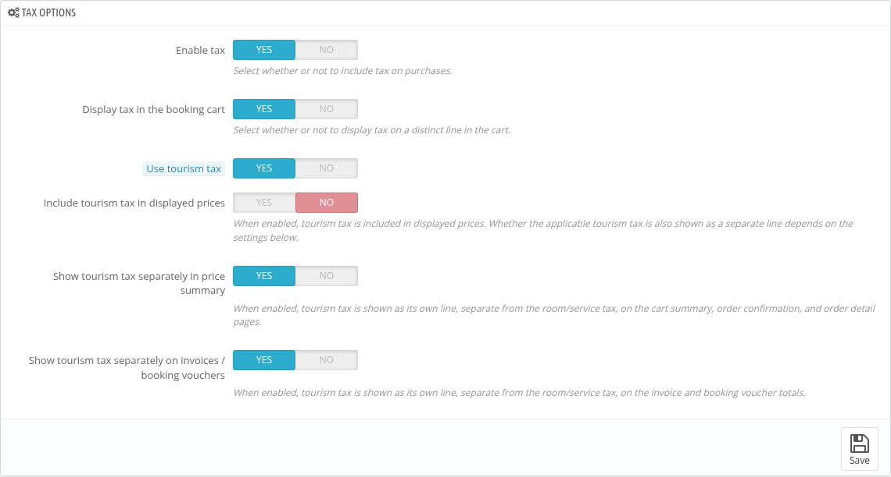

# Taxes

In the **Taxes** Section of, admin can manage and configure tax settings to comply with local regulations.

This includes adding, editing, or enabling/disabling specific taxes.

The admin can also view the **ID, Name, Tourism Tax, Rate** of the tax and toggle the enable/disable status. The **Tourism Tax** column shows whether a tax is a tourism tax.

## Add New Tax

To add a new tax, click on "add new tax" and fill in the following details.

- **Name**: Add the name of the tax.This name will be displayed in the cart and on invoices.

- **Is tourism tax**: Select "Yes" if this tax is a tourism tax. When enabled, this tax will be used for tourism tax purposes only. For a normal tax, keep it "No".

- **Rate**: Enter the exact rate in the format (xx.xx, xx.xxx). (e.g-19.60, 19.625). This field is shown only when **Is tourism tax** is "No".

- **Enable**: You can enable or disable the tax at any time using this option.

### Tourism tax settings

When **Is tourism tax** is set to "Yes", the following options appear instead of **Rate**:

- **Tax Calculation Type**: Choose **Fixed amount** or **Percentage**.

- **Tax value**: Enter the value of the tax, as per the selected calculation type.

- **Per night**: When enabled, the tax amount applies for each night of the booking instead of once per booking.

- **Per occupancy**: When enabled, the tax amount multiplies by the number of adult occupants.

- **Apply on child**: When enabled, children pay the adult rate by default.

- **Set child age range**: When enabled, you can define child age bands, each with its own tax value.

    - **Child Tax Calculation Type**: Choose **Fixed** (each age range charges its own flat amount) or **Percentage** (each age range charges a percentage of the adult's own calculated tax).

    - **Child age ranges**: Click "Add Range" and enter the **Min age**, **Max age** and tax value of each range. Leave the maximum age blank for no limit ("No cap"). Children outside all ranges are charged the adult's calculated tax.

- **Tiered pricing**: When enabled, the tax amount is determined by the matching price range. Prices outside all ranges use the base **Tax value**.

    - **Price ranges**: Click "Add Range" and enter the **Min price (from)**, **Max price (up to)** and **Tax value** of each range. Leave the maximum price blank ("No cap") for no limit; the maximum price itself is not included in the range.

- **Set valid date ranges**: When enabled, define one or more date ranges (**From** and **To**) in which the tax applies. When disabled, there is no date restriction. Ranges cannot overlap.

- **Valid days**: Select the days of the week (Mon to Sun) on which the tax applies.

*Note: The tourism tax is assigned to hotels from the Tourism Tax tab of the hotel, and to room types through the Tourism Tax Rule of the room type. Tourism taxes are grouped in a [Tax Rule](../tax_rules/) group marked as a tourism tax rule group.*

## Edit a tax

To edit a tax, click the Edit option and provide all the details just as you did when adding it.

## Tax options

At the bottom of the page is the **Tax options** section.

With this section, the admin can configure the general settings of tax using the following options:

- **Enable tax**: Enable this option if you want to include taxes in each booking made by the guests.

- **Display tax in the booking cart**:Enable this option if you want to display the tax on a distinct line in the cart.

- **Use tourism tax**: Enable this option to enable tourism tax calculation for hotel room bookings. This option is available only when **Enable tax** is enabled.

- **Include tourism tax in displayed prices**: When enabled, tourism tax is included in displayed prices. Whether the applicable tourism tax is also shown as a separate line depends on the next two options. This option, and the next two, are shown only when **Enable tax** and **Use tourism tax** are both enabled.

- **Show tourism tax separately in price summary**: When enabled, tourism tax is shown as its own line, separate from the room/service tax, on the cart summary, order confirmation, and order detail pages.

- **Show tourism tax separately on invoices / booking vouchers**: When enabled, tourism tax is shown as its own line, separate from the room/service tax, on the invoice and booking voucher totals.

