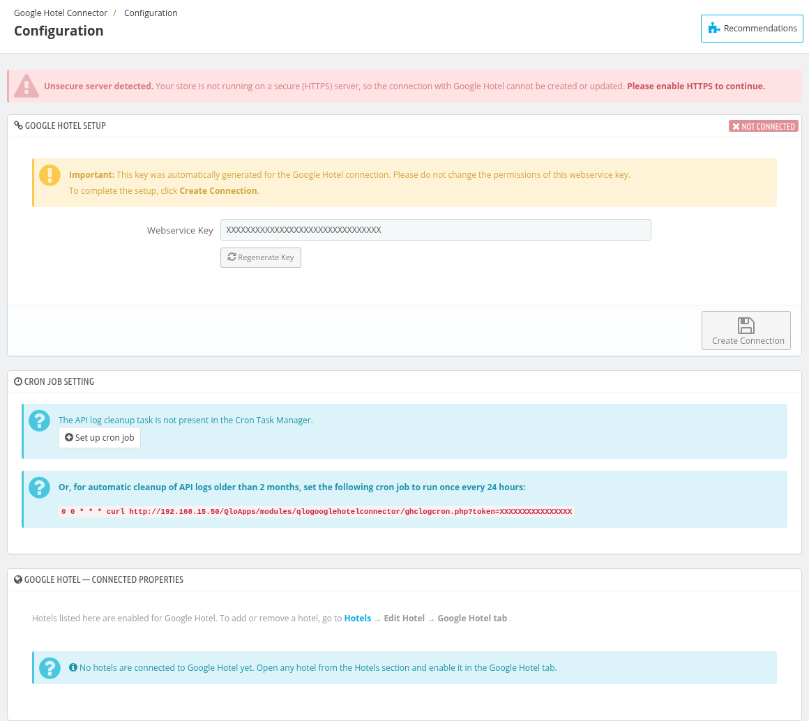
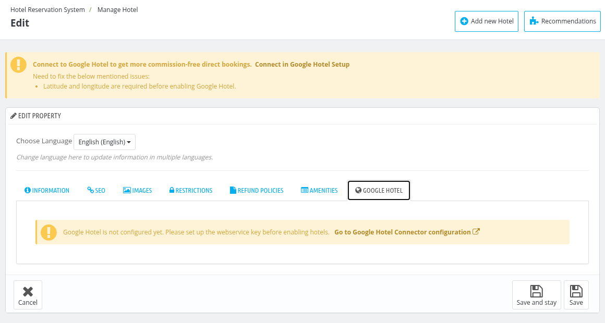
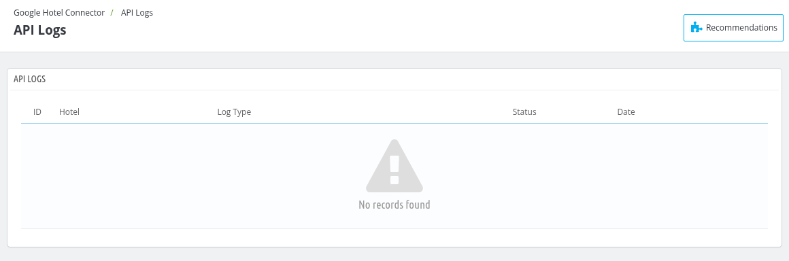

# Google Hotel Connector

The **QloApps Google Hotel Connector** module connects your QloApps with Google Hotel, so that your hotels can be listed on Google and get more commission-free direct bookings. The module is installed by default and adds a **Google Hotel Connector** menu in the back office with the **Configuration** and **API Logs** pages. It also adds a **Google Hotel** tab to the hotel edit form.

## Configuration

Go to **Google Hotel Connector > Configuration**.

*Note: The connection with Google Hotel can be created or updated only on a secure (HTTPS) server. If your store is not running on HTTPS, the message "Unsecure server detected. Your store is not running on a secure (HTTPS) server, so the connection with Google Hotel cannot be created or updated." is shown, with a link to enable HTTPS, and the **Create Connection** (or **Update Connection**) and **Regenerate Key** buttons are disabled.*

### Google Hotel Setup

This section shows whether your store is **Connected** or **Not Connected** with Google Hotel.

- **Webservice Key** : The webservice key that is generated automatically for the Google Hotel connection. Please do not change the permissions of this webservice key.
- **Regenerate Key** : Click it to generate a new webservice key. A confirmation is asked first because the current webservice key becomes invalid immediately.
- **Create Connection** : Click it to create the connection with Google Hotel. After the connection is created, this button is changed to **Update Connection**.
- **Delete Connection** : Click it to delete the connection with Google Hotel. A confirmation is asked first. It is shown only when the store is connected.

### Cron job setting

The module deletes the API logs older than 2 months automatically. If the [Cron Task Manager](/1.8.0/advance_parameter/cron_task_manager/) module is enabled, click **Set up cron job** to add this task to it, or set the shown cron job on your server manually to run once every 24 hours. If the task is already present in the Cron Task Manager, its current schedule is shown here.

*Note: If you have set up a cron job for the API log cleanup manually on your server, it is recommended to remove it and use the Cron Task Manager from now on.*

### Google Hotel - Connected Properties

This section lists the hotels that are enabled for Google Hotel with their **Google Status** and **Last Updated** date. The **Google Status** is **Verified**, **Pending** or **Failed**. Click on the hotel name to open its edit page. Hotels are added or removed here from the **Google Hotel** tab of the hotel, as described below.

## Enable a hotel for Google Hotel

Go to **Hotel Reservation System > Manage Hotel**, edit the hotel and open the **Google Hotel** tab.

If the connection is not created yet, the tab shows the message "Google Hotel is not configured yet. Please set up the webservice key before enabling hotels." with a link to the configuration page. Once the connection is created, the tab shows:

- **Google Status** : Shows **Connected**, **Pending** or **Not Connected** for the hotel.
- **Enable on Google Hotel** : Select **Yes** to list the hotel on Google Hotel. If some required details of the hotel are missing, they are listed in the tab and this option stays disabled until you fill them in.
- **Room Types** : Select the room types of the hotel that you want to list on Google Hotel. It is shown when **Enable on Google Hotel** is set to **Yes**. For a new hotel, save the hotel first and then edit it to select the room types.

*Note: Google reviews newly activated properties on a weekly basis. After you enable a hotel, it may take up to 1 week for the property to be processed and become available on Google. Once it is approved, the status is updated automatically.*

## API Logs

Go to **Google Hotel Connector > API Logs** to see the requests exchanged with Google. The list shows the **ID**, **Hotel**, **Log Type**, **Status** (Success or Error) and **Date** of each log. Each log can also be opened with the **View** action. The log types are Full Availability & Rates Update, Availability & Rates Change Update, Google Status, Connection, Delete Connection and Properties Details.

