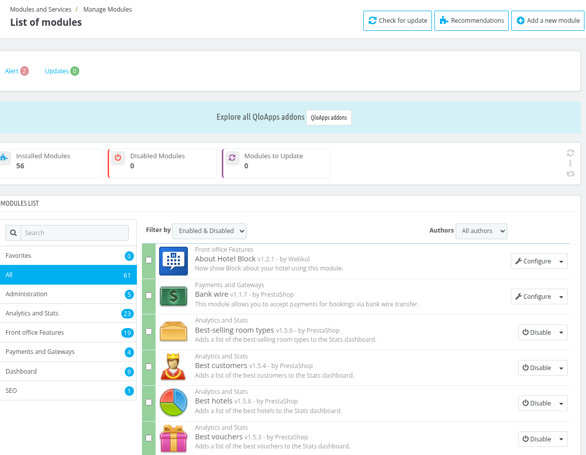
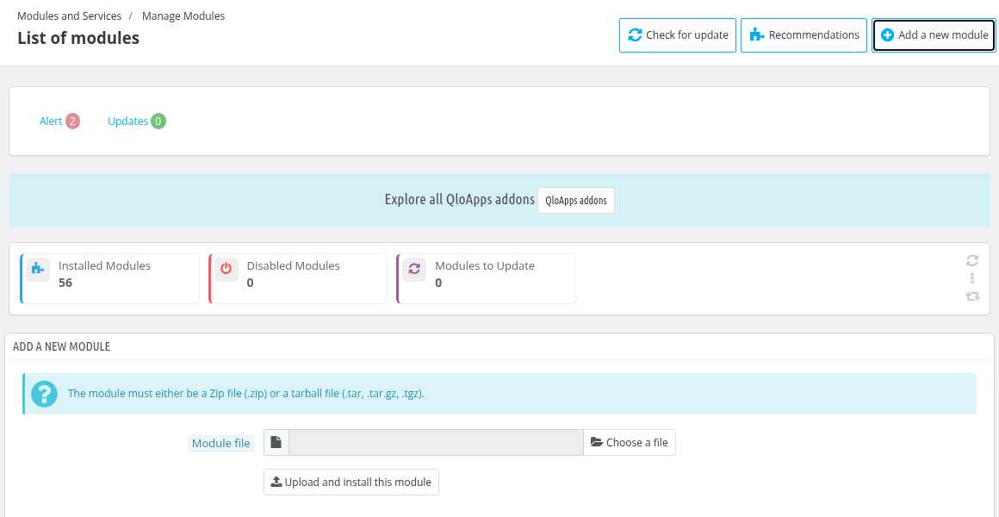
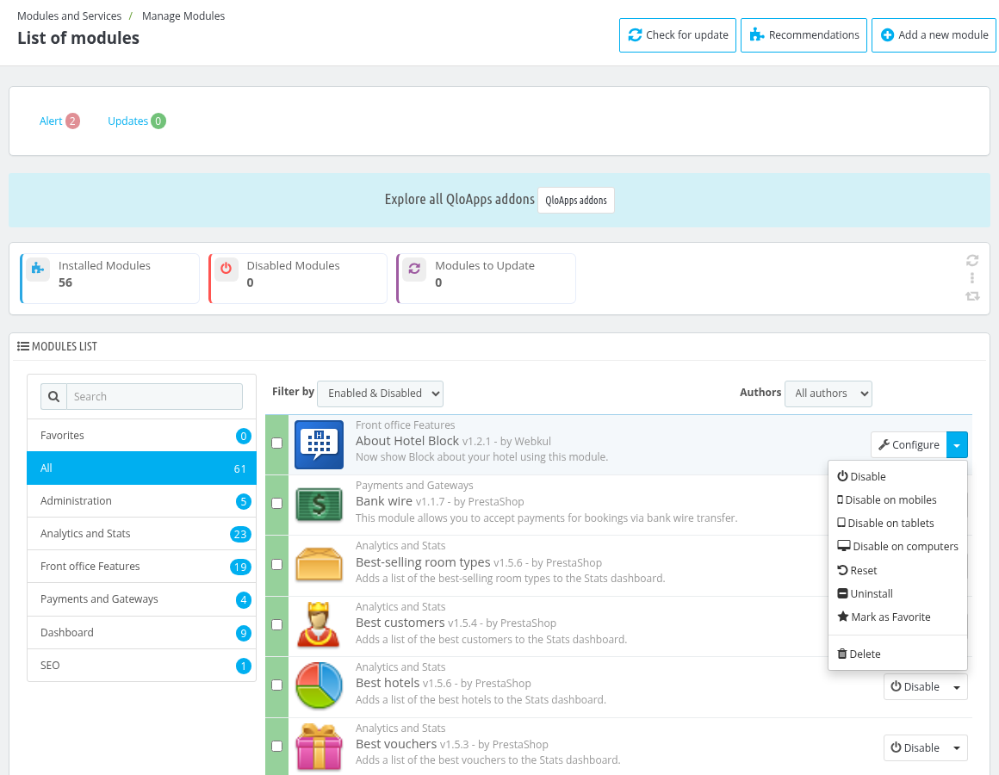
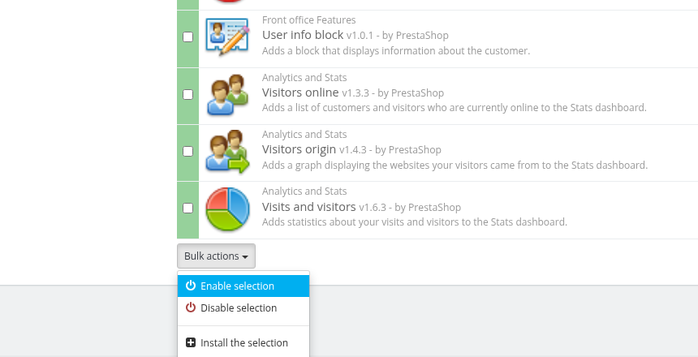

# Manage Modules

The **Manage Modules** section in QloApps provides a simple and efficient way to oversee all installed, disabled and to update-ready modules. It allows the admin to:

- Install, uninstall, enable, or disable modules.
- Enable, disable, install or uninstall several modules at once with the bulk actions.
- Configure module settings to match your needs.
- Update modules for improved performance and security  alerts to notify if there's any issue.
- Quickly search and filter modules by enabled or disabled modules and by authors.

To open it, go to **Modules and Services > Manage Modules**.

## Add a new module

To add a new module click on **add new module** then the admin has to choose the zip file of the module and click on **upload and install this module.**

## Module List

The **Modules List** section in QloApps provides a comprehensive overview of all available modules that can be installed or managed within the platform.

Modules are organized into categories such as:
- Favorites
- All
- Administration
- Analytics and Stats
- Front office Features
- Payments and Gateways
- Dashboard
- SEO

Admin can also Quickly search modules by name using the **Search** box above the categories, and filter them with the following options:

- **Filter by** : Choose **Enabled & Disabled** to see all the modules, **Enabled Modules** to see only the enabled modules or **Disabled Modules** to see only the disabled modules.
- **Authors** : Choose **All authors** or a single author of the module (eg: prestashop and webkul) to easily locate specific modules.

*Note: The modules that are bundled with QloApps but not installed yet (for example the Sitemap Generator, PayPal Checkout and Duitku payment modules) are also listed here with an **Install** button.*

Admin can Easily enable, disable, configure, or update each module with a simple click.

When the admin clicks on the drop-down button next Configuration, he will see the following options:

- Disable
- Disable on mobiles
- Disable on tablets
- Disable on computers
- Reset
- Uninstall
- Mark as favorite
- Delete

## Bulk actions

To work on many modules at once, the admin marks the checkbox at the beginning of each module and then clicks on the **Bulk actions** button shown below the list. The following options are available:

- **Enable selection** : Enables all the selected modules.
- **Disable selection** : Disables all the selected modules.
- **Install the selection** : Installs all the selected modules.
- **Uninstall the selection** : Uninstalls all the selected modules.

