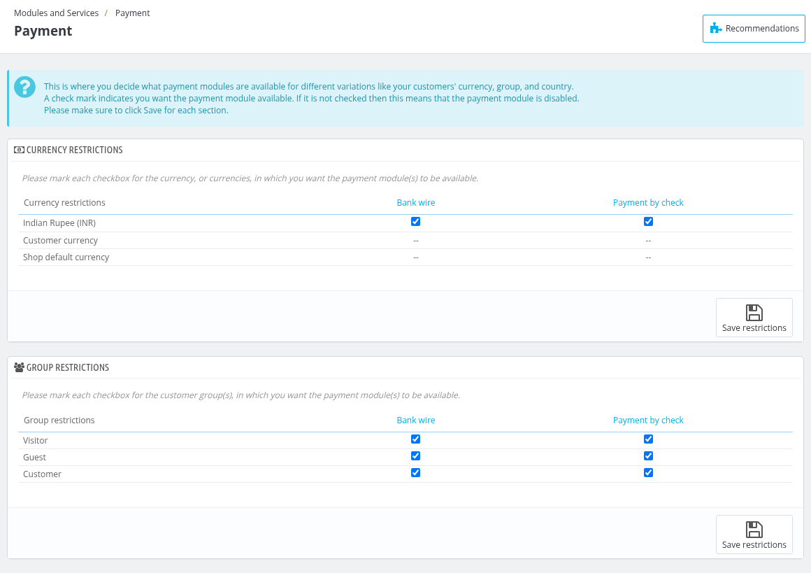
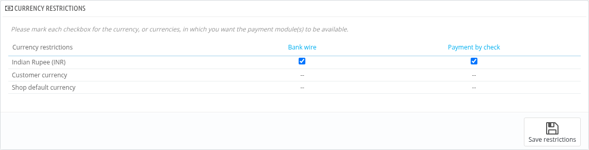
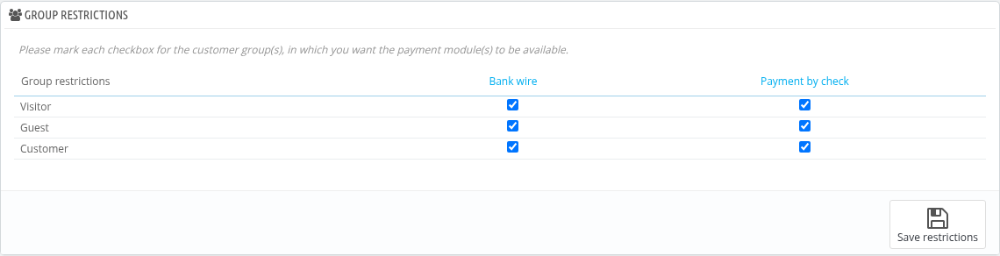
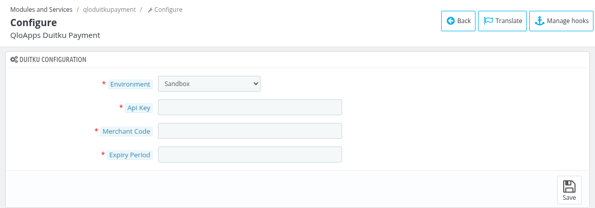
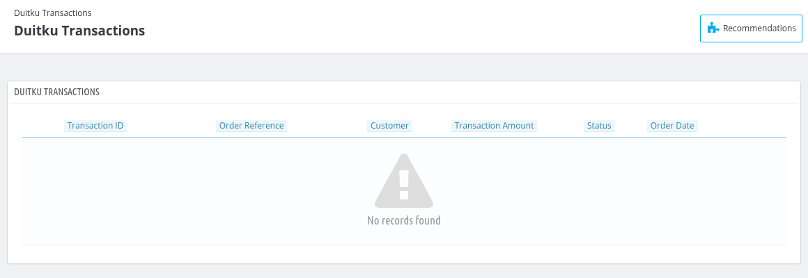

# Payments

The **Payments section** in QloApps is a place where the admin decides what payment modules are available for different variations like **currency and Group.**

A check mark indicates you want the payment module available. If it is not checked then this means that the payment module is disabled.

To open it, go to **Modules and Services > Payment**.

*Note: Only the installed payment modules are shown here. **Bank wire** and **Payment by check** are installed by default. The **PayPal Checkout** and **Duitku** payment modules are also bundled with QloApps; install them from **Modules and Services > Manage Modules** to use them (see [Duitku payment](#duitku-payment) below).*

## Currency Restriction

With this section admin can decide which modes of payment are available for customers based on their currencies.

the admin simply needs to mark the checkbox for each currency (or currencies) in which they want the payment module(s) to be available.

## Group Restriction

With this section admin can decide which modes of payment are available for customers based on the Groups they belong to.

the admin simply needs to mark the checkbox for each group (or groups) in which they want the payment module(s) to be available.

## Duitku payment

The **QloApps Duitku Payment** module allows the guests to pay for their bookings with the Duitku payment gateway. It is bundled with QloApps but is not installed by default, so first install it from **Modules and Services > Manage Modules**.

*Note: The Duitku payment option is available to the customer only when the booking currency is Indonesian Rupiah (IDR), so make sure that currency is available for this module in the **Currency Restriction** section above.*

Then click **Configure** of the module and fill in the **Duitku Configuration** form:

- **Environment** : Select **Sandbox** to test the configuration or **Production** to accept payments live.
- **Api Key** : Enter the API key obtained from Duitku.
- **Merchant Code** : Enter the merchant code obtained from Duitku.
- **Expiry Period** : Enter the time, in minutes, for which the payment remains valid. The value must be between 10 and 180.
- **Save** : Click it to save the configuration.

Once the module is installed, a **Duitku Transactions** menu is added to the back office. It lists the payments done through Duitku with the **Transaction ID**, **Order Reference**, **Customer**, **Transaction Amount**, **Status** and **Order Date**.

