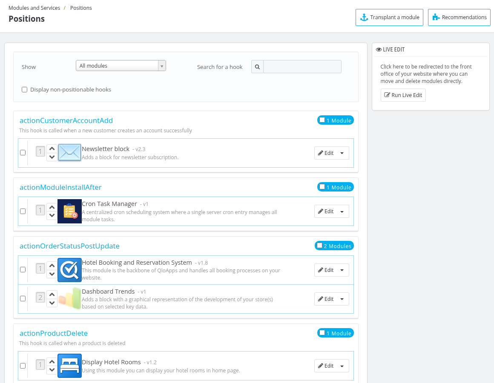
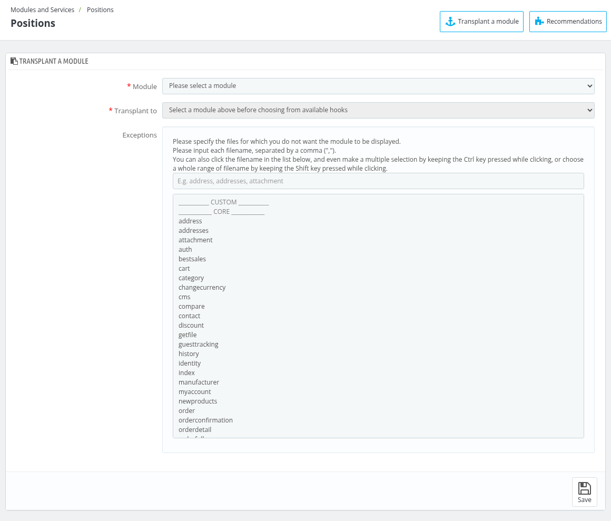
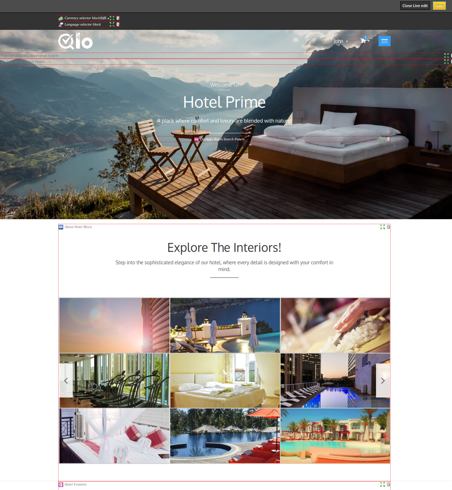

# Positions

The **Position Section** in QloApps allows admins to manage and customize the placement of modules across different parts of their hotel booking platform.

This feature provides complete control over the layout and user interface.

To open it, go to **Modules and Services > Positions**.

Admin can also filter hooks using the **Show** dropdown menu, search for a specific hook by typing its name in **Search for a hook**, and also view non-positionable hooks for better clarity and control.

## Transplant a module

**Transplant a module** refers to the process of moving a module from one position or hook to another within the system.

To transplant a module click on transplant a module then select from  the  following options:

- **Module:** Select the modules that you want to  be positioned or transplanted to specific locations (hooks) on the platform.
- **Transplant to:** select a specific hook where you want the module to be displayed.
- **Exceptions:** specify the files for which you do not want the module to be displayed. Type each filename separated by a comma or select the filenames from the list.

## Run live edit

The **Run Live Edit** button is shown in the **Live Edit** box on the right side of the page. With the help of **Run Live Edit** feature in QloApps admin can easily manage the placement and visibility of website modules.

With its intuitive drag-and-drop interface, admin can:

- **Reposition Modules:** Move modules to desired locations directly on the front office.
- **Real-Time Preview:** See changes as you make them without backend configurations.

