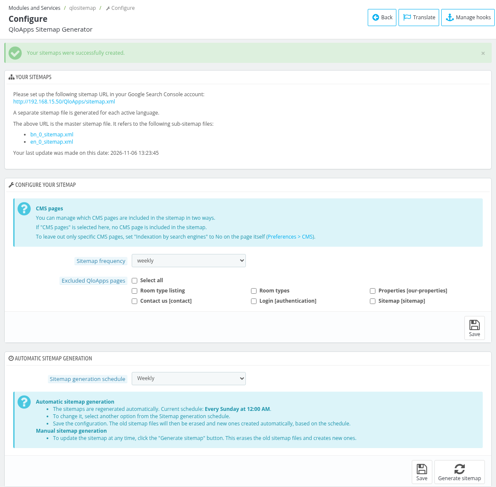

# QloApps Sitemap Generator

The **QloApps Sitemap Generator** module creates the XML sitemaps of your hotel website, so that the search engines (like Google) can find and index the pages of your website easily. The sitemaps can be generated manually or kept up to date automatically.

The module is bundled with QloApps but is not installed by default. To install it, go to **Modules and Services > Manage Modules**, find **QloApps Sitemap Generator** and click **Install**. Then click **Configure**.

## Your sitemaps

This section shows the sitemap files created by the module. Until you generate the sitemap, it shows the message "No sitemap has been generated yet."

After the sitemap is generated, it shows:

- The main (master) sitemap URL, which you have to set up in your Google Search Console account.
- The list of the sub-sitemap files that the main sitemap refers to.
- The date of your last update.

*Note: A separate sitemap file is generated for each active language of your website.*

## Configure your sitemap

- **Sitemap frequency** : Select how often you update your property website (always, hourly, daily, weekly, monthly, yearly or never). It is added to the sitemap files as the change frequency of the pages.
- **Excluded QloApps pages** : Mark the pages that you do not want to include in the sitemap files. Mark **Select all** to select all the pages in the list at once. The list contains Room type listing, Room types, Properties, Contact us, Login and Sitemap pages. **Standalone products** and **CMS pages** are also listed when they exist on your website.
- **Excluded module pages** : Mark the pages of the modules that you do not want to include in the sitemap files. This field is shown only when there are module pages available.
- **Save** : Click it to save the settings. Generate the sitemap again to apply them.

*Note: If you mark **CMS pages** in **Excluded QloApps pages**, no CMS page is included in the sitemap. To leave out only specific CMS pages, set "Indexation by search engines" to No on the page itself in **Preferences > CMS**.*

## Sitemap generation schedule

The **Automatic sitemap generation** section regenerates the sitemaps automatically using the [Cron Task Manager](/1.8.0/advance_parameter/cron_task_manager/). If the Cron Task Manager module is not installed or is disabled, a warning is shown with a link to install or enable it.

- **Sitemap generation schedule** : Select **Weekly**, **Monthly**, **Yearly** or **Never** to decide how often the sitemaps are regenerated. If the schedule was changed in the Cron Task Manager to some other value, it is shown as **Custom** followed by the schedule.
- **Save** : Click it to save the schedule. The old sitemap files are erased and new ones are created automatically as per the schedule.
- **Generate sitemap** : Click it to update the sitemap at any time. This erases the old sitemap files and creates new ones, and the message "Your sitemaps were successfully created." is shown.
