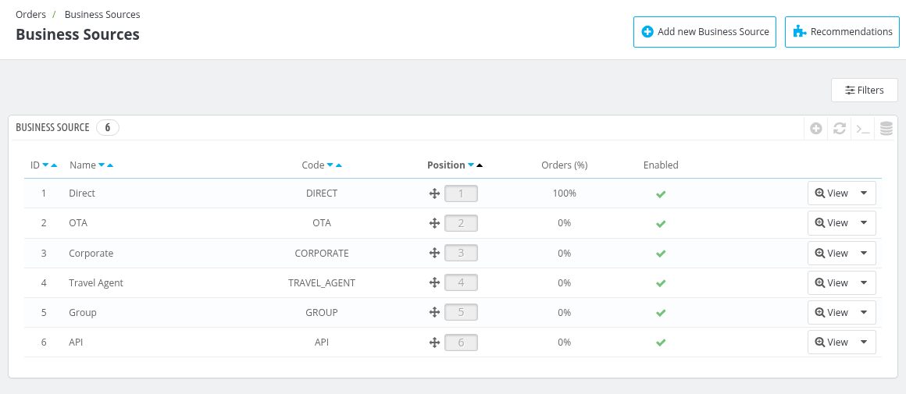
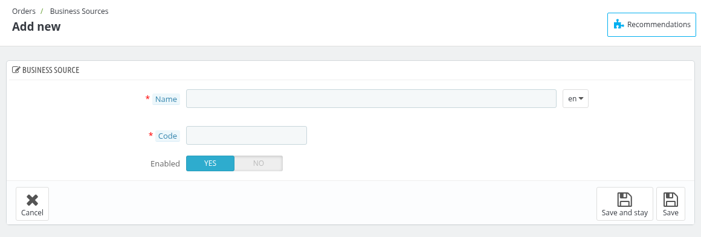
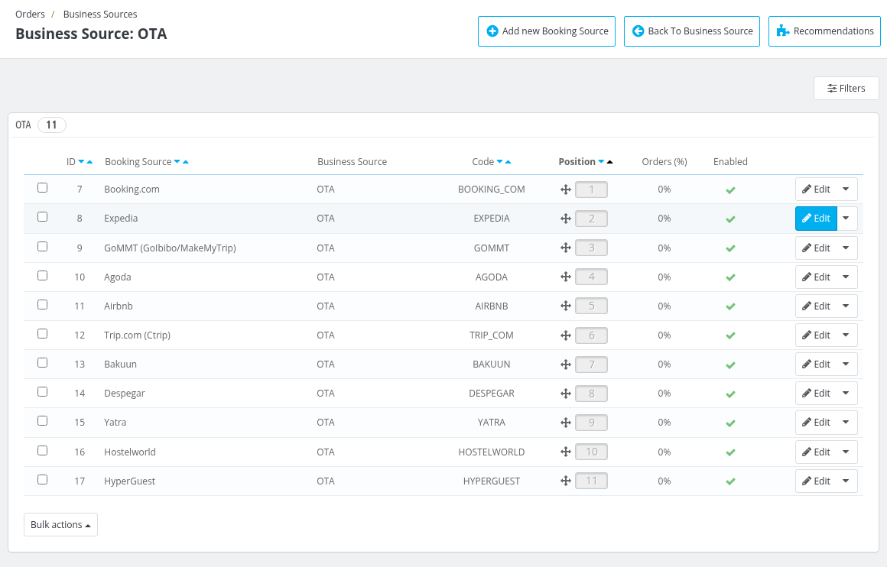
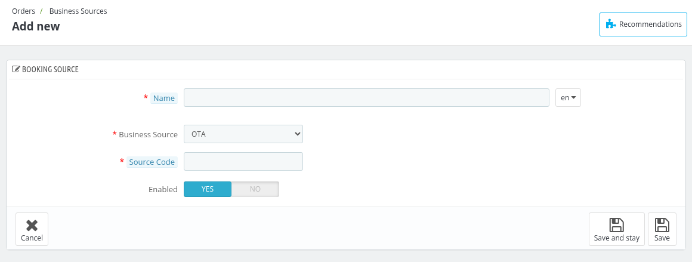
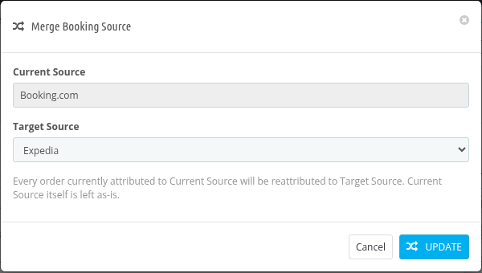

# Business Sources

Business Sources are used to know from where your bookings are coming. Each Business Source (for example Direct or OTA) contains Booking Sources (for example Walk-in or Booking.com), and the Booking Source is selected on each order.

## Business Sources

This page displays the list of all the Business Sources with the following details:

- **ID** : ID of the Business Source.
- **Name** : Name of the Business Source.
- **Code** : Code of the Business Source.
- **Position** : Position of the Business Source. Drag and drop the rows to change the position.
- **Orders (%)** : Percentage of the orders that came from this Business Source.
- **Enabled** : Click on the icon to enable or disable the Business Source.

*Note: The Business Sources that are provided by default (Direct, OTA, Corporate, Travel Agent, Group and API) cannot be deleted. A Business Source that has default Booking Sources under it cannot be disabled.*

### Add new Business Source

To add a new Business Source click on **Add new Business Source**.

- **Name** : Enter the name of the Business Source.
- **Code** : Enter a short unique code, e.g. "OTA". Only letters, numbers, underscores and hyphens are allowed. The code cannot be changed after creation.
- **Enabled** : Select Enabled to use this Business Source, else select Disabled.

Click on **Save** to save the Business Source.

## Booking Sources

Click on **View** of a Business Source to see the Booking Sources under it.

The list displays the **ID**, **Booking Source**, **Business Source**, **Code**, **Position**, **Orders (%)** and **Enabled** of each Booking Source. Click on **Filters** to filter the list. Use the buttons of a row to edit, merge or delete the Booking Source. You can also select multiple Booking Sources and delete them with **Bulk actions**.

*Note: The Booking Sources that are provided by default (for example Walk-in and Direct Website) cannot be deleted or disabled. A Booking Source cannot be enabled while its Business Source is disabled.*

### Add new Booking Source

To add a new Booking Source click on **Add new Booking Source**.

- **Booking Source** : Enter the name of the Booking Source.
- **Business Source** : Select the Business Source under which this Booking Source will come.
- **Source Code** : Enter a short unique code, e.g. "BOOKING_COM". Only letters, numbers, underscores and hyphens are allowed. The code cannot be changed after creation.
- **Enabled** : Select Enabled to use this Booking Source, else select Disabled.

Click on **Save** to save the Booking Source.

### Merge Booking Source

If you want to move the orders of one Booking Source to another Booking Source of the same Business Source, click on **Merge** in the dropdown of the Booking Source.

- **Current Source** : The Booking Source whose orders will be moved.
- **Target Source** : Select the Booking Source to which the orders will be moved.

Every order currently attributed to Current Source will be reattributed to Target Source. Current Source itself is left as-is. Click on **Update** to merge.
