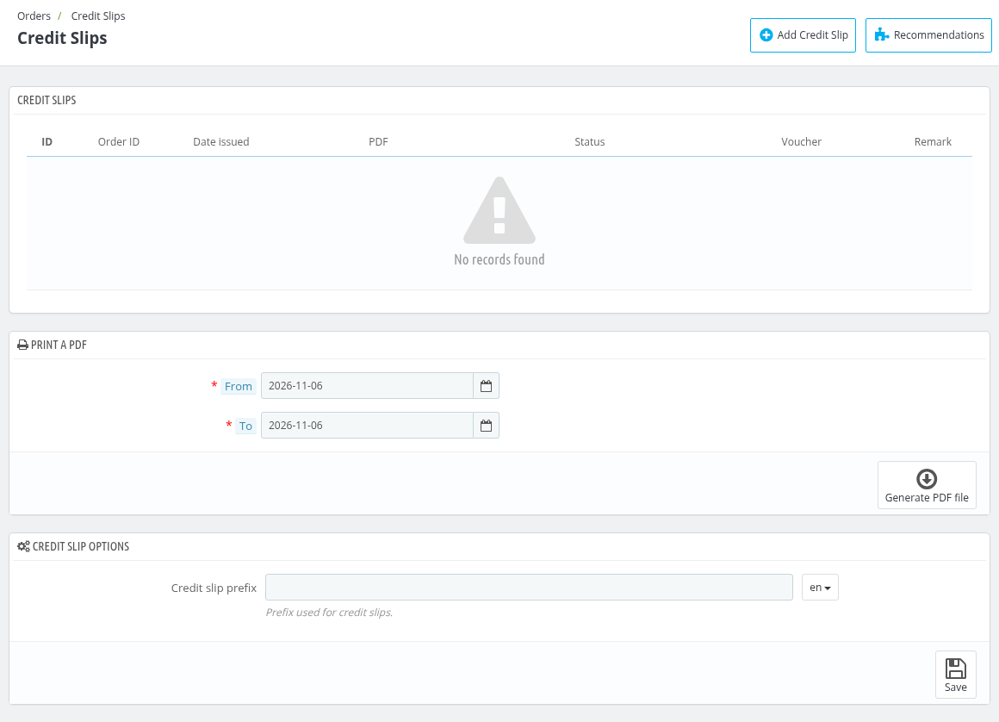
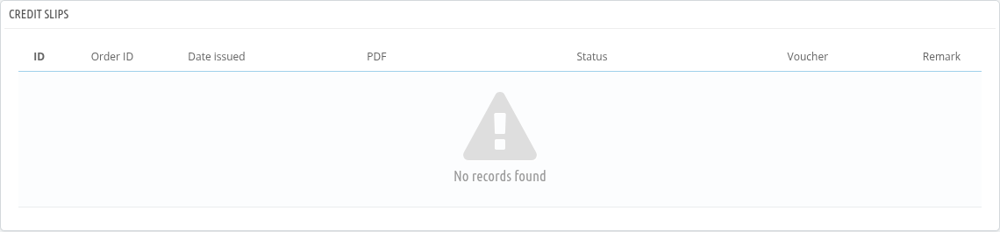
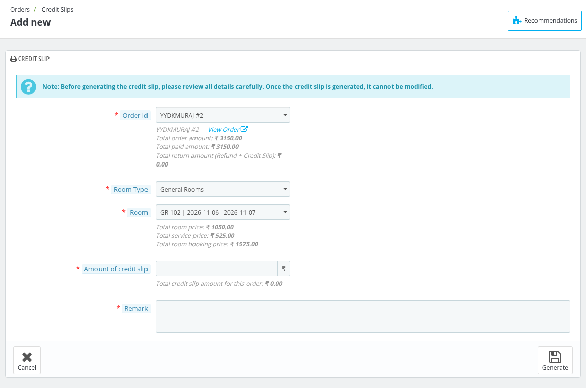
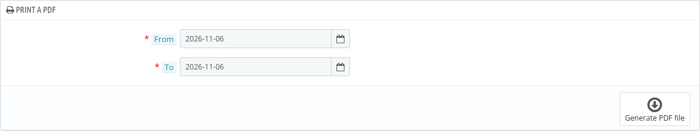
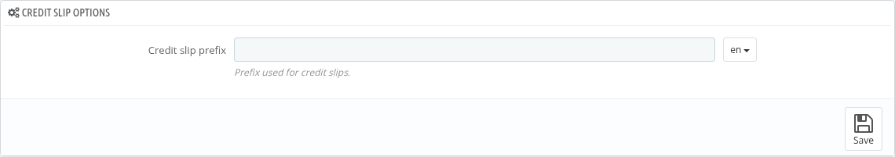
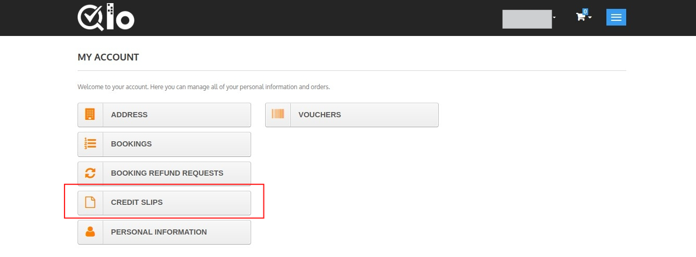
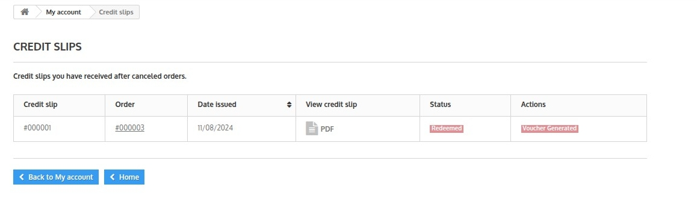
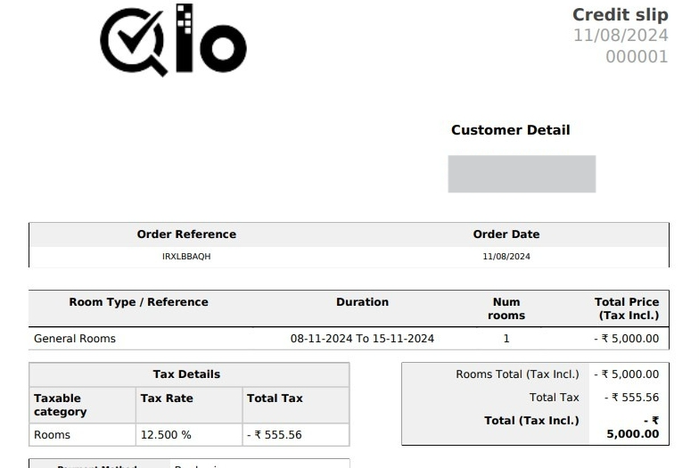

# Credit Slips

Credit slips are the slips generated for the credits provided to the guests  when they cancel their orders.

This page contains following sections:

## Credit Slips

This section displays the list of all credit slips which you have issued for your hotel.

The following details about the credit are displayed in the credit slip.

- ID
- Order ID
- Date Issued
- PDF
- Status
- Voucher
- Remark

*Note: The Status of a credit slip is Active or Redeemed. For an Active credit slip you can click on **Generate Voucher** to generate a voucher for the credit slip. Once the status is changed to Redeemed, a voucher can no longer be created.*

## Add Credit Slip

To generate a credit slip for a booking click on **Add Credit Slip**.

- **Order id** : Select the order for which the credit slip is to be generated. The total order amount, total paid amount and total return amount (Refund + Credit Slip) of the order are displayed.
- **Room Type** : Select the room type of the order.
- **Room** : Select the room for which the credit slip is to be generated. The total room price, total service price and total room booking price are displayed.
- **Amount of credit slip** : Enter the amount of the credit slip for the customer. It must be greater than 0.
- **Remark** : Enter the remark for this credit slip.

Click on **Generate** to generate the credit slip.

*Note: Before generating the credit slip, please review all details carefully. Once the credit slip is generated, it cannot be modified.*

## Print a PDF

You can also filter and generate the report of all credit slips issued by your hotel to the guests for a particular duration of time through this section.

Select the date ranges from the calendar and click on **Generate PDF file**.

## Credit slip options

**Credit slip Prefix**

To insert prefix in the credit slip number, Add the prefix in the box.

## Customer account Credit Slip
Customer can see all his credit slip by going to his account page then click on the Credit Slips button.

After clicking he can see all the credit slips available to him.

## Sample Credit Slip
