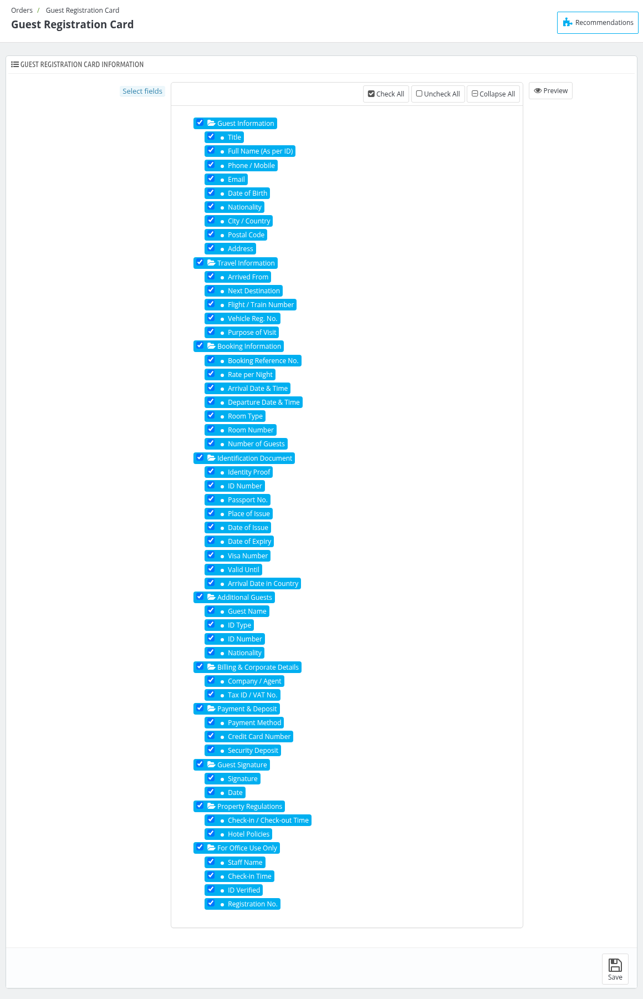
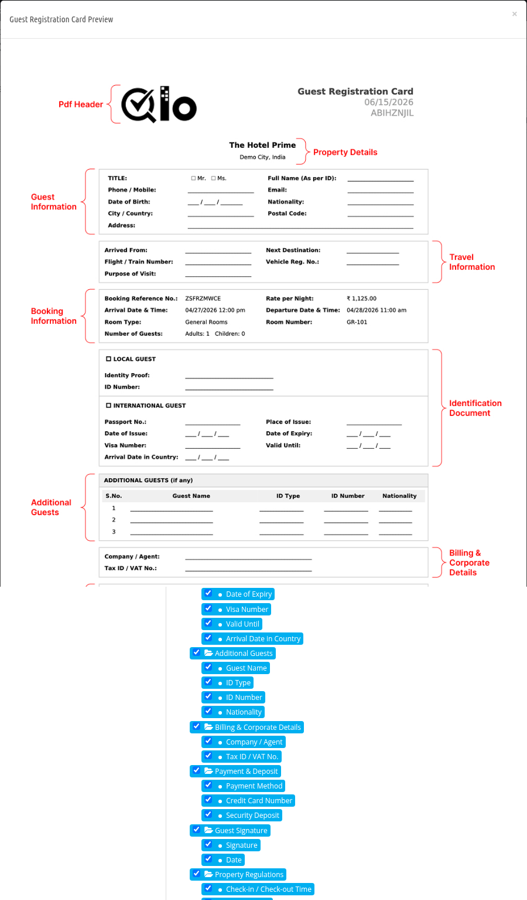

# Guest Registration Card

The Guest Registration Card (GRC) is a PDF that can be downloaded for each room of an order. On this page you can select which information is shown on it.

## Guest Registration Card Information

In **Select fields**, the information is divided into sections: Guest Information, Travel Information, Booking Information, Identification Document, Additional Guests, Billing & Corporate Details, Payment & Deposit, Guest Signature, Property Regulations and For Office Use Only. Each section contains its fields.

- Select the checkbox of a field to show it on the card, or select the checkbox of a section to select all of its fields.
- Use **Check All**, **Uncheck All** and **Collapse All** to select or collapse the whole list quickly.
- Click on **Preview** to see how the card looks like.

Click on **Save** to save the selection.

*Note: At least one field must be selected.*

## Download the card

To download the card of a room, open the order from [Orders](/1.8.0/orders/orders/), click on the arrow next to the **Edit** button of the room and click on **GRC**.
