# Orders

This tab displays the list of orders you received for your hotels.

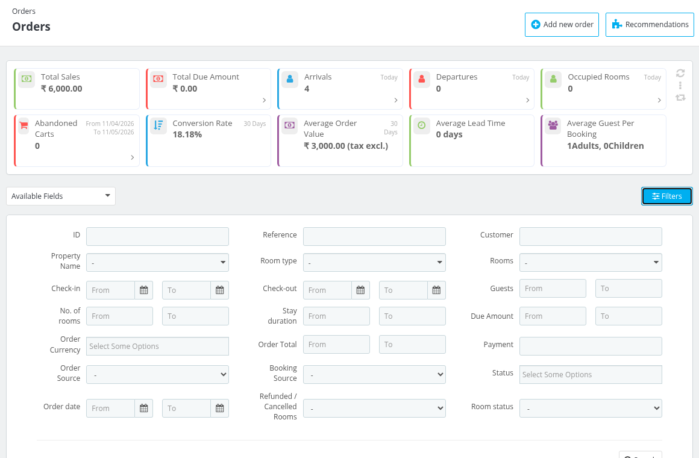

## KPIs
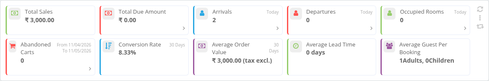
- **Total Sales** : This field tell you about all the  sales and revenue created by all orders combined.
- **Total Due Amount** : This field tell you about all the due amount left for all the orders.
- **Arrivals** : Total number of arrivals for today.
- **Departures** : Total number of departures for today.
- **Occupied Rooms** : Total number of occupied rooms for today.
- **Abandoned Carts** : Total number of Abandoned carts for the date range shown on the card.
- **Conversion Rate** : Percentage of visit that results into order booking in given period of time.
- **Average Order Value** : Total average order value excluding tax in a period time.
- **Average Lead Time** : Average number of days between time guest book their room and time guest arrive at the hotel.
- **Average Guest Per Booking** : It tell you about the average number of guest per booking.

## Add new order

To create a booking from the back office click on **Add new order**, add the rooms to the cart on the Book Now page, select the customer and fill in the order details. While creating the order you can choose the following:

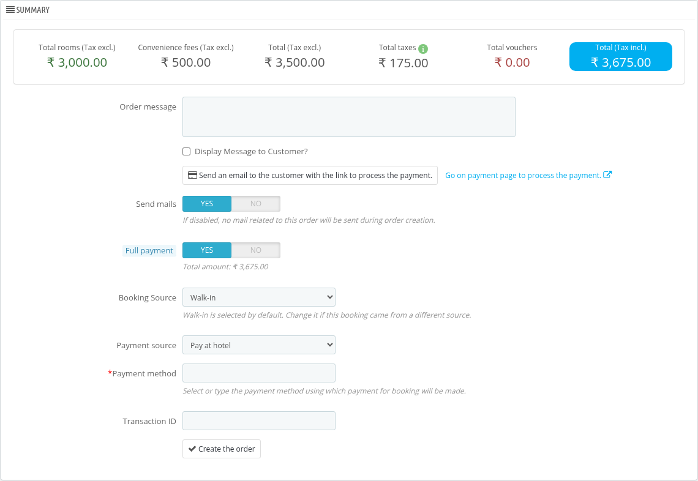

- **Booking Source** : Select the source from which this booking came, for example Walk-in. Booking sources are grouped under their business source. Walk-in is selected by default. To manage these sources see [Business Sources](/1.8.0/orders/business_sources/).
- **Payment source** : Select where the payment is made, for example Pay at hotel.
- **Payment method** : Select or type the payment method using which payment for booking will be made.
- **Transaction ID** : Enter the transaction ID of the payment.

## Filters

### Available Fields

You can display the various fields of the order by selecting them from available fields options.

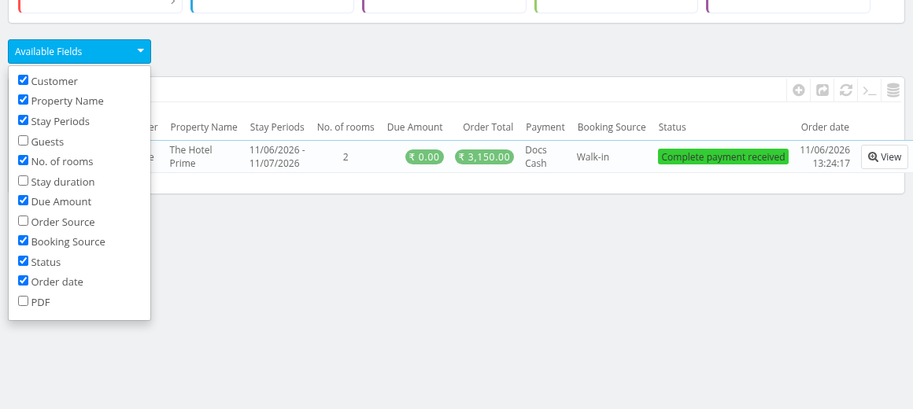

### Filters

The order data can be filtered using the various search filters. Click on the **Filters** button to open them.

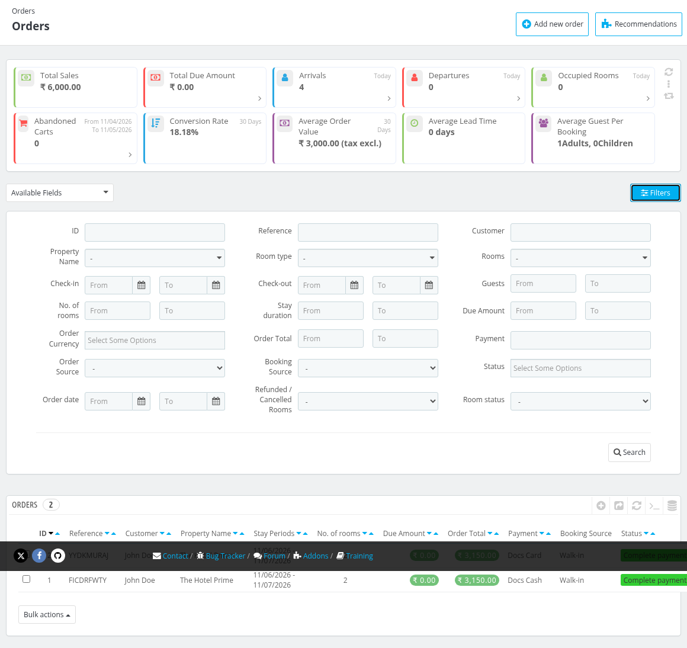
In this filter you can filter list based on:
- **ID** : ID of the order.
- **Reference** : You can filter based on the reference.
- **Customer** : You can filter based on the name of the customer.
- **Property Name** : You can filters based on the hotels.
- **Room type** : You can filter orders based on the room types.
- **Rooms** : You can filter the list based on the name on the room number.
- **Check-in** : You can filter orders based on the check-in date of the customers.
- **Check-out** : You can filter orders based on the check-out date of the customers.
- **Guests** : You can select the number of the guest range.
- **No. of rooms** : You can filter orders based on the number of rooms.
- **Stay duration** : You can filter orders based on the stay duration of the customers.
- **Due Amount** : You can filter result based on the due amount.
- **Order Currency** : You can filter based on the Order currency.
- **Order Total** : You can filter orders based on the total amount of the orders.
- **Payment** : You can filter results based on the Payment amount.
- **Order Source** : You can filter based on the Order Source.
- **Booking Source** : You can filter based on the Booking Source.
- **Status** : You can filter list based on the status of the order.
- **Order date** : You can filter based on the Order date.
- **Refunded / Cancelled Rooms** : You can filter based on the Refunded/cancelled rooms status.
- **Room status** : You can filter list based on the status of the room type.

*Note: The Stay Periods column of the list shows the stay dates of the order. If an order has rooms with different stay dates, a tooltip lists each stay period with the number of rooms.*

## View order details

To view the order details of any order click on view option.

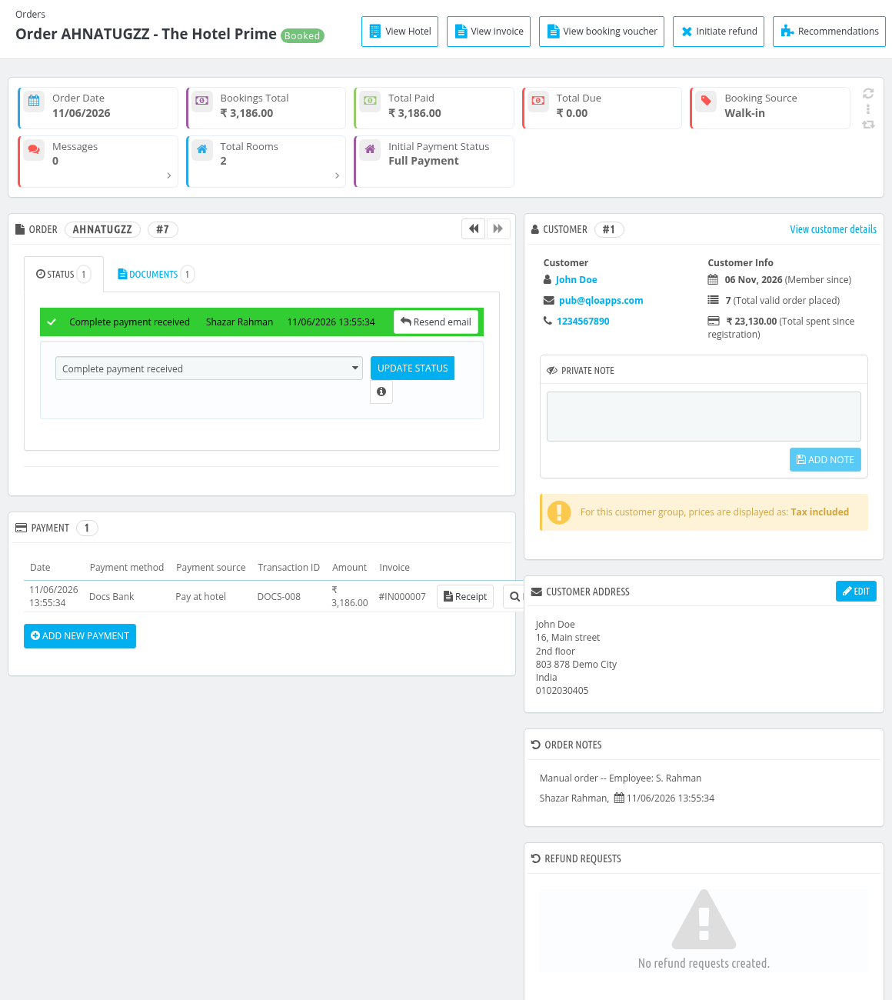

## Details of booking of particular order

At first we have some important Shortcut buttons to Quickly complete some tasks.

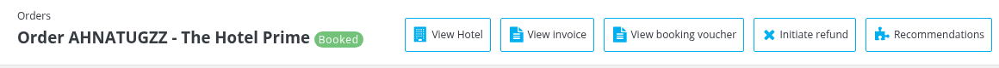

- **View Hotel** : Opens the settings page for the hotel associated with this order.
- **View invoice** : Allows you to view the invoice for the selected order.
- **View booking voucher** : Opens the booking voucher PDF of this order.
- **Refund** : Enables you to initiate a refund for this order. The button is shown when refunds are allowed for the hotel of the order. See [Refunding a booking](#refund-a-booking).

Below the buttons the page shows cards with the **Order Date**, **Bookings Total**, **Total Paid**, **Total Due**, **Booking Source**, **Messages**, **Total Rooms** and **Initial Payment Status** of the order.

The various section on the order details page display and edit various details of the order. Lets discuss each section of the page one by one.

### Order

This section displays the data of the order.

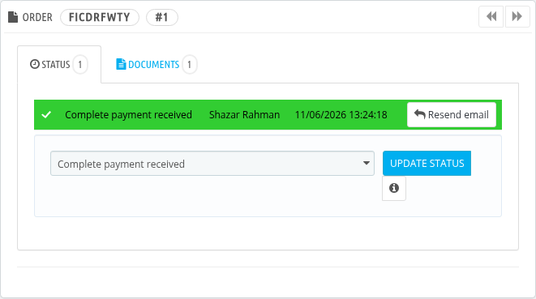

You can update the payments status of the order by selecting the status from the drop down and then clicking update status button. Click on the info button next to it to see why some statuses can not be selected.

You can add view the documents uploaded for this order and can also add a note for the document.

### Customer

It displays the following details of the guest:

- Email: Email of guest
- Phone: Phone of guest
- Member since: Date of guest registration of client on website.
- Total valid order placed and Total spent since registration.
- Private note: Add notes about guest to personalize his experience.

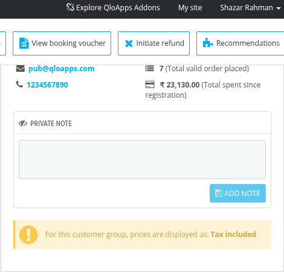

**To view the full details of the customer click on view customer details and you will be redirected to customers page**

### Payment

This section displays the details of the payment of the order: Date, Payment method, Payment source, Transaction ID, Amount and Invoice.

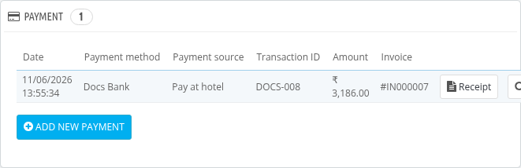

- **Receipt** : Click on this button to open the payment receipt of that payment. The button is shown when receipts are enabled. See [Payment Receipts](/1.8.0/orders/payment_receipts/).
- **Details** : Click on this button to see the payment details.

To Add new payment in case partial payment is made or when guests pays on desk click on **Add new payment**.

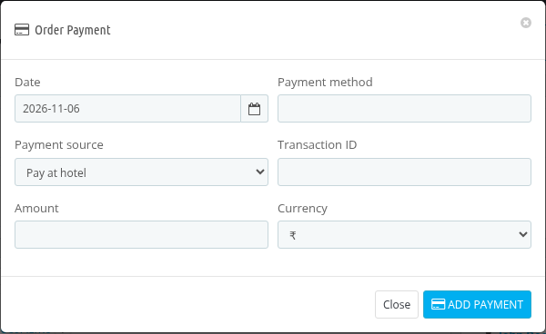

Fill the details and save the data.

### Refund Requests

This section lists the refund requests of the order with Request ID, Total Rooms, Requested Date and Status.

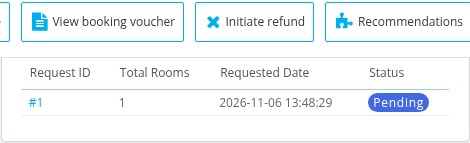

### Booking Detail

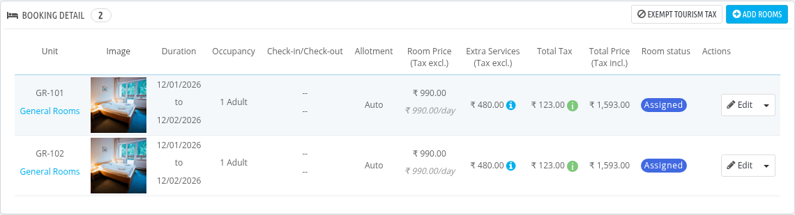

This section displays the  following details of the order:

- Unit (Room Number and Room type)
- Image
- Duration
- Occupancy
- Check-in/Check-out
- Allotment
- Room Price (Tax excl.)
- Extra Services (Tax excl.)
- Total Tax
- Total Price (Tax incl.)
- Room status
- Actions

#### Room Status

You can update the status of a room (check-in, check-out, no-show, cancelled) from the drop down next to the **Edit** button of the room. Click on **Room Status**.

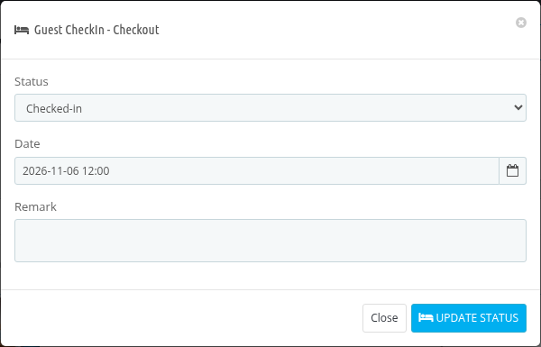

- **Status** : Select the new status of the room: Assigned, Checked-in, Checked-out, No-show or Cancelled.
- **Date** : Select the date and time of the check-in or check-out. It is shown when Checked-in or Checked-out is selected.
- **Remark** : Add a remark for the status change.

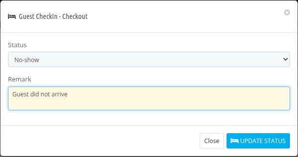

The same way you can select **Cancelled** to cancel a room.

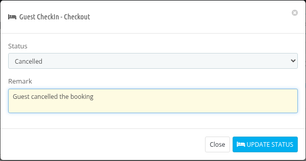

After the update the status of the room is shown in the **Room status** column.

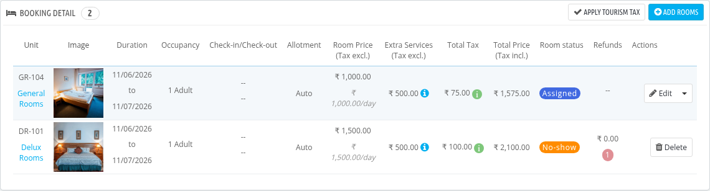

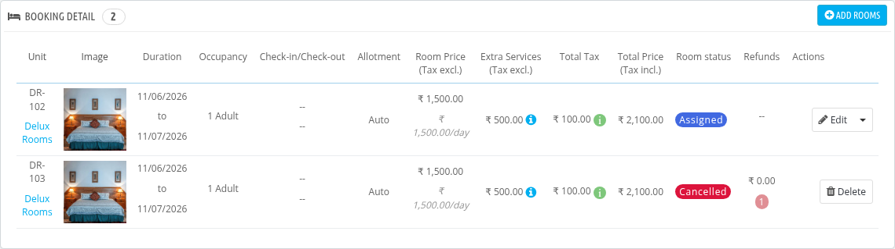

- A room cannot be checked in before the check-in date of the booking.
- A room cannot be marked as No-show before the check-in date of the booking.
- A room cannot be changed to No-show or Cancelled once the guest has checked in.
- The last room of an order cannot be checked out while there are pending bills for the order.
- When a room is set to No-show or Cancelled, a refund request is created for the room with status Pending if refunds are allowed for the hotel. You can process it from Manage Order Refund Requests.
- The statuses can be renamed from [Room Statuses](/1.8.0/orders/room_statuses/).

**Actions of a room**

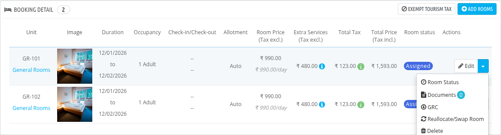

Click on the arrow next to the **Edit** button to see all the actions of a room:

- **Room Status** : Change the status of the room.
- **Documents** : Upload and view the documents of the guest for this room.
- **GRC** : Download the Guest Registration Card of this room as PDF. The information shown on it is set in [Guest Registration Card](/1.8.0/orders/guest_registration_card/).
- **Reallocate/Swap Room** : Reallocate the room or swap it with another room.
- **Delete** : Delete the room from the order.

For a room with status Cancelled or No-show only the **Delete** button is shown.

**Edit order details**

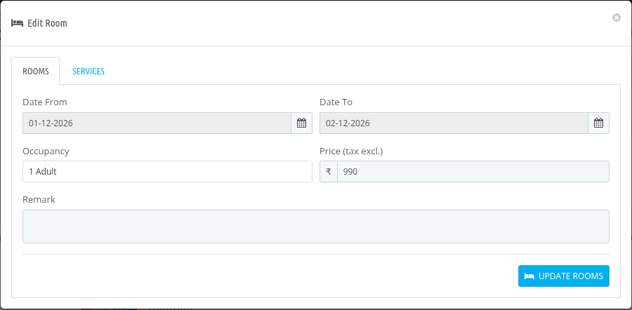

Click on edit to edit the details of the order. You can edit the following details of order:

- Check-in
- Check-out
- Price
- Occupancy

**Reallocation and Swap of order**

 You can also reallocate and delete the order of the guest.
 To reallocate click on the drop down right to the edit button and then click on the Reallocate/Swap Room.

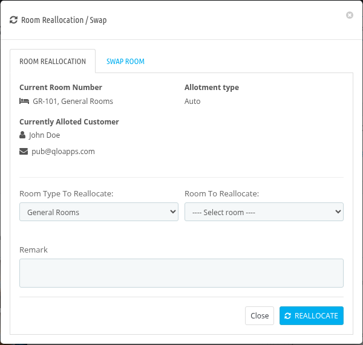

**Add rooms in order**

To add a new room of any room type in the order click on add rooms in order and fill up the details. The button is not shown when the order status is Refunded, Cancelled or No-show.

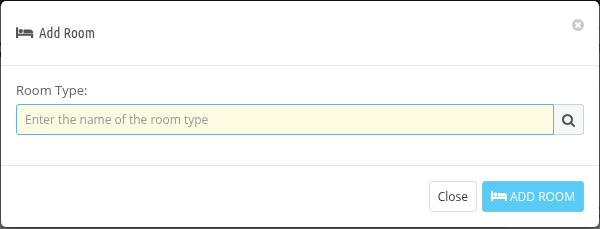

**Tourism tax**

If tourism tax is enabled in your store, the Booking Detail section shows the **Exempt Tourism Tax** and **Apply Tourism Tax** buttons, and the same options are in the actions of each room.

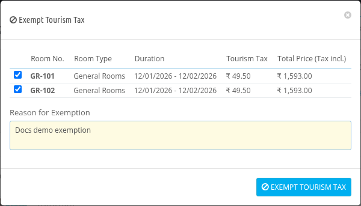

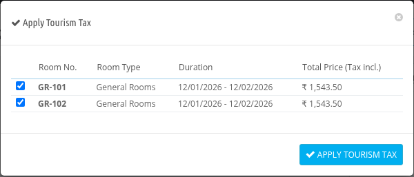

- **Exempt Tourism Tax** : Select the rooms (and products) for which the tourism tax is applied and enter the **Reason for Exemption**, then click on **Exempt Tourism Tax**.
- **Apply Tourism Tax** : Select the rooms (and products) for which the tourism tax was exempted and click on **Apply Tourism Tax** to apply it again.

The tourism tax is shown separately in the order summary.

### Messages

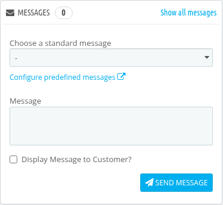

To communicate between the guest through messages using this section.

Fill the following details and click send:

- Choose a standard message: select default message or add a predefined messages.
- Display Message to Customer?: Check this to display the message to the customer.
- Message: Add the content of the message.

### Voucher
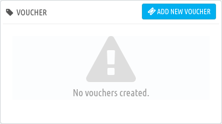

Here you can see all the vouchers applied to the customer.

### Order Summary

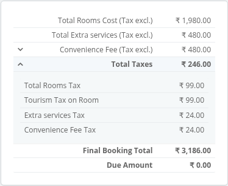

In this section you can see the order summary like:
- Total Rooms Cost (Tax excl.)
- Total Extra services (Tax excl.)
- Convenience Fee (Tax excl.)
- Total Taxes (including Tourism Tax lines when applicable)
- Final Booking Total
- Refunded Amount (when a refund is made)
- Due Amount

## Refund a booking

If refunds are allowed for the hotel, click on **Refund** (Initiate refund) on the top of the order page.

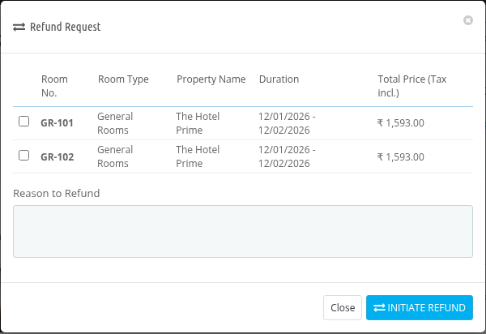

Select the rooms (or products) to refund, enter the **Reason to Refund** and submit. The refund request is then listed in the **Refund Requests** section of the order.
