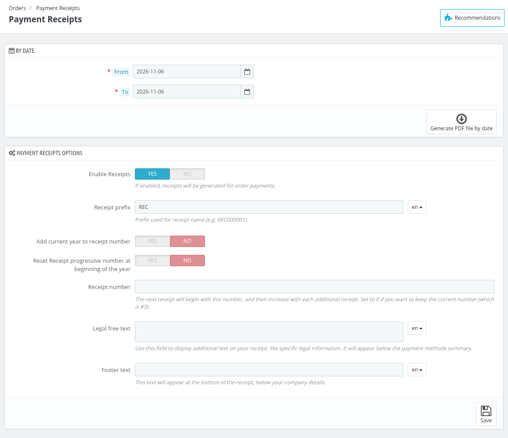

# Payment Receipts

Payment Receipts tab is used to generate and configure the receipts of the payments made for your orders.

## By Date

This section is used to generate the combined report of payment receipts for a particular duration of time.

You can select the date range in the **From** and **To** fields and then click on **Generate PDF file by date** to generate the PDF.

*Note: If no payment receipt is found for the selected period, an error message is displayed.*

## Payment Receipts Options

You can configure the receipts using the various options in the Payment receipts options section.

#### Enable Receipts

Enable this option to generate receipts for order payments. When it is enabled, a **Receipt** button is shown against each payment in the Payment section of the order page.

#### Receipt prefix

Add the prefix used for the receipt name (e.g. REC000001).

#### Add current year to receipt number

Enable this option to add current year with the receipt number.

#### Reset Receipt progressive number at beginning of the year

Enable this option to reset the progressive number of the receipts at the beginning of the year.

#### Receipt number

The next receipt will begin with this number, and then increase with each additional receipt.

***NOTE: Set to 0 if you want to keep the current number***

#### Legal free text

Use this field to display additional text on your receipt, like specific legal information. It will appear below the payment methods summary.

#### Footer text

Add the text you want to show at the bottom of the receipt. This text will appear at the bottom of the receipt, below your company details.

Click on **Save** to save the options.
