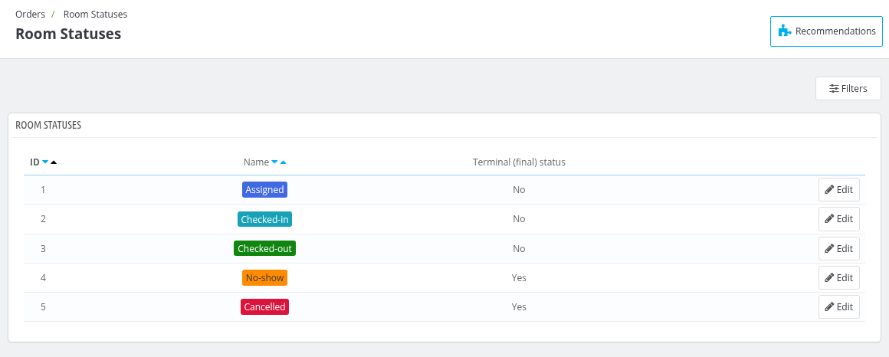
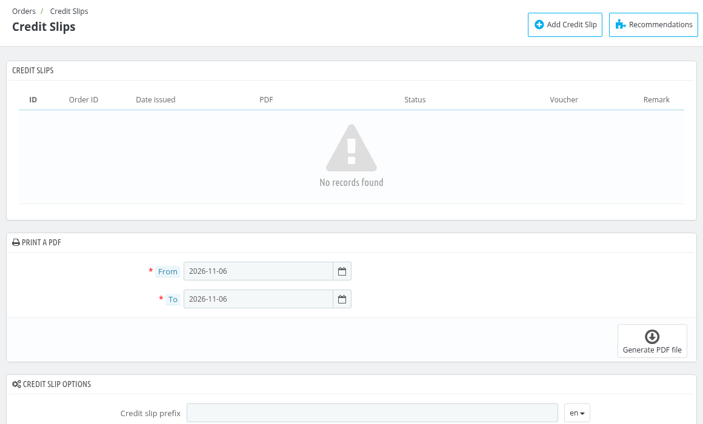

# Room Statuses

Room Statuses displays the statuses that a room of an order can have. These statuses are used when you change the status of a room from the order page.

The list displays the following details:

- **ID** : ID of the status.
- **Name** : Name of the status with its color. The statuses are Assigned, Checked-in, Checked-out, No-show and Cancelled.
- **Terminal (final) status** : Yes if a room with this status cannot be edited, only deleted. No if the room can still be edited.

*Note: Room statuses cannot be added or deleted.*

## Edit a Room Status

Click on **Edit** to edit a status.

- **Name** : Enter the name of the status.
- **Color** : Select the color of the status.
- **Terminal (final) status** : This setting is fixed for each status, so it cannot be changed.

Click on **Save** to save the changes.
